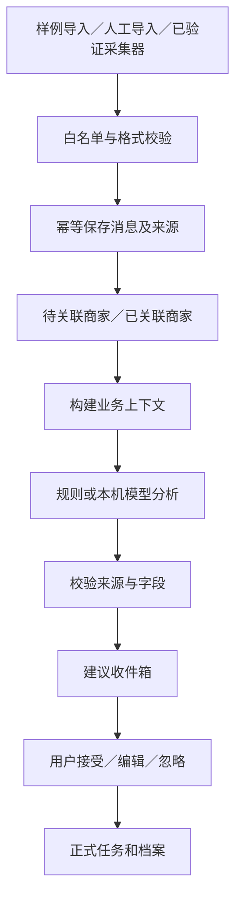

# 业务工作流：本地客户跟进助手

状态：待实施设计。适用渠道：个人微信私信、普通微信群。默认用户：单人商家拓展／服务人员。

## 1. 目标与边界

每天回答四个问题：谁在等我处理？我答应过什么？今天应该联系谁？哪些历史客户有具体理由重新联系？

第一阶段的数据与推理全部留在本地。系统不会控制微信客户端，不自动发送、加好友或修改联系人。默认只处理用户选定的业务会话，不扫描全部联系人来推断业务范围。

“本地跑通”分两个独立里程碑：

1. 业务闭环通过：样例／人工导入 → 档案 → 分析建议 → 用户确认 → 跟进任务 → 草稿 → 人工操作记录。
2. 实时接入通过：在真实 Mac 上验证采集器后，将选定会话的消息持续导入同一流程。

第一项通过不能声称已实现微信实时采集；第二项受客户端、系统权限和数据可见范围影响。

## 2. 初次设置

1. 选择本机数据目录；确认目录不在 iCloud、网盘或其他同步目录下。
2. 创建业务配置：服务介绍、目标商家、可提供的能力、不能作出的承诺。先用结构化文本填写，不做知识库。
3. 设置业务时区（默认 Asia/Shanghai）、每日处理数量和工作日；提醒先展示在工作台。
4. 导入虚构样例验证操作，再导入获准处理的业务消息。
5. 选择会话白名单；为联系人和群关联商家。
6. 选择规则分析模式；需要语义分析时，另行启用本机模型。

## 3. 商家关联

一个商家可以关联多个联系人和会话；一个群也可能包含多个商家。

- 新会话先进入“待关联”，允许正常归档，但不生成归属明确的商家结论。
- 名称相似仅提供关联建议，不自动合并商家或联系人。
- 私信可由用户设置默认商家；群聊按联系人、消息或人工选择确定归属。
- 群归属不清时保留在会话级待确认，不向群内所有商家复制任务。
- 关联修正后，可重算受影响建议；用户确认过的任务不被静默改写。

## 4. 消息进入与分析

分析产出四类建议：客户需求、待办／承诺、业务阶段变化、跟进／激活机会。每项必须包含证据消息；没有依据的结论不写入客户事实。

导入历史消息时，默认生成历史摘要和待确认事项，不把所有过去截止的事项直接推入“今日逾期”。用户确认其仍有效后才进入正式任务。

## 5. 每日使用流程

### 开始工作

工作台优先展示：

1. 已确认的逾期及今日到期任务。
2. 客户明确问题、疑似尚未处理的需求，作为待确认建议。
3. 到达约定回访日期的客户。
4. 匹配到新业务机会、且没有触达限制的历史客户。

每项展示商家、原因、截止时间、上次进展、证据、建议动作及草稿。同步或分析异常在页面单独提示，不能把无新数据解释为没有待办。

### 处理一位商家

1. 查看关联私信与群的时间线、当前需求、未完成承诺。
2. 接受或修改分析建议，建立正式跟进任务。
3. 生成草稿；用户检查事实、称呼、日期、价格和承诺。
4. 用户复制内容，在微信中自行选择正确联系人／群并发送。
5. 返回助手记录“已联系”、渠道、时间、结果和下次动作。

复制草稿不代表发送。后续即使采集到相似发出消息，也仅提示可能已联系，由用户核对。没有可靠消息定位能力时，展示联系人、会话和时间，不承诺一键跳转微信原消息。

### 收尾

对今日任务逐项选择完成、延期或取消。联系过客户不等于业务事项已完成：发出报价可完成“发报价”任务，但应另建“等待报价反馈”任务。

## 6. 跟进状态

| 状态 | 含义 | 可由谁更改 |
| --- | --- | --- |
| pending_review | 分析产生，尚未确认 | 用户接受、编辑、忽略 |
| open | 我方待处理 | 用户或明确配置的规则 |
| waiting_customer | 等客户反馈 | 用户；模型仅建议变更 |
| snoozed | 暂缓至明确日期 | 用户 |
| done | 已完成 | 用户确认 |
| cancelled | 无需继续 | 用户确认 |

任务可重新打开，所有变化保留事件记录。模型不能覆盖用户修改；发现“已解决”“改到下周”等消息时，提供关联既有任务的更新建议。

“客户未回复”仅指在当前可见消息范围内未发现有效回应，不等同于客户无意向。界面显示数据覆盖起点和最近成功采集时间。

## 7. 历史客户激活

激活来源优先级：明确约定的回访时间 → 新业务能力与历史需求匹配 → 合作／续约节点 → 用户主动选择的沉默客户复盘。

提供“业务机会”录入：新服务、适用商家、已知限制、有效期及素材。系统匹配已确认需求，展示匹配依据与建议话术。

触达前先执行确定性排除：拒绝联系、用户暂停、未解决投诉、重复任务、冷却期未结束、活动过期。仅仅超过若干天没联系，只能进入“复盘候选”，不能自动推断购买意向。

一期建议每日最多展示 5 条激活候选、同一商家建议冷却期 14 天；均可修改，属于工作量控制参数，不是微信安全发送额度。未被选择的建议不会自动发送。

## 8. 成功标准

- 用户能从任一正式待办查看来源证据。
- 同一商家的跨会话信息可聚合，混合商家群不会错误扩散任务。
- 重复导入／重复分析不重复创建相同建议或任务。
- 用户每天能完成“查看 → 确认 → 联系 → 记录 → 安排下次跟进”。
- 能分清未分析、分析失败、没有发现事项和缺少数据。
- 用户认为跟进清单有帮助，且整理成本下降；商机与成交效果单独跟踪。
