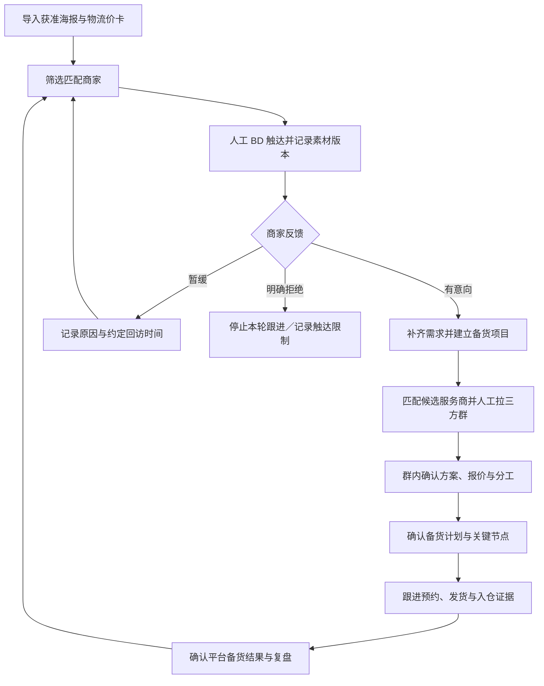

# 业务工作流：商家备货与头程物流协同助手

状态：待实施设计。用户为跨境电商平台产品／运营人员；渠道为个人微信私信与普通微信群。采集、数据库与工作台先部署本地；分析明确使用 DeepSeek API，不依赖企业微信，不自动发送。

## 1. 业务目标与角色

核心目标是推动商家在平台完成备货，消息归档、BD 触达和三方建群都是推进手段。备货完成的具体口径须按平台业务确认，系统暂分别记录“备货意向、备货计划、预约／下单、已发货、已入仓”，不将任何单一物流节点默认等同于平台备货成功。

| 角色 | 负责事项 | 助手边界 |
| --- | --- | --- |
| 平台产品／运营（我） | 筛选商家、介绍平台备货价值、提供获准素材、协调服务商、推动节点、收集产品问题 | 组织信息、建议动作与草稿；不替平台承诺补贴或物流履约 |
| 商家 | 说明货物与备货需求、评估方案、确认计划、提交资料及执行备货 | 商家表态有证据；沉默不代表拒绝或同意 |
| 头程服务商 | 确认可承运性、费用、时效、截单与操作要求、执行运输 | 服务商负责的承诺不能归到我方；不能替其确认报价 |

同一联系人可能兼任不同角色，按服务商／商家主体及具体项目确定。用户不是默认的物流销售或承运方。

## 2. 工作对象：商家 + 备货项目 + 三方群

一个商家可有多个联系人、多个国家／线路及多批备货。每批明确需求建立独立“备货项目”，用以绑定价卡、候选服务商、报价、群聊、任务和物流节点。

- 商家：长期主体档案，包含经营品类、目标市场、已确认需求与触达限制。
- 备货项目：本次要推进的市场／仓库、货物、数量、目标时间、当前阶段和阻塞原因；未知字段留空。
- 服务商：能力、线路与联系方式；能力来源及有效性可追溯。
- 三方群：协作入口；可关联多个批次，不能把群的进度直接当作所有项目的进度。
- 素材与价卡：可复用但有版本、适用范围、有效期与对外使用范围。

私信／群先经白名单，再人工确认主体关联。名字相似不自动合并；混合商家群、批次不明的消息进入待归属，不向全部项目扩散。

## 3. 完整业务流程

### 阶段 A：素材准备与商家筛选

平台人员录入获准宣传海报、头程物流价卡及其结构化摘要。一期手工录入并核对关键字段；OCR／图片模型仅为后续可选能力，不能依赖聊天图片占位自动读懂报价。

匹配依据包括商家已确认的目标市场、货型、备货时间、价格／时效关注点。未明确市场或货型的商家可进入“先问需求”清单，不直接推荐具体报价。

输出：推荐联系对象、匹配理由、可用素材版本、话术草稿。发送由用户在微信手工完成；复制或选择素材不算已发送，不假定对方已读。

### 阶段 B：确认需求与备货意向

收集目标国家／仓库、品类与特殊货属性、预计重量／体积／件数、发货地、期望发货／到仓时间以及主要顾虑。只收集当前阶段必要信息，不让字段填写阻塞初步沟通。

“看看价卡”仅记录询价／了解，不等于同意备货。对明确意向建立项目；历史会话中出现旧意向先复核是否仍有效。

输出：需求卡、待补字段、商家意向证据、下一步动作。

### 阶段 C：服务商匹配与人工建群

基于已确认线路与货物条件给出候选服务商，标记能力依据和待确认限制，不假定价格最低即最优。确认商家愿意对接后，用户人工拉群并关联群 ID、商家、服务商和项目。

建群首条草稿应交代：平台协同角色、商家需求摘要、服务商待确认问题、目标时间和各方分工。不得夹带其他商家资料或未经允许的内部价卡。

建群不是转化完成。输出：群内交接摘要、服务商确认任务、商家补资料任务、我方协调任务。

### 阶段 D：三方确认与阻塞处理

将群内讨论整理为：需求版本、方案版本、明确报价、待确认项及下一动作。逐项绑定责任方和内部跟进人。

典型阻塞包括价格不匹配、时效不确定、货物条件不满足、资料待补、服务商未反馈、商家无货／资金安排以及平台操作问题。缺少证据时标为待确认，不能自动判断真实原因。

同一群没有新消息不直接触发催商家：若下一步是服务商确认含税口径，应提醒我向服务商核实。

### 阶段 E：备货计划与执行节点

用户确认商家计划及关键日期后，建立里程碑：资料／报价确认、预约或下单、截单／交货、实际发货、预计与实际到仓。按项目实际需求启用节点，不强制所有业务使用同一路径。

到期、变更或异常先生成核实建议；模型不根据“好的”“收到”自动判定已发货、已入仓。聊天证据可记录为“对方反馈”，与平台记录、单据或人工核验分别标明。

### 阶段 F：结果复盘与再次备货

按平台定义确认本批结果，记录最终未推进原因、服务问题及下批计划。用已确认的备货周期或商家约定生成回访建议。

产品问题（操作困难、能力缺口、规则不清）进入独立问题清单，关联项目及证据；产品改进不与物流履约任务混在一起。

## 4. 每日工作台

| 优先队列 | 展示内容 | 主要动作 |
| --- | --- | --- |
| 今日履约／节点风险 | 截单、约定交货、到仓目标临近；异常未处理 | 核实实际状态，协调责任方 |
| 三方对接卡点 | 等报价、等货物信息、等服务商确认、平台问题 | 显示该找谁、问什么、何时再确认 |
| BD 后续跟进 | 已发素材待反馈、约定回访、有意向未建群 | 查看历史上下文并选择动作 |
| 历史商家激活 | 线路更新、新价卡、已解决历史顾虑、下一批备货窗口 | 核对匹配依据与素材后人工联系 |
| 待审核与数据异常 | 归属不明、报价冲突、分析失败、采集缺口 | 人工复核，避免错误推进 |

每张卡显示：商家、项目／批次、阶段、阻塞、责任方、内部跟进人、期限、证据、建议动作与草稿。每日先处理有明确节点和责任的项目，再处理探索性触达；优先级可人工调整。

操作闭环：查看证据 → 接受／编辑建议 → 人工沟通或核实 → 记录结果 → 安排下一步。联系记录不是业务完成记录。

## 5. 项目阶段与任务状态分别管理

项目阶段建议：需求确认 → 服务商对接 → 方案确认 → 备货计划确认 → 执行中 → 结果待核验 → 已完成。另设暂停和终止，允许重开／退回并记录原因。BD 触达状态独立记录，不用发海报、建群次数代替项目转化。

| 任务状态 | 含义 |
| --- | --- |
| open | 内部跟进人待处理 |
| waiting_external | 等商家／服务商／其他方；必须明确责任方 |
| snoozed | 用户确认暂缓至某日 |
| done | 具体事项已确认完成 |
| cancelled | 事项取消并记录原因 |

AI 输出先进入 pending_review 建议收件箱，不是正式任务状态。外部责任方与内部跟进人分别记录；即使等服务商，也要明确我方何时检查。负责人不明时保留 unknown 并进入复核队列，不自动归到商家。

模型仅建议创建／更新任务和阶段，不能静默覆盖用户确认结果。发出价卡、完成建群、商家说“收到”都不能直接将项目置为已完成。

## 6. 价卡与海报使用规则

- 每份素材保存版本、出处、适用市场／线路、货型限制、有效起止、对外可用范围和人工审核状态。
- 价卡须保留币种、计价单位、计费重／体积规则、重量档、起运／目的地、税费与附加费包含情况，以及时效口径。
- 缺少条件时标为“待服务商确认”；不生成无条件的最低价或到仓保证。
- 宣传价、参考价卡、服务商针对具体项目的确认报价分开保存。旧报价不被新价卡覆盖。
- 有效期未知时不得视为长期有效；作对外推荐前人工核实。已过期／撤回素材禁止成为新推荐的发送附件。
- 海报与结构化价卡冲突时停止自动价格建议，进入人工复核；系统不自动编辑海报价格。

## 7. 历史商家激活

优先触发：约定回访时间、新线路／价卡匹配历史需求、商家原有价格／时效顾虑被新方案解决、明确的下一批计划。

仅价格变化不能直接触发“更便宜”结论：应比较相同路线、货型、计价单位、税费和附加费口径。没有可比数据则只建议核实方案，不计算节省比例。

拒绝联系、用户暂停、未解决投诉、重复任务、冷却期内和素材过期均由确定规则排除。沉默时长只能产生复盘候选；可先询问有无备货安排，不假定有货。

一期建议每日最多 5 条激活候选、商家冷却期 14 天，可人工配置；这是工作量参数，不是微信安全发送额度。用户确认已联系后才进入触达统计。

## 8. 本地验证与效果指标

先用虚构数据或获准导入跑通业务闭环，再在真实 Mac 验证采集。第一阶段消息原文、素材与档案留在本机，获准的脱敏上下文发送至 DeepSeek API 分析；云端推理不属于本地处理。对外客户消息与建群仍全部人工执行。

业务指标分层记录：实际触达商家数 → 明确需求／意向数 → 三方对接数 → 计划确认数 → 实际发货与核验完成数。明确各阶段去重主体、时间范围与证据；一个商家多个项目不能混用分母，不将相关性视作素材的因果效果。

效率指标：漏跟进数量、卡点停留时间、逾期任务、每日整理时间、草稿采纳情况。金额、货量与备货结果只有在有记录且口径明确时统计；聊天覆盖不完整时展示 unknown。

产品输出：可追溯的问题清单、常见阻塞分布和获准范围内的需求汇总，不在一期做缺乏依据的商家价值评分。
