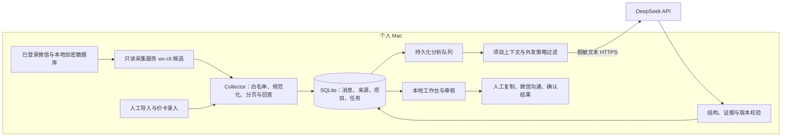

# 完整架构：微信采集、DeepSeek 分析与商家备货协同

状态：拟实施设计，未验证真实设备和 API。本文替代旧的“先导入、可选本机模型”架构；默认分析引擎为 DeepSeek API。业务状态以 [工作流](01-workflow.md) 为准。

## 1. 部署决策与边界

首版全部应用进程放在个人 Mac：微信、本地采集服务、采集适配器、Web API、SQLite、worker 与浏览器。仅分析调用通过 HTTPS 到 DeepSeek。应用无需入站公网端口、ECS、Redis、Tailscale 或本机大模型。

系统不提供发送微信、自动加好友、自动拉群接口；不使用 RPA 操作微信，不以规避 EDR／DLP 或审计作为实现目标。业务数据外发须处于用户有权处理的范围，选用 DeepSeek 不意味着已经取得平台对所有内部数据的外发许可。

### 总体结构



wx-cli 的密钥提取与运行属于单独可信边界：微信密钥仅采集组件持有，业务应用与 DeepSeek 均不需要它。SQLite WAL 与微信自身数据库 WAL 为不同文件，备份／读取不能混用。

## 2. 组件、技术与进程

| 组件 | 技术与职责 |
| --- | --- |
| wx-source | 经实测的 wx-cli，读取本地微信 DB／WAL，提供回环查询接口；账号与版本固定 |
| collector | Python 3.12 + httpx，按白名单获取、转换与幂等保存；维护独立覆盖信息 |
| application | FastAPI、Jinja2、少量 HTMX／原生 JS；SQLAlchemy 2、Pydantic、Alembic |
| app-db | SQLite WAL、外键、busy timeout；消息、项目、任务、租约队列统一事务 |
| analysis-worker | DeepSeek 客户端、上下文预算、脱敏与 JSON 验证；初始并发 1 |
| scheduler | 作为 worker 内定时循环：到期提醒、回查任务、日清单；固定任务键防重 |
| browser | 本机登录、商家／项目／三方卡点／价卡／今日工作台 |
| lifecycle | 手工前台运行验证后，以用户级 launchd 管理进程；不依赖终端永远打开 |

采集器每批短事务写入；worker 调模型前释放数据库锁。SQLite 单机部署不跨网络文件系统；库默认位于 ~/Library/Application Support/Wechat-Agent/，配置可更改且避开同步目录。仓库只存代码、迁移、虚构样例，不存聊天、价卡或凭据。

## 3. 真实微信接入契约

### 3.1 选型与设备前提

首选验证 pandorafuture/wx-cli，前次源码核对提交 2abe708f55bfe135539a385df856fdc58f97fc74。它是第三方工具，不是官方消息接口；不能保证任意版本适用或无账号风险。必须保存兼容矩阵：芯片、macOS、微信构建号、工具 tag／commit、权限方式、消息覆盖与已知缺陷。

前次核对文档描述 LLDB hook、重启微信与 SIP 权限前提，与“纯内存扫描”不同。不得把关闭 SIP、重签客户端或其他系统保护变更自动写入安装脚本。如果设备上无法按可接受权限运行，该采集路径阻塞，继续使用导入模式但不标记实时就绪。

仅微信小号所在、用户批准的私信与群可导入。Mac 微信必须实际获得消息；离线后不保证补齐全部历史。微信退出、休眠、密钥失效、新分片、版本升级都会影响覆盖，需要可见告警。

### 3.2 采集接口与能力探测

候选服务监听 127.0.0.1:9100；启动器不能假定它支持配置文件或环境变量 token，应以选定版本 --help 和源码验证。若仅支持命令行 token，避免写 shell 历史／日志，并记录同机参数可见风险；不宣称已由系统钥匙串自动解决上游所有存储问题。

现有候选接口：health、sessions、contacts、messages、timeline、events（SSE）。这是上游接口，与应用自己的 /api 路由分开。实际用法在接入时做契约测试，不能凭路径名假定参数相同。

已核对 timeline 必须同时传 since 和 until，支持 limit、offset、order、分页元数据及分片警告；返回 snippet，不足以直接保证全文。优先白名单会话级 messages 查询，避免全会话 timeline 枚举私人聊天；如必须使用 timeline，适配器丢弃非白名单正文，不写入日志、数据库或队列。上游解密缓存仍可能包含更多会话，这是本地暴露边界，需在设备准入时说明。

必须探测并记录：全文能力、稳定 ID、方向、发送者、引用、消息类型、分页排序、范围含端点语义、分片状态、原地更新／撤回可见性。snippet 不能静默当全文；必要时按会话补查正文，若无完整接口则标 partial 并进入采集阻塞／复核。

SSE 用于提醒 collector 提前扫描；实际消息以持久化查询入库为准。不能把断开的 SSE 当成持久消息队列。

### 3.3 Collector 标准消息

```json
{
  "schema_version": 1,
  "source": "wx_cli",
  "account_id": "local-account-id",
  "conversation_id": "source-chat-id",
  "conversation_type": "group",
  "source_id": "source-message-id-as-string",
  "sender_id": "source-contact-id",
  "direction": "incoming",
  "event_time": "2026-11-04T09:00:00+08:00",
  "message_type": "text",
  "text": "请服务商明天确认这批货的附加费",
  "completeness": "full",
  "source_locator": {"shard_id": "source-shard", "local_id": "source-local-id"}
}
```

原始账号／联系人 ID 只用于本地映射，不发送模型。direction 为 incoming／outgoing／unknown；自己发出的微信消息不等于系统自动发送，也不自动视为某个待办完成。

ID 去重策略按能力验证：有可靠服务端 ID 时用 source + account + conversation + server_id；不存在时用经验证的 shard + local_id 稳定组合，并标来源。绝不跨账号／会话仅凭 ID 去重。只有时间、文本而无稳定 ID 时隔离复核，不能丢掉真实重复发言。所有 ID 作为文本，金额精确存储。

采集游标、原始时间、入库时间、消息修订和质量状态分别保存。人工 JSONL 使用同一契约与稳定 ID，source=manual；虚构数据 source=fixture，禁止混为真实业务数据。

### 3.4 增量与恢复算法

默认可配置轮询 10 秒、固定扫描窗口 5 分钟、最近 15 分钟重叠回查；均为起始调优值，不是完整性保证。首次历史回填选择日期范围，限速按小时／天窗口推进，增量优先于历史任务。

1. 取得白名单会话与账号身份；意外切号暂停，不把新号并入旧号。
2. 从 checkpoint 选择固定 [since, until]，使用明确升序遍历全部分页，页大小遵守上游上限。
3. 每页规范化并幂等保存，记录原始分页计数、跳过／警告和摘要完整度。新消息与对应分析 job 在同一事务创建。
4. 所有页完成后才记录窗口扫描完成；警告、partial 或分页异常留下 gap，不声称覆盖完整。允许继续采其他窗口，但 gap 独立持久化，不能被更大的成功时间戳抹掉。
5. 崩溃重放整窗口，重复记录不重复分析。固定 until 不等于快照，offset 分页仍可能漂移，近期回查和更早抽查负责发现迟到记录。
6. 初始配置每小时回查最近 24 小时、每日检查更早可用历史，并对关键项目抽样核对；无限迟到与已清理本地历史无法保证补齐。
7. 变更／撤回只有上游可观察时记录 revision，撤回触发相关建议失效复核，不伪造已无法访问的原文。

去重键包含修订和业务上下文版本；消息采集水位不等待 DeepSeek 完成。上游离线时暂停扫描、保留分析队列与人工工作；显示采集最后成功时间、已扫描范围及 gap。

## 4. 存储模型与业务约束

所有实体使用内部 UUID；时间存 UTC、业务显示 Asia/Shanghai。JSON 载荷必须配应用 schema 验证，不能替代外键及唯一约束。

| 表组 | 核心实体与字段 |
| --- | --- |
| 主体 | merchants；service_providers；contacts(account_id, source_contact_id)；merchant_contacts、provider_contacts；关系人工确认 |
| 会话与消息 | conversations、allowlist；messages（标准字段、唯一键、ingested_at）；message_revisions；message_merchants、message_projects；非白名单不存正文 |
| 项目与参与方 | stocking_projects(merchant_id, market, origin, warehouse, cargo, weight/unit, volume/unit, pieces, ready_at, dispatch/arrival_target, stage, version)；project_participants、project_conversations |
| 价卡与素材 | material_versions(file_hash, local_path, version, kind, source, review_status, external_use_scope, valid_from/until, status)；rate_card_rows(route, cargo, band, currency, unit, amount, billing_rule, tax, surcharge, transit_basis) |
| 确认报价 | project_quotes(project, provider, card_version, terms_snapshot, evidence, confirmed_by/at, valid_until)；新卡不覆盖旧报价 |
| 执行协同 | project_milestones(planned_at, actual_at, evidence_type, verification)；project_blockers(category, responsible_party, internal_owner, check_again_at, state) |
| 客户跟进 | merchant_facts(evidence, review_status, user_locked)；followup_tasks(project可空, state, responsible_party/contact, internal_owner, check_again_at, due_at, due_text/precision, version)；task_events |
| BD 与激活 | outreach_records(material_versions, sent_confirmed_at, outcome)；touchpoints；opportunities；outreach_preferences(do_not_contact, paused_until, cooldown) |
| 产品反馈 | product_issues(project, category, description, evidence, review_status, resolution) |
| 运行 | sync_checkpoints、coverage_gaps、jobs(lease/attempts)、analysis_runs、suggestions、model_usage、egress_policies、audit_events |

补充约束：

- 项目／群多对多，消息可待归属；关联群不自动将同群所有消息归入全部项目。
- 待审核建议与正式任务分离。任务 open／waiting_external／snoozed／done／cancelled；responsible_party 与 internal_owner 分开。
- 接受建议在同一事务幂等生成／更新业务对象与事件；version 乐观锁防止覆盖用户修改。用户锁定事实不可由模型重写。
- 单位、税费、附加费和时效起算不同，不直接比较价格或算节省比例；不满足货型条件不能推荐确定报价。
- evidence_type 区分 chat_report、document、platform_record、manual_verification。用户配置的备货完成口径有版本；建群、说收到、聊天报告已发货不直接等于备货成功。
- 图片／语音／文件默认仅元数据和覆盖标记。价卡、海报由用户选择本地原文件，关键字段人工录入并审核；不假定 DeepSeek 文本 API 能处理图片、语音或 PDF。

## 5. 业务 API、页面与事件

| 接口 | 用途 |
| --- | --- |
| GET /health | DB、collector/worker 心跳、采集与模型状态，不含消息正文 |
| POST /api/sources/validate | 真实源能力诊断，不自动降低系统保护 |
| POST /api/sources/sync | 排增量／回填任务，限定范围和白名单 |
| GET /api/sources/coverage | 已扫描窗口、缺口、最近成功与部分覆盖 |
| POST /api/imports | 标准批次导入；校验、预览、唯一键和逐条报告 |
| POST /api/associations | 主体、联系人、会话、消息／项目关联 |
| GET/POST /api/merchants、/api/projects | 查询／创建商家与备货项目 |
| POST /api/projects/{id}/transition | 版本化阶段建议人工确认 |
| POST /api/materials、/api/materials/{id}/review | 素材导入／审核，价卡行字段确认 |
| POST /api/quotes、/api/milestones、/api/blockers | 项目报价、节点与三方卡点；验证归属与证据 |
| POST /api/analysis-runs | 排分析任务；受外发政策和预算约束 |
| GET /api/suggestions | 待审建议与证据 |
| POST /api/suggestions/{id}/accept | 幂等接受；不直接对外发消息 |
| POST /api/tasks/{id}/transition | 任务状态与审计事件 |
| POST /api/touchpoints、/api/opportunities、/api/product-issues | 联系结果、激活契机、产品问题 |
| POST /api/drafts | 生成可编辑草稿，重查素材有效性及外发范围 |
| GET /api/model-usage | 脱敏策略版本、token、费用估计、错误分布 |

GET 无副作用。工作台包含今日节点风险、三方卡点、BD 后续、历史激活、待审核、采集／分析异常。每卡展示主体、批次、责任方、内部跟进人、证据与下一次检查；没有可靠客户端定位能力时不提供虚假的微信消息直达链接。

内部事件：message_ingested/revised → analysis_requested → suggestions_ready → suggestion_accepted → task/project_changed。相同业务事件具有唯一键；接受更新后可使旧草稿过期，但不能形成无新输入的无限分析循环。定时跟进由确定规则生成，模型不决定是否绕过触达限制。

## 6. 可靠性、运维与安全

- 原文采集与模型外发使用不同政策：会话可归档但可禁止外发。默认禁止未配置范围外发；blocked_policy 不阻塞采集、不死循环重试。
- 业务页面 127.0.0.1:8765；上游采集 127.0.0.1:9100；本地会话认证、Host/Origin 校验、CSRF、文本转义。不同本地端口并不自动构成权限隔离。
- wx 密钥只在上游本机受限存储；DeepSeek API key 由应用通过 macOS Keychain 获取（开发可用忽略的本地环境配置），不放 URL、前端、聊天或日志。collector 不需要 DeepSeek key。
- 日志默认 ID、计数、耗时、错误码；HTTP SDK 调试日志关闭。模型原始输入／输出如需排障，单独开本地受限短期保存策略。
- lease 队列、指数退避与有限重试，异常进入 failed；worker 崩溃可重领，外部 API 请求超时后重试可能重复计费，不能宣称 exactly-once。
- 每日 SQLite Backup API 一致性备份到非同步目录；按策略保留并实测恢复。消息、素材、任务、人工修改及证据映射一起验证。
- 素材文件限制类型／大小，不执行宏、不自动访问聊天链接。文件权限仅当前用户，FileVault 不等同于数据库逐字段加密。
- 采集／调用延迟、窗口缺口、队列积压、token、错误率、任务重复率分别监控；heartbeat 不替代真实读写与模型契约检查。
- 用户级 launchd 按采集器健康顺序启动 collector，其后 API／worker 可独立运行；系统休眠仍会停止实时性。登录后恢复任务，不承诺合盖持续采集。
- 删除按主体覆盖派生建议、缓存、导出和本地备份保留策略；外部 API 数据保留不由本机删除控制，需核实服务条款。

## 7. 配置契约与未来部署

示例配置见 DeepSeek 文档。所有默认间隔、重叠、批大小与预算都是起始配置，性能和完整性需实测。

未来如需服务器，采用 Mac 本地 outbox 主动推送获准标准事件，云端幂等接收后 ACK；密钥与整库不传云端。采用 HTTPS／必要时 Tailscale，不能让云端任意查询联系人和完整数据库。届时再评估 Postgres 与多用户权限，不是首版必要条件。
