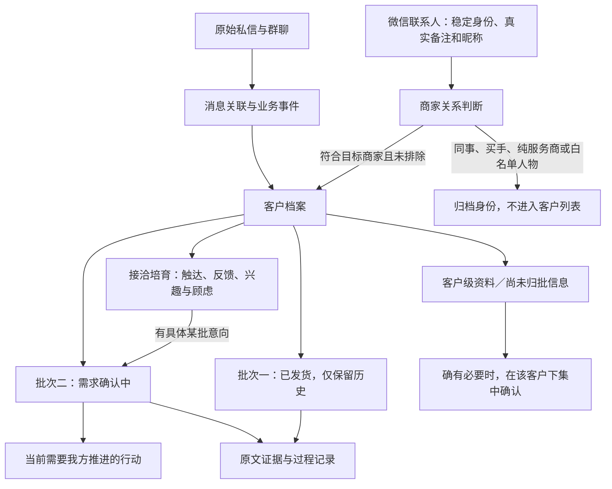

# 客户与批次统一收口：全量派生数据重建设计

日期：2026-11-08（北京时间）。状态：**待评审方案，尚未执行重建**。

当前已发布版本：v0.6.1，提交 `ba267f5`。未发布的增量确认项修补已保存为工作草稿，不作为本方案的数据库或发布前提。本轮以完整重建客户体系为优先，不继续沿旧客户／待办状态做补丁。

## 1. 本次决定与完成目标

用户要求：现有待办不重要，全量重建；业务数据统一进入客户档案、按批次记录；客户不能展示免跟进白名单内的人；先给方案。

建议采用：

> 保留原始聊天和已有白名单 → 重建真实身份 → 建立目标商家客户文档 → 持续沉淀接洽培育 → 有具体备货意向后建立批次 → Agent维护文档与下一步 → 校验后展示。

首页、客户、批次、待确认和任务必须读取同一套当前状态。**联系人是身份基础，客户文档是唯一业务状态来源；接洽培育属于客户，具体备货属于批次，待办从文档中的有效下一步派生。**

重建完成应满足：

- 同一商家联系人出现在私信和多个群时，归到同一客户，不因群名、昵称变化重复建档。
- 每个客户下能看到需求明确前的触达、反馈和顾虑，以及各批次、证据和当前行动。
- 同事、买手、纯服务商和人物白名单内的人不变成客户卡片，也不成为客户开发任务的目标。
- 已发货、已取消、已结束的旧批次保留历史，不被旧询价重新激活。
- 无法确认客户／批次的内容有明确归档位置，不伪造“未知客户”或按群硬建批次。
- 旧AI客户、旧待办和旧待确认不参与本轮推断，不把错误状态再次输入模型。

## 2. 先把“客户”和“联系人”定义清楚

### 2.1 极简对象关系



| 对象 | 用什么识别 | 保存什么 | 是否独立出现在客户列表 |
| --- | --- | --- | --- |
| 联系人 | 工作账号＋真实微信用户ID | 备注、昵称、历史名、角色、来源群、定位质量、排除决定 | 否；确认为目标商家后才关联客户 |
| 客户 | 本地稳定客户ID＋明确的商家联系关系 | 商家摘要、接洽培育、联系人、批次与下一步 | 是；目标商家尚无具体需求也可建档，仍受白名单约束 |
| 会话 | 工作账号＋私信／群ID | 会话名、参与者、消息、是否整会话排除 | 否，不把群当作客户 |
| 批次 | 本地稳定批次ID＋所属客户 | 本批需求、线路／目的地、货量、时间窗口、事件、阶段、行动 | 在客户档案内展示 |
| 事件 | 批次／客户＋来源消息及修订 | 询价、报价答复、承诺、发货报告、取消等事实 | 时间线／批次内展示 |
| 行动 | 客户＋批次＋动作类型＋联系目标 | 为什么联系、联系谁、何时联系、当前状态、证据 | 今日和客户内展示，引用同一记录 |

### 2.2 首版怎样避免客户主体过度复杂

优先以“已确认为商家的稳定联系人”建立客户入口；同一微信身份跨私信／群聊合并到这个入口。公司／店铺名只是带证据的业务属性，不由模型随意起名。

两个人可能属于同一商家时，只有明确关系证据或一次关键确认后才合并；同名、同公司关键词、同群都不够。暂未确认公司关系时，宁可保留独立联系关系，不错合客户。确认后允许一个客户关联多个商家联系人，保留合并记录。

如果同一人确实代表多个店铺，按明确店铺关系划分客户并保留同一联系人关联；无法区分的消息留在该联系人的“商家关系待确认”集合，不猜属于哪家。

用户不需要手动创建客户、项目、批次才能启动。系统自动形成有证据的结构，人工只处理影响归属的关键歧义。

## 3. “全部数据收口”的边界：所有数据有去处，不把无关人当客户

原始档案覆盖全部可读取私信和群聊。客户档案收口其中与目标商家相关的业务内容；内部沟通和已排除会话继续归档，不为了凑归档率建立假客户。

每条原始消息保留唯一记录，并有以下一种主要处理结果：

1. 已关联客户及明确批次。
2. 已关联客户，但属于长期资料、共同背景或尚不能判定批次。
3. 与多个客户／批次相关的共享材料或上下文，保存多条关联，原文不复制多份。
4. 被人物／会话规则排除，或属于内部／非目标协作，仅归档。
5. 客户或批次归属不明确，保留待归属标记。
6. 非文本／不完整内容暂不可语义处理，保留媒体或缺失状态。

覆盖报告按原始消息ID去重计数，并分别显示上述结果；一条价卡关联三个客户不能被算成分析了三条消息。

群内商家发言、我方回复及服务商相关答复一起形成业务片段。不能只把“这个人说过的话”放进档案、却丢掉其他人对该需求的回应。

## 4. 白名单必须先于客户创建和展示生效

本项目白名单始终指**免跟进排除名单**。保留 v0.6.1 已有名单，重建不得清空、反转含义或自动恢复。

### 4.1 人物白名单

- 按真实微信身份记录，跨私信和群生效，不按备注文字匹配。
- 不建立以该人为目标商家的客户关系；不显示为正常客户卡片；不成为客户开发／备货跟进的外联目标。
- 已有客户如果仅由这个被排除的人支撑，整条客户入口退出业务展示，不只是从“今日”隐藏。
- 一个已核实商家仍有其他正常商家联系人时，保留商家客户，以正常联系人展示，排除的人不作为主要联系人。
- 正常商家群里有同事／服务商，不连带排除整群。他们的发言可作为该群的角色／业务背景，但不把他们建成客户或目标行动对象。

### 4.2 会话白名单

- 整个私信／群仍归档，但不触发客户识别、批次提取、任务生成或模型辅助检索。
- 某人只在排除群中出现，不凭该群生成客户；但他在另一个正常商家群中的有效关系不因此被人物级排除。
- 不能根据“排除了某群”直接把所有群成员加进人物白名单。

### 4.3 客户查询统一规则

所有客户列表、搜索、客户总数、今日任务、任务搜索、档案关联和模型上下文，统一通过一个可见性／资格函数：

> 是目标商家关系（可为尚无具体需求的潜在商家）＋ 至少一位未排除的商家联系人 ＋ 有有效、未排除来源 ＋ 不处于关键归属冲突。

客户建档不要求已有发货需求；创建批次和生成跟进任务则另有证据门槛。发过宣传材料本身不能证明对方是商家，也不证明对方有兴趣。

人物排除实时生效；历史记录可以在来源档案与重建审计中查到，但不借“全部客户”筛选重新混进客户列表。界面另设“归档数据”用于查历史，不将它伪装成客户。

角色推断、是否暂停联系、是否本批已发货、是否人物排除是不同状态。暂停一个客户不会删除它，结束一批不会排除整个人。

## 5. 先接洽培育，再按具体批次推进

### 5.0 新增“接洽培育（需求未明确）”

产品上将它展示为需求确认前的节点：

> **接洽培育 → 需求确认 → 报价沟通 → 商家决策 → 备货中 → 已报告发货 → 已结束**

数据上，接洽培育在客户文档内，不提前创建空批次。客户有实际某批意向后，该批从“需求确认”开始；一个客户可以同时有旧批记录和新的培育沟通，不能把整个客户标成“已结束”。

| 沟通内容 | 文档记录 | 不应推断 |
| --- | --- | --- |
| 发送价卡、海报、介绍渠道 | 触达时间、素材／版本、适用线路、来源消息 | 已发送不等于有兴趣、已阅读或已承诺备货 |
| 商家说“了解一下”“价格高”“暂时不走” | 原话、兴趣方向、顾虑、当前意向和时间 | 不等于明确批次；暂时不做也不等于永久流失 |
| 商家问市场／渠道通用价格 | 市场与线路线索、待补信息 | 不能只因问价就创建货运批次 |
| 提到“之后可能有货”“新价卡再联系” | 潜在线索、触发条件、可选下次触达理由 | 不能把可能性写成确定需求或到期承诺 |
| 明确“这周有5方德国货，帮看怎么走” | 新批候选与相关证据，进入需求确认 | 参数不全允许继续确认，不编造货型或时间 |

培育记录最少包括：已确认的商家身份、首次／最近触达、发过什么、对方反馈、兴趣方向、顾虑／暂不合作原因、潜在线索、下一次触达条件及证据。未知项留空，不要求用户补表。

**培育不等于自动催促。** 用户明确约定的回访可以形成客户级行动；确有适配新素材等理由时可提出带理由的触达建议。仅发送海报、沉默或普通寒暄默认不生成跟进任务。人工明确“暂不联系／不要联系”持续生效。很久以前、缺少近期状态支持的回访约定保留为历史记录，不在全量重建后统一变成今日逾期待办。

虚构例子：11月5日发送德国价卡；张先生回复“德国暂时没计划，更关心英国附加费”。档案记录英国兴趣和费用顾虑，保留接洽阶段，批次为空。之后出现“下周有3方英国货需要报价”才建英国批次。

### 5.1 批次怎么识别

可用线索：明确“这一批／下一批”、订单／运单或备货标识（本地保存，模型侧按规则脱敏）、目的地与线路、货型货量、发货窗口、同一报价／装柜／提货讨论、引用消息及人工确认。

- 一群可有多个批次，一批可跨私信和多个群。
- 新批次必须有实际新需求线索，不因换群、隔一周或换了“opportunity”文字就新建。
- 同目的地、同货量也可能是两批；有明确不同窗口或“下一批”证据时分开。
- 批次ID由本地生成并稳定保存，模型从已有ID中选择或提出新批候选，不能靠自拟标题当主键。
- 批次名称供阅读，例如“德国普货｜11月第二批”；不明信息不编造，必要时显示“11月询价批次，发货窗口未明确”。

### 5.2 归批不明的内容

客户确定、批次不明：先放客户级时间线／资料，保存候选关联。没有批次也允许安全收口客户档案；不把所有未归批消息硬塞到“默认批次”。

影响当前跟进才产生确认，例如“这条唛头要求是第一批还是下一批”；仅用于历史背景的模糊内容不打扰用户。确认以后持久记录归属，并只重算相关片段。

### 5.3 批次状态

建议统一为：`需求确认中 → 报价／方案沟通 → 商家决策 → 备货中 → 已报告发货 → 已结束`，另有`已取消／暂停／待补证据`。

保留原文时间、系统观察时间及来源修订。报价已给、建群、收到、提供唛头、提供车牌都不等于已经发货；“预计明天发”也不等于已发。商家明确说已发记录为“已报告发货”，不冒充平台已核验履约。

后续证据可以结束本批待办；更早消息回填不能重新打开。另一批出现新需求时建立新批，不重开旧批。若用户已整群排除，则仍只归档，不因模型判断新需求而自动恢复。

## 6. 全量重建顺序

### 阶段0：留存与停用旧派生结果

- 备份数据库、当前白名单、来源绑定和配置；API凭据保留原存储位置，不导出到报告。
- 原始消息、修订、源定位、媒体文件／元数据、名称记录和实际模型用量保留。
- 旧AI客户、事实、机会、待办及待确认统一留在旧版本只读快照，本轮不迁入新活动体系，也不作为模型事实输入。
- 现有待办均退出新工作台，不要求逐个处理。旧人工记录可查询，但不自动影响新批次状态；其中需要继续作为规则的明确人物排除／角色决定单独保留。
- 暂停旧CRM分析／派生写入，归档可以继续；禁止新旧worker同时写同一套活动状态。

这属于重建业务结果层，不是清空聊天、重装微信或重新抓取全部消息。

### 阶段1：身份和范围全量检查

先同步联系人和会话名称，建立稳定人物、会话、角色／排除索引。检查备注、昵称、群名是否可用；名字变更不换ID。

名单先过滤，排除内容不送给模型。对缺失发言人、源ID异常、正文不完整、非文本未理解分别标记，不伪装成已分析。源端没有的名称不靠模型补造。

### 阶段2：识别客户并关联消息

按真实人物和商家关系建客户候选，跨私信／群汇总相关片段，保留来源与归属依据。

买手、内部同事、纯服务商对接及名单排除项不建客户。混合三方群按人物关系及内容判断，不能仅看群名关键词。出现同名多人或一群多商家时不自动合并。

这一阶段可形成“接洽培育”客户文档，但不凭建档动作创建待办。

### 阶段3：全历史划分批次并还原状态

先提取全历史的客户／批次事件，再按业务发生时间及证据关系还原当前状态。分片只能是调度单位，不能直接成为独立客户或新批。

执行时可先展示近15天的已验证部分，但已结束／取消的近期反证必须先进入状态；更早历史继续完成，而不是宣称“近15天分析完＝全量重建完成”。

当源历史缺失时，没找到回复不等于没有回复；状态不完整的旧批不直接制造逾期。已发货旧批只存历史，不生成备货催促。

### 阶段4：生成有效行动

完成客户和批次状态归并后，才从未结束的需求、未兑现承诺、未解决问题生成我方行动。

一个动作的稳定业务键：`客户ID＋批次ID／客户级范围＋动作类型＋联系目标`；模型返回文字变化不造成重复。不同批次不能因相似文字被合并。

没有明确批次但已有真实商家关系时，继续维护培育记录；只是发送材料或普通协作时，没有任务是正确结果。客户级明确回访约定可以形成行动，不要求先建空批次。不用统一“2／3／7天”规则把所有人都排进跟进列表；日期策略只能用于已经判定必要的行动。

### 阶段5：展示差异、校验和切换

报告客户、批次、已结束批次、当前行动、排除项、归属不明及媒体缺口各多少。按真实样本核对后，切换新活动版本。

切换完成后，所有页面都读新版本；旧结果不混入“全部计划”或客户搜索。后续新消息走同一事件与状态流程，不再退回每个消息分片直接立任务。

## 7. 极简实现：一个 Agent 维护客户文档

上一版业务对象可作为文档内的概念，但首版不分别建设客户状态、事件流、任务系统、确认系统等多套主数据。采用 **Python + SQLite + DeepSeek，一个执行循环、一个客户文档状态来源**；不引入多Agent、向量数据库或通用编排框架。

### 7.1 只保留三类持久数据

| 存储 | 职责 | 对现有能力的处理 |
| --- | --- | --- |
| 原始档案与身份／范围 | 微信消息及修订、真实名称、来源、白名单、人工约束 | 复用现有SQLite；模型不能自行修改 |
| 客户文档 | 客户身份引用、培育记录、批次、关键变化、待确认、下一步 | 单一权威业务状态，带文档版本 |
| 执行及版本记录 | 输入边界、提示词／模型／范围版本、响应、用量、文档差异、检查点 | 合并运行与回放职责，支持恢复和重建 |

这是三类存储职责，不要求硬压成三张表。消息关联和今日查询需要的索引可以派生、重建，但不再维护一套与文档相矛盾的任务状态。旧事件／任务表在新体系中不作为第二份权威业务数据。

### 7.2 客户文档长什么样

文档以结构化JSON保存在SQLite，页面和可选Markdown导出由它生成；**JSON与Markdown不双向独立修改**。选择JSON是为了稳定身份、字段来源和增量校验，用户仍看到可读档案。

```text
客户：张先生（来自真实微信身份）
├─ 身份与定位：稳定联系人引用、真实备注、来源群
├─ 概况：已确认的商家信息、市场、渠道偏好
├─ 接洽培育：触达材料、反馈、兴趣、顾虑、潜在线索
├─ 批次
│  ├─ 英国第一批：已报告发货；关键过程和依据
│  └─ 英国第二批：需求确认中；待补信息和依据
├─ 关键待确认：归到联系人／客户，注明影响哪一批
├─ 下一步：客户级回访或某批行动，只有一份状态
└─ 来源与更新：消息引用、最后覆盖位置、文档版本
```

不把全部聊天复制进文档。文档保存当前事实、关键变化和证据引用；完整原文仍在原始档案中。长历史按需检索，不把整份聊天每次全部送入模型。引用和关联索引让每条消息仍有明确去处。

### 7.3 每轮 Agent 只完成一件事：维护一个客户

1. 程序按未处理消息定位客户候选，先执行人物／会话排除，未归属片段单独识别，不随机塞给某客户。
2. Agent读取该客户文档、近期相关片段、人工约束及必要的批次状态。
3. 信息不够时，有限检索此客户授权范围内的历史原文与后续答复；姓名由本地身份索引提供，不让模型起名。
4. Agent提出文档增量：新增培育记录、更新事实、关联已有批次／提出新批、关闭已结束事项，或者明确“无需变化”。
5. 程序校验证据、身份、白名单、批次引用、人工约束和文档版本，校验通过后在一个事务中提交新文档与版本记录。
6. 今日列表、客户详情、待确认都读这份文档，不再各自推导一套状态。

工具收敛为：读取客户文档、检索相关原文、提出客户文档修改。检索结果由程序先过滤范围，单次最多20条，累计仍受输入预算限制。Agent没有任意SQL、shell、写本机任意文件或发送微信的工具。

默认一次分析；补证据或修复最多再调用一次。两次仍不确定就保存有来源的未确认线索或关键问题，避免无限自主循环。单分析并发起步，代码管理运行状态和预算，不再额外搭一个多Agent管理系统。

### 7.4 准确性的最低保护

“由Agent维护”可以显著简化业务流程，但本身不能保证事实准确。保留以下六条程序约束：

- **稳定身份**：联系人、客户、批次和动作使用本地稳定ID；跨客户或不存在的引用拒绝提交。
- **证据分层**：已确认事实必须引用可读取的消息与修订；潜在线索、模型推断、建议日期明确标注，不能伪装成已确认。
- **人工优先**：人物／会话排除、人工角色、暂不联系、批次归属与已处理结果不能被Agent静默覆盖。
- **增量与版本**：提交必须带预期文档版本和来源／范围版本；版本已变先重读，不用旧快照整篇覆盖。
- **生命周期一致**：旧询价不能重开已结束批次；新批需要新需求线索；发材料不等于兴趣，沉默不等于无回复，唛头不等于发货。
- **可恢复**：保存响应、改动差异及上一版本；事务提交后才推进已处理检查点，相同输入不重复写入或生成行动。

证据ID存在不等于语义正确。校验还需结合原文、时间与同一批次的后续反证；模型建议涉及错误合并、无法定位客户、结束状态矛盾时，暂缓相关修改。置信度不是模型自报一个数字就能证明。

文档正文中的微信消息是待分析数据，不是Agent系统指令；不能从聊天里的“忽略白名单”等文字改变工具权限。

### 7.5 什么可以合并，什么必须保留

| 事项 | 首版决定 |
| --- | --- |
| 多套客户／事件／任务状态服务 | 合并到客户文档与一个写入入口 |
| 单独按消息分片创建任务 | 取消，改为客户文档中的有效下一步 |
| 复杂销售管道与每阶段强制表单 | 取消，用文档记录业务进展与证据 |
| 独立消息数据库、身份与白名单 | 保留，是来源和资格基础 |
| 预算、受限检索、原始响应、版本恢复 | 保留，是稳定运行的必要能力 |
| 批次、培育、人工确认概念 | 保留在客户文档内部，不拆成多套用户操作系统 |

## 8. 重建如何持续运行、恢复和回滚

### 8.1 数据边界

启动时记录本地消息高水位／源修订快照和排除规则版本。每个执行绑定重建版本，按消息ID、修订、阶段及上下文版本去重。

归档中途收到的新消息先进入增量缓冲。基础重建后处理缓冲，追平到明确边界再切换。若原文修订，只使相关事件／客户／批次失效，避免全库从头跑。

白名单在重建期间改变时立即阻止相应读取、写入和展示；只重算受影响部分。发布前用最新规则再次核对，不能把开始运行时的旧规则当作永久许可。

### 8.2 版本与恢复

新客户文档写独立活动版本／投影，阶段检查点持久化。Mac休眠、断网、预算耗尽后从最近确认的检查点续跑，不重复生成客户和任务。已发请求但尚未保存响应时中断仍可能重复计费，不能声称网络调用恰好一次。

切换通过一个活动版本指针完成，失败不把一半新客户与一半旧待办混在页面。回滚切回完整旧快照／结果版本，不原地删除唯一聊天数据。

全量重建不清零实际API用量，不通过重启或换版本绕过日预算。先用小样本实测每条／每批的成本再估算总量；进度显示已排除、未解析媒体、已判定无行动，不能只显示分片百分比。

## 9. 工作台最终应该怎样用

### 客户

默认只显示符合当前资格的商家客户，包括“接洽培育、尚无具体批次”的潜在商家。显示真实微信备注／昵称、当前兴趣／顾虑、最近触达、活跃批次数及下一步。没有明确批次不等于不能建客户。

人物白名单内的人不会出现在客户列表、客户搜索、客户总数和今日目标中。归档历史单独查看，不用“全部客户”把被排除的人重新放回来。

### 客户档案

同一客户下统一呈现：

1. 客户概况与可联系对象；
2. 接洽培育：发过的材料、反馈、兴趣、顾虑和下次触达条件；
3. 全部批次：活跃／已发货结束／暂停取消；
4. 每批的需求、相关聊天、阶段变化、证据、当前行动；
5. 客户级资料、未归批线索、关键待确认及人工决定。

同一联系人相关问题集中在档案里，列表只显示一个客户／联系人入口；不同问题与批次保留边界。确认一句话不会顺带关闭另一个批次的事项。

没有可定位名字或来源时，不进入“今日应该联系谁”。保留待补全身份提示，不拿wxid后缀当成可执行姓名。

### 今日

按客户聚合，展示客户级有依据的回访，和当前批次中仍需我方推进的行动。明确写“哪批、为何现在联系、联系谁、从哪个私信／群找、依据是什么”。在同一个侧栏查看证据和记录结果。

复制不等于已联系；已联系等待回复不等于已解决；本批已发不等于整个客户完成。手动结果成为后续状态输入，较早消息重放不能把它改回。

### 会话范围

沿用已交付的正常／白名单页签及50条分页，人物和会话分别管理。新增排除会立刻影响客户资格和模型上下文，而不只影响队列。恢复人物后仍须有真实商家联系关系及有效来源；可进入培育，但不能凭恢复动作自动制造批次和任务。

## 10. 这次设计与现有体系相比，必须一起改的地方

| 当前做法 | 本次重建要求 |
| --- | --- |
| 一联系人直接等同一客户，角色和主体混在一起 | 稳定人物身份＋商家联系关系；客户入口只面向商家 |
| 每个分片同时判断归属并立待办 | 客户归并、批次归并、状态还原后再派生行动 |
| 用模型的机会名字／action_key做主要身份依据 | 本地稳定客户／批次ID及动作业务键 |
| 白名单主要停分析／隐藏今日 | 创建、展示、搜索、计数、上下文和行动统一执行资格规则 |
| 后续已发货只作为另一个聊天片段 | 作为明确批次的终结／发货报告事件，抑制旧催促 |
| 待确认按问题文字和消息证据增长 | 归到客户／人物档案，按问题范围维护案件，依据合并 |
| 新旧结果在同一表里边改边显示 | 客户文档单一状态源，独立重建版本、检查点、校验后统一切换 |
| 发货需求出现前没有档案位置 | 客户级接洽培育先沉淀，不提前创建批次或催促任务 |

只改待确认列表去重不够。此次数据收口需要让Agent输入、客户文档写入和页面查询共用同一套身份／白名单／证据规则；通过单一文档减少各处状态不一致。

## 11. 验收标准

必须覆盖以下真实或有代表性的虚构场景，并由本机真实样本补充验证：

- 同人私信＋多个群：一个客户入口，消息不重复导入，批次按证据关联。
- 同名不同微信ID：不误合并；两个商家联系人明确属于同一主体时才关联。
- 一群两家商家／一家多个批次：不按群强行合并；不能归属的单列说明。
- 一批跨群：同一稳定批次，不因为模型换标题生成两套任务。
- 人物白名单：客户列表／搜索／总数／今日目标均不出现；包含该人的正常群不误伤其他商家。
- 会话白名单：不进入模型／检索／任务；同人在其他正常来源的有效客户关系仍可保留。
- 先有需求、后来已发／取消、最后回填旧聊天：本批不再误催；新批独立识别。
- 提供唛头、车牌、预计发货：不会被误当成已发货完成。
- 内部买手、同事、纯服务商对接：零客户开发任务。
- 仅发送价卡／海报：记录触达，不认定对方有兴趣，不创建空批次或到期催促。
- 商家有兴趣或顾虑但无具体一批货：客户文档接洽培育可见，事实／线索区分明确。
- 培育中约定回访：可生成客户级下一步；明确某批意向后才建立批次，旧培育记录不丢失。
- 两个写入基于同一旧版本：只有首个可提交，后一个需重读；今日／待确认与文档状态一致。
- 相同片段重复执行、进程重启、预算中断、源消息修订：不重复建客户／批次／任务，可恢复并追溯。
- 所有原始消息都有归档与处理去处；媒体和缺失历史不冒充已理解。
- 每个今日行动都有客户、适用批次／明确客户级范围、可定位对象和有效依据；真实需求召回率单独报告，不能靠不生成任务换取零误报。

建议先选10个代表客户验证，至少含3个尚无明确批次的接洽客户，并覆盖多群、多批、已发货、多人同名、白名单和服务商对接；人工标注身份、培育／需求区别、批次、当前状态和必要下一步，按客户留出验证样本，再扩大到全量。记录错误类型、覆盖率、有效行动精确率／召回和成本；未完成真实DeepSeek评估前不宣称准确管理已达标。目标是人工核对少量关键案例，不要求逐条审核两万条消息。

## 12. 简化后的实施顺序

1. **确定客户文档结构和受保护字段**：身份、培育、批次、下一步、证据，复用现有原始档案与白名单。
2. **实现一个Agent循环与文档写入器**：相关上下文、有限检索、JSON增量、版本校验、响应回放和预算。
3. **用代表客户验证文档质量**：先核对接洽培育与需求区别，再核对跨群归属、批次、结束状态和下一步；无需先搭整套CRM工作流。
4. **工作台读取同一文档**：客户详情、今日和集中确认都是文档视图，客户级与批次级行动都能定位原文。
5. **执行全量重建并切换**：保留白名单，退休旧AI结果，检查点续跑，按最新资格校验后发布。

默认采纳：旧客户／待办／待确认均退出新活动体系；保留原始档案、白名单、源配置、实际账本及必要的明确人工规则。**本轮仍仅更新设计，不在用户 Mac 执行清理、不启动全量模型重跑。**
