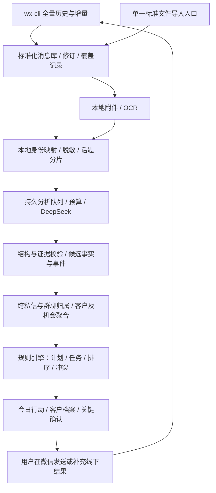

# 半托管欧区备货用户助手 · 产品与技术设计

版本：已确认设计 1.1；日期：2026-11-05（北京时间）。用户已授权实施；本文描述完整目标，本轮已实现与未交付部分见第 18 节。

本轮进一步的模型执行与上下文设计见 [Harness完整方案](MODEL_HARNESS_DESIGN.md)，目前待审阅，尚未实施。

适用对象：跨境电商平台产品／运营人员；纯工作个人微信；全部可读取私信与普通群聊；通过价卡／海报 BD 商家，协调商家与头程服务商，推动平台备货。

## 1. 产品目标与设计结论

主链路固定为：

> 导入／持续采集聊天 → DeepSeek 识别联系人、客户与需求 → 自动生成有来源的客户档案 → 自动维护跟进计划和待办 → 用户处理今天该联系谁 → 新聊天反馈自动更新档案与下一步。

借鉴成熟 CRM 的联系人／客户／商机分层、统一沟通时间线、下一步行动、管道阶段和身份去重；简化为单人工作台，不照搬销售团队的录入表单、审批流、复杂报表和项目管理。

| 系统负责 | 用户只负责 |
| --- | --- |
| 读消息、识别角色、归档客户、提取需求、关联证据 | 首次确认工作账号及 DeepSeek 分析范围 |
| 创建、更新、去重、关闭任务，判断当前跟进状态 | 对身份冲突、公司合并、关键业务事实做必要确认 |
| 按价值、紧急程度和联系节奏安排今天行动 | 选择联系对象、核对话术，在微信手动发送 |
| 根据新回复调整下一步，回顾历史客户激活机会 | 对系统无法观察的线下结果补充一句，必要时纠错 |

**取消：先手动建商家、建项目、逐会话绑定、逐条接受 AI 建议，才能开始使用。** 人工补录是可选补充，不能成为自动分析的入口条件。

成功标准：用户每天主要处理少量有理由、有证据的行动卡，而不是面对消息列表、建档表格和大量待审核建议。自动化有不确定性时，保留已有可用结果，仅将受影响决策放入确认区。

## 2. 当前差距与保留资产

现状依据仓库代码：`analysis.context()` 要求商家和项目关联；模型仅输出 `task_create`；建议需手动接受才建任务；“客户全景”是联系人发言汇总，不是 AI 客户档案。现有闭环确实偏向手工 CRM。

| 保留并复用 | 必须重构 |
| --- | --- |
| wx-cli 接入、账号核对、私信／群聊发现、历史续传 | 分析不再依赖 merchant_id／project_id |
| 一个标准 CSV／JSON／JSONL 手动文件入口 | 联系人、客户、业务机会、关系和事实模型 |
| 消息稳定 ID、修订、去重、异常行隔离 | 自动建档、跨会话分析、任务生命周期 |
| 本地存储、登录保护、DeepSeek 客户端、任务队列基础 | 首页、客户详情、少量关键确认、统一运行入口 |
| 图片按需读取、原文回查、备份机制 | 覆盖度、分析进度、预算、暂停与恢复的可理解状态 |

用户上报已归档约 20,078 条消息，仍存在读取失败会话、身份缺失、无稳定 ID 和隔离行。这些是待核实的数据覆盖情况，不代表 DeepSeek 已分析或全历史完整。已有数据全部保留并复用，不要求重新导出。

## 3. 从第一次打开到每日使用

### 3.1 首次设置：三步，之后不用逐个配置群

1. **确认数据**：连接现有 wx-cli（文件导入仅作备用）；确认工作账号；默认纳入该账号全部可读私信与群聊。支持排除个别会话；保留试点入口但不限制正式范围。
2. **连接 DeepSeek**：安全保存 key、用虚构样本检查 API；展示将发送的脱敏文本样例、分析范围、每日预算。一次确认账号级分析授权；默认包含此工作账号后续发现的新会话，可切换为“新会话待授权”。
3. **开始整理客户**：展示已入库与待分析消息数、分批费用估计和预计时间范围；先分析近期消息产生可用今日行动，后台继续全历史。用户无需先建任何商家／项目。

首次整理默认先处理最近 15 天，之后从早到晚补齐更早历史，并重算受影响客户。所有纳入的可读历史最终都经过分析；近期优先不等于忽略历史。尚未补齐时标“初步档案”，不能声称全量完成。

系统使用当前消息量及首批实际 token／耗时估算范围；未跑样本不报确定费用和时间。预算不足就暂停，展示恢复日期与调整入口，不要求用户手工拆聊天。中途关闭页面不取消后台任务；退出后台进程会暂停，重新启动后续跑。

### 3.2 日常：打开首页即可工作

1. 首页给出“今天建议联系谁”，默认最多 10 张主要行动卡；逾期与紧急事项优先，可展开其余项。
2. 点卡片查看客户近况、行动理由、原话和建议话术，必要时修改后复制。
3. 在微信手动发送。复制不等于发送；采集识别到实际外发且匹配此事项时，自动记录联系行为；无法可靠匹配时只展示已外发消息，不自动归入某个任务。仅“发过消息”不等于需求已解决。
4. 新回复到达后自动调整：已答复的报价确认不再提醒；等待商家反馈的事项进入等待；明确下周联系则改期。
5. 系统无法看到的电话／线下结果，点“记录结果”输入一句话；用户也能“改期／不跟进／纠正”，立即生效。

仅剩关键确认时显示角标；没有事项时明确“今天暂无到期行动”，不能为填满页面编造客户或任务。

## 4. 信息架构与首页交互

主导航为：**今日跟进、客户、待确认、分析概览、设置**。导入、消息档案、运行诊断、素材版本藏在设置或详情中；不在首页展示 JSON、会话 ID、建商家／建项目表单。分析概览用于处理覆盖、预算与队列可见性，不引入复杂销售经营报表。

```text
今日跟进                        已同步 09:10 · 分析到 09:08
[今天 6] [等待回复 12]            [待确认 2]

优先联系
┌ 王先生 · 待确认公司名称        报价反馈 · 今日到期 ┐
│ 最近：美国海运，约 3 方，担心附加费               │
│ 为什么：你昨天承诺今天确认是否含派送费           │
│ 下一步：先向服务商确认，再反馈商家               │
│ [查看依据] [查看话术] [记录结果] [改期] [更多]     │
└───────────────────────────────────────────────┘
历史客户激活（默认收起，最多 3 位，能说明新触达理由）
```

“等待回复”独立列表，没到复查时间不挤占今日行动。卡片显示当前真正需要联系的对象（可能是服务商），同时显示关联客户；一张卡可含前后依赖步骤，不把三方协调拆成用户必须自己重组的碎片。

客户详情默认显示：一句话近况、主要联系人、当前需求与机会、下一步、沟通时间线。事实点旁可展开来源；技术 ID、完整消息档案及抽取详情二级展开。客户可搜索，可按“近期要跟进／等待／历史激活／不联系”筛选；未知公司也正常显示客户称呼。

## 5. 自动建档与身份归属

### 5.1 对象分层

| 对象 | 自动生成的内容 | 约束 |
| --- | --- | --- |
| 联系人 Contact | 稳定微信身份、昵称／备注、私信与群内记录、角色证据 | 键为工作账号 + 稳定对方 ID；昵称不当唯一键 |
| 客户 Customer | 商家主体／个人商家档案、联系人、需求摘要、历史顾虑 | 无公司名也可建档；不伪造公司名 |
| 服务商 Provider | 物流提供方身份、线路能力、协作历史及有效依据 | 不因出现在商家群就归为商家 |
| 关系 Membership | 联系人属于哪个主体、有效时间、角色、证据 | 同一人可代表多个主体或切换角色 |
| 机会 Opportunity | 当前一项需求，如美国普货海运备货 | 自动生成；并非所有聊天都要有机会；可在客户级建任务 |
| 跟进计划 Plan／行动 Task | 阶段、下一目标、责任方、依赖、时间与证据 | 可只关联联系人／客户，不强制关联公司或项目 |

联系人身份可由本地消息确定；“商家／服务商／其他”由上下文识别。身份存在不等于客户成立：纯通知、群广告、系统账号、明显非商家对象只保留联系人记录，不泛滥创建客户和跟进任务。角色不明确时保留“未分类”，只有影响当前行动时才询问。

### 5.2 私信和群聊如何贯通

- 同一工作账号中相同稳定发送者 ID，自动关联到同一联系人；一个联系人的私信和多个群共同提供档案依据。
- 私信对端 ID 与群发送者 ID 无法可靠对齐时，不以昵称猜测合并。未知发送者保留会话证据，但不能指派为某客户事实。
- 一个群可含多个商家、多个服务商、多个机会。先识别每条消息的说话人、对象、引用与话题，再归属；群名称仅为辅助线索。
- 公司名称、域名、店铺等形成主体匹配候选。**首版不自动合并两个已独立存在的客户主体**；同一稳定联系人可复用既有未冲突档案，其余合并作为关键确认。
- 关联不确定的需求保留为“此群的待归属线索”，不写入随机客户。只有有价值且影响近期行动的线索才进入确认区。
- 群内未说话且源端未提供身份的成员无法凭空建档；不同工作账号隔离，不自动跨账号合并。

## 6. 客户档案：事实、判断、缺失信息分开

| 分组 | 示例字段 | 更新规则 |
| --- | --- | --- |
| 身份 | 联系称呼、公司／店铺、联系人关系、角色 | 稳定身份本地绑定；企业归属可待确认 |
| 经营与物流需求 | 市场、品类、货型、货量、发货频率、出货地、目的地 | 字段级存证；未知留空，不弹出补全表单 |
| 决策信息 | 价格敏感、担心附加费、时效诉求、合作服务商 | 区分对方明确表达与 AI 判断 |
| 沟通状态 | 最近有效交流、我方承诺、对方承诺、待解决顾虑 | 私信与群聊合并，保留事件先后 |
| 当前机会 | 备货阶段、预计窗口、阻塞项、下一步 | 不凭“收到”“已拉群”推进到完成 |
| 激活线索 | 上次搁置原因、约定回访日、可匹配新信息 | 需要具体触达理由，不能只因沉默就推荐 |

每个可展示结论包含：原始消息 ID 与修订号、会话、发送者、消息时间、必要上下文、提取时间、事实类型、模型／提示词版本。界面显示简短依据，点击直达原文；模型推断和计划时间分别标“AI 判断”“建议日期”。

以“对方说过什么”为事实，不把其声明视为客观核验结果。`reported`（对方反馈）、`inferred`（推断）、`user_confirmed`（用户确认）独立保存；模型置信度仅作内部排序辅助，不能冒充校准过的概率。

新证据补充而非全量覆盖：带有效时间保存“以前每月 2 方、现在 5 方”；不同批次的价格／货量分别存储。矛盾无法解释就标冲突，不一律取最新一句。用户修正的字段被锁定，后续相反证据只提示，不静默覆盖；可一键恢复自动更新。

源消息被修订时，依赖旧修订的事实、摘要和任务进入待重算，旧引用标为已变更。用户在本系统删除记录时，清理相应派生内容并重算，不继续把已删除原文当有效证据；源端不可见不等于自动判定已撤回或删除。排除会话默认停止后续分析，是否清除已有派生内容须单独提供操作，避免混淆“暂停”和“删除”。

## 7. 自动维护机会与三方协同计划

机会示例：“某商家 · 美国普货 · 11 月出货需求”。只有存在具体需求才创建；线路、批次、明确订单号、时间窗口共同辅助区分。无法区分批次时先保留客户级需求，不让用户为了让系统运行先建项目。

默认阶段：**有需求 → 方案／报价沟通 → 商家决策 → 出货准备 → 物流执行 → 备货结果待核验 → 已核验完成**，另设“暂停／不再推进”。有证据可跳过中间阶段，但必须保留依据和未核实标记；平台备货完成口径由用户最终确认。

计划按阶段自动维护下一步，例如：

| 聊天证据／状态 | 自动处理 | 用户看到 |
| --- | --- | --- |
| “美国 3 方，月底走，派送包不包？” | 建需求；缺条件时先问服务商；反馈商家为后续依赖 | 一张协调行动卡，说明先问谁、再反馈谁 |
| 服务商提供附加费，尚未转告商家 | 完成询价步骤，激活反馈商家步骤 | 今日出现“把已确认条件反馈商家” |
| 商家说“下周三再联系” | 暂缓当前催促，按对话当地日期排回访 | 到期才出现回访行动 |
| 商家说“这批不做了” | 关闭对应机会和未执行任务，保留终止原因 | 不再提醒这批；其他机会不受影响 |
| “货已到仓” | 记对方报告到仓；生成有需要才出现的核验事项 | 不直接标平台备货成功 |

等待外部反馈是计划状态；到复查时间才出现行动，不能把服务商应做的事情每天当作我方逾期待办。多个机会并存，不能把群中一个人的“已发货”关闭所有商家的任务。

## 8. 待办、时间与重复治理

### 8.1 哪些会自动成为任务

明确承诺、可归属的具体请求、明确约定回访、推进当前机会必需的下一步，自动创建／更新可操作任务。无需逐条“接受 AI 建议”。任务有 `explicit`（明确提出）或 `suggested`（系统建议）来源，均可编辑／忽略。

寒暄、群发海报、纯知识信息不直接产生任务。只有“需求／顾虑 + 可执行下一步”成立才推荐行动。缺关键对象、否定语义或责任方无法判断时，先保留线索，必要时才提关键确认。

### 8.2 日期规则（默认北京时间）

- 存储 UTC，展示、相对日期解析和每日预算界限使用 Asia/Shanghai；可在设置更改业务时区。
- “明天”按原消息时间解析，不按分析当天；“下周三”保留原话、解析依据与规范日期。存在跨时区／歧义时不假装精确。
- 未明确时刻的“明天联系”安排为当天行动，不虚构“承诺上午 9 点”；系统默认提醒时段只是偏好。
- 无约定日期但确需推进：初始策略为报价反馈后 2 个工作日复查、明确等材料后 3 个工作日、一般意向 7 天；这些是可调策略，不是客户承诺。首版“工作日”为周一至周五，暂不内置各国节假日历；用户可改期。
- 联系冷却默认 3 个自然日，同一客户的非紧急动作合并；明确约定、临近截止和新回复可覆盖冷却。等待外部、拒绝联系和已终止状态优先于通用策略。

### 8.3 历史初始化不制造成千上万的逾期项

先按时间顺序重建承诺 → 答复 → 改期／取消 → 当前状态，再生成行动。近期优先分析形成的结果标“初步”，历史补齐后重算；不会把旧摘要当作高于新消息的事实。

超过 30 天且无后续证据的旧承诺默认 `historical_unresolved`，不计入今天逾期。仍有当前价值时转为一条“建议核实近况／激活”，而非复活所有旧任务。明确尚未履行且有持续新证据的事项例外，显示理由。

### 8.4 任务状态与用户保护

状态：`open → waiting_external / snoozed → done / cancelled`，可纠错重开。新的回复可自动完成有直接证据的具体事项，如“已确认含派送费”；“我已发出询问”只记录联系并进入等待，不算整个业务完成。

去重键组合账号、客户、机会、行动类型、对象及证据链。重复导入／任务重试不重复生成；语义相似先查同客户同机会，不能跨批次合并。新消息可修改原任务，不无限新增。

用户设置的时间、已完成／取消状态、手工修改内容优先；AI 相反结论生成可撤销的变更提示，不能自动重开用户关闭事项。所有自动更新可查看原因并撤销；撤销写入纠正记录，后续重跑不得复活同一误判。

## 9. 今日排序、话术和历史激活

排序采用可解释规则：明确约定到期／逾期 → 阻塞近期出货的关键事项 → 新需求待回复 → 常规复查 → 有具体理由的历史激活。相同级别按截止临近、需求强度和最后有效交流排序；不以消息条数代表客户价值。

默认主要行动最多 10 张；未展示任务仍可在“全部行动”看到，截止风险不能被推荐数上限隐藏。激活候选默认最多 3 位，每位需要：历史需求／搁置原因、当前新理由、合适联系对象、最近联系时间。默认激活冷却 14 天，不与一般跟进冷却混淆。

话术基于行动、已知需求及有效素材，默认一段简短可编辑消息，可带待确认占位符；只有在用户展开时生成并缓存，避免全量预生成费用。不得虚构优惠、价格、承诺或“已帮您安排”。有价格和条款时，必须使用已核实且未过期的同版本依据；否则建议询价而非生成确定报价。

“不要联系”人工设置即时生效；客户明确拒绝联系可自动进入暂停联系并提示确认，确认前也不推荐触达。解除需用户操作。用户忽略一个激活建议，不应每天再次出现；策略复查默认 30 天后或有新实质证据时才重新评估。

## 10. 关键确认：仅处理影响业务的歧义

| 情况 | 自动完成的部分 | 只需确认什么 |
| --- | --- | --- |
| 同名／疑似同公司两个档案 | 各自正常建档和跟进 | 是否合并主体；可选择以后再说 |
| 三方群分不清商家／服务商 | 归档已知事实和未归属线索 | 某个联系人在此机会中的角色 |
| 一条需求可能属于两个客户／批次 | 保存会话级线索；其他客户正常运行 | 此需求归谁／是否新机会 |
| 关键条款或数量矛盾 | 显示冲突，不据此对外报价 | 当前适用版本或“仍未知” |
| 模型与人工修改冲突 | 保持人工结果 | 是否采纳新证据更新 |
| 平台备货完成、关键 OCR 价格 | 保存“对方反馈／待核验” | 是否已核实及依据 |

确认卡给出系统建议、两侧证据和一键选项；不用让用户重填整张表。按影响当前行动排序，相关问题合并为一张；可稍后处理，不因低价值信息缺失催填。超过 7 天未处理的非关键问题折叠；关键项仍保留，但只冻结受影响决策。

初版确认区不作为每条模型输出的审批队列。目标是抽样评估后，至少 80% 的有效新客户建档和常规跟进无需人工确认；身份歧义不会为追求比例而强行归属。

## 11. 图片、价卡和其他消息类型

文本为主闭环，附件作为重要信息来源而不是静默丢弃：每条媒体记录“已获取／未下载／解密失败／已识别”等覆盖状态。

- 图片／海报：复用现有本地读取能力；目标使用 macOS Vision 本地 OCR，不把图片原件默认发 DeepSeek。OCR 文本可随已授权上下文分析，记录原图、区域、识别版本和置信信息。
- 价卡：提取市场、线路、币种、计费单位、货型、税费／附加费、时效、有效期、适用范围；未核实前可作为待询价线索，不能作为确定报价或“更便宜”激活依据。
- 素材：从聊天自动发现候选，不要求逐张手录；只对会影响对外建议的版本要求一次确认。同一文件哈希复用 OCR 与审核状态，不同版本不串用。
- 语音／视频／文件／引用消息：记录类型及可用正文／引用。首版不承诺语音转写和所有文件解析；影响当前需求时提示“存在未识别附件”，不能显示上下文已完整理解。
- DeepSeek 文本模型不直接理解图片。OCR 属后续独立交付关口，不能用文本闭环测试代替媒体验收；图片很多时必须显示“文本分析完成，媒体待处理”。

## 12. 技术架构与数据处理流水线

首版继续本机 Mac 部署，无需 ECS、Tailscale、企业微信、向量数据库或复杂 Agent 框架。DeepSeek 负责理解和结构化提取，确定性代码负责授权、证据校验、身份键、日期规则、预算、任务状态和事务写入。



### 12.1 分析单元与上下文

1. 先按会话、时间、回复／引用关系形成带少量重叠的窗口，不机械每 50 条就忘记前后文；初始目标约 2,000–4,000 输入 token，实际按模型上限、输出预算动态调整。
2. 首轮提取“谁对谁说了什么、提出／答复／取消了何事”，输出事实和业务事件，不让模型直接写数据库。
3. 本地身份索引和当前客户／机会摘要辅助归属，检索同一联系人相关私信和群片段；有原始证据的摘要才可复用。必要时补取少量原文，最多两轮，仍不明确则保留歧义。
4. 把有效事实按客户／机会聚合，重建时间线；规则加模型生成下一步候选，检查已有任务和用户纠正后再提交。
5. 全量补齐期间，相关客户有新消息时新任务优先；写入前检查输入修订、授权和档案版本，过期结果重排，不覆盖较新状态。

仅当需求归属需要上下文时追加跨会话原文，不能把所有聊天一次性发送。使用结构化检索与 SQLite 索引先跑通，后续确有需求再引入语义检索。

### 12.2 外发内容与身份映射

源 ID、wxid、电话、邮箱、地址等使用本地稳定别名映射；联系人和组织别名在同一账号内可跨窗口对齐。模型输出别名，本地还原为稳定身份；跨账号使用不同命名空间。脱敏前可在本地从确定元数据提取标识，但禁止仅凭同名自动合并。

市场、货型、需求、时间、必要的数量与物流条件需保留可用业务语义；这不等于商业信息完全匿名。不可逆脱敏后无法还原的公司名不强行要求模型识别，档案可仅用联系人称呼。对正文中未知身份名称，模型只能返回源片段定位的候选，不能自行创造本地主体 ID。

一次账号级授权取代逐群审批，但设置可随时排除会话、暂停分析和撤销授权。撤销先停止新外发并阻止进行中结果写入；已发送请求无法收回。原始整库、微信密钥、图片原件不发给模型；模型无执行工具权限，聊天中的指令仅作为数据。

## 13. 目标数据模型与输出契约

以下为待实现实体，不表示现有数据库已有这些表。

| 实体 | 核心字段与关联 |
| --- | --- |
| contacts / identity_aliases | account_id、稳定源身份、显示名、别名、身份质量 |
| customers / organizations / memberships | 客户、可选主体、联系人、多角色关系、有效时间；独立于旧 merchant/project |
| facts / business_events | 主体、字段／事件类型、值、事实类别、有效时间、状态、证据集合 |
| opportunities / followup_plans | 客户、可选批次信息、阶段、目标、阻塞、下一步与依赖 |
| tasks / touchpoints | 可关联联系人／客户／机会；行动、执行对象、责任方、状态、约定／建议日期、来源、版本 |
| evidence_links | 源消息、修订、说话人、片段／附件区域、提取版本；跨实体复用 |
| review_items / corrections | 歧义类型、候选、依据、影响范围、用户决定、字段锁与撤销记录 |
| analysis_runs / analysis_units | 授权快照、范围、输入指纹、检查点、模型／提示词版本、token、重试、覆盖与错误 |

旧任务改为允许无 merchant_id／project_id，增加客户／联系人／机会关联；不通过生成虚构商家绕过非空约束。现有商家／项目作为人工已知资料迁移，可兼容显示，不再是入口。

模型分两种契约：**提取事实／事件**和**汇总档案／提出行动变更**。每个可生效字段和行动都须有服务端可验证的证据；模型不能自报审核通过。示例（别名与消息均为虚构）：

```json
{
  "schema_version": 2,
  "facts": [
    {"subject_ref":"C001","field":"target_market","value":"美国","kind":"reported","evidence_refs":["E001"]}
  ],
  "events": [
    {"type":"request_quote","actor_ref":"C001","opportunity_hint":"美国普通货","evidence_refs":["E001"]}
  ],
  "action_proposals": [
    {"operation":"create","customer_ref":"CU001","summary":"向服务商确认是否含派送费","responsible_party":"self","contact_ref":"C002","due_text":null,"evidence_refs":["E001","E002"]}
  ],
  "ambiguities": []
}
```

`CU001` 仅能引用本次输入中已有的本地客户别名；尚未存在客户时返回联系人别名与归属候选，由本地规则创建。模型可提出 create／update／complete／cancel／wait，但目标对象与当前版本必须由服务端校验。输出内无效引用、跨账号身份、不可解释日期、价格无证据或结构错误均不能进入正式档案和行动。

## 14. 队列、成本、覆盖与运行方式

- 分离采集进度、分析进度、媒体识别进度。导入完成不等于分析完成；每个范围的失败／隔离／缺证据都有计数与可重试入口。
- 分析单元状态：queued／running／succeeded／waiting_budget／retry／failed／superseded／excluded；单个异常窗口隔离，其他客户继续处理。
- 输入指纹包含消息修订、相关人工纠正、授权与模型／提示词版本。同输入重试写入幂等；超时不代表未计费，保守预留后有限重试，不能承诺 API 调用恰好一次。
- 首版 DeepSeek 并发默认 1，429 遵守 Retry-After，瞬时错误指数退避；相同输入最多 3 次，结构错误可有限重试，失败留原因；不向其他模型供应商自动转发。
- 初始每日 token 预算沿用 100,000，可按历史批次调整；输入、输出和重试都计费，首次批量前显示估算及预算。实际费用以 API 用量和账单为准，不写死单价。
- 同账号采用可恢复的单一业务写入序列／版本冲突重排，避免历史聚合覆盖增量。暂停保留检查点；更新授权后重新校验所有待发任务。
- 目标提供一个启动入口统一管理 Web、采集和分析后台；页面关闭后继续，设备休眠时暂停、唤醒后补齐。开发期独立子进程仍可用，高级诊断收起；不要求用户长期维护四个终端。
- 首页显示“已同步到／已分析到／待处理／覆盖缺口”，只对阻塞日常使用的故障显著提醒。后台未运行时明确提示，不假装自动同步。

## 15. 数据迁移与回退

1. 开发前基于当前真实库结构做一致性备份；媒体、账号绑定单独保留。先用脱敏副本验证，禁止拿用户唯一数据库直接试迁移。
2. 增加实体、证据和运行记录；消息主键、修订与历史导入记录不变。旧人工商家／项目／角色／任务保留，迁入时标人工来源与锁定字段。
3. 旧未接受 AI 建议仅作历史候选，不直接批量变成新任务；旧模型输出没有客户档案能力，不能当新档案的真值。
4. 对现有消息建立身份索引，近期小样本跑新流程；新旧界面用功能开关隔离，默认不重复运行旧分析 worker，防止双重建任务。
5. 验证后全量分析历史，再接增量；暂停不影响消息归档。再次导入同一批文件、恢复任务、重算客户均不重复建档。
6. 回退通过旧版本与迁移前备份在独立数据目录恢复；保留新库备份，新版用户纠正可导出再重放。不能声称旧代码可直接读取新结构或回退不损失迁移后的新增修改。

## 16. 分阶段交付与验收

**设计已获确认。第一轮交付文本自动建档 → 当前计划 → 今日行动的完整链路，不只换页面。**

| 阶段 | 交付 | 进入下一阶段的条件 |
| --- | --- | --- |
| A：核心闭环 | 自动联系人／客户、文本事实与证据、机会与计划、任务新增更新关闭、今日与详情页、少量关键确认 | 无商家／项目的空业务库也能从聊天产出真实可用行动；无需逐条接受建议 |
| B：现有全量上线 | 全历史初始化、近期优先、旧承诺消解、预算续跑、现有库迁移、增量与统一启动 | 现有约 2 万条记录可续跑；明确显示缺口；每天新回复能更新档案与任务 |
| C：媒体与激活 | 本地 OCR、价卡版本审核、附件证据、基于需求与有效素材的历史激活 | 关键价格字段需核实；未识别媒体不被当已理解；激活不重复骚扰 |

A 阶段需包含最小可恢复队列和增量能力；B 做全量规模与运行体验完善。完整预期包括 A/B/C，不能把图片价值和历史激活无限后置；若实际样本主要靠价卡图片表达需求，必须先补 C 的 OCR 再扩大真实使用范围。

### 必须通过的场景

| 场景 | 预期效果 |
| --- | --- |
| 未创建任何商家／项目，导入 1 段私信 | 自动识别商家联系人、生成可追溯档案与下一步 |
| 同一联系人有私信和两个群的发言 | 一个联系人档案，统一时间线与需求；确属不同公司时仍保留多个客户主体 |
| 同名不同 wxid、一个群多个商家 | 不误合并、不串客户事实；有价值的歧义才提问 |
| 服务商在群中报价、运营答应去确认 | 商家／服务商／我方责任正确；今日行动指向正确联系对象 |
| 旧承诺后已有答案／取消 | 不重建旧任务，不产生虚假逾期 |
| 昨天说“明天”，今天导入／半年后导入 | 前者按正确日期入今日；后者进入历史判断，不机械入逾期 |
| 同一聊天重复导入、超时重试、崩溃续跑 | 不重复建客户和任务；失败与可能重复计费有记录 |
| 用户改期、关闭任务／修正公司归属 | 后续分析尊重人工结果，纠正影响范围可重算 |
| 复制话术、实际外发、新回复分别发生 | 仅复制不记联系；实际外发记联系；回答证据才完成对应事项 |
| 模型返回虚构证据／未知 ID／跨账号引用 | 拒绝写入，局部失败可恢复，不污染档案 |
| 超预算、API 限流、账号切换、授权撤销 | 可解释暂停／隔离；无越权外发，不丢采集历史 |
| 图片未下载／OCR 条件有缺失 | 明确提示覆盖不足，不生成确定价格和虚假完整结论 |

### 效果评估与发布门槛

实现前从用户有权处理的真实数据中，抽取至少 30 段覆盖私信、三方群、多商家群、历史承诺和已取消需求的片段，人工标出身份、事实、当前任务和证据；保留独立留出样本，不能反复改 Prompt 只适配同一批。

目标（待真实试验验证，不是已达成）：身份自动匹配错误为 0 个已知样本；可展示事实证据有效率 100%；事实准确率 ≥95%；当前可执行任务精确率 ≥90%、召回率 ≥80%；至少 80% 的有效常规建档和跟进无需确认。比例均报告样本数与口径；“有引用”不代表引用确实支持结论，需要人工抽检语义。

核心体验验收：不手工建任何商家／项目，打开首页能说清今天联系谁、为什么、下一步是什么；处理一张日常行动通常不超过三次操作（微信发送另计），无事项时不编造提醒。关键数字、身份归属和平台完成状态的错误优先修复，不能以平均分掩盖。

## 17. 已确认产品决策（建议默认值仍可迭代）

以下是产品取舍，不需要先逐字段讨论数据库；其余技术实现按本文推进，遇到真实样本偏差再调整。

| 编号 | 建议默认方案 | 需要改变时的影响 |
| --- | --- | --- |
| D1 自动化边界 | 常规建档、计划、待办自动生效；仅身份冲突、关键条款、完成核验和人工冲突需确认 | 若全量审批，会重新增加用户工作量 |
| D2 页面 | 今日／客户／待确认／分析概览／设置五个入口；项目和消息退到详情 | 若以项目看板为首页，会偏离每天联系谁 |
| D3 分析范围 | 一次授权全工作账号（含后续新会话），可排除；近期 15 天优先，后台补全历史 | 可改为新会话待授权，自动覆盖会减少 |
| D4 跟进节奏 | 今日最多 10 张主要卡、最多 3 个激活；报价 2 工作日、等材料 3 工作日、意向 7 天；一般冷却 3 天，激活 14 天 | 都应设置可调，真实试用后校准 |
| D5 历史遗留 | 超 30 天无新证据的旧承诺不直接算逾期；保留历史未决与少量有理由激活 | 改为全算逾期会导致首次工作台不可用 |
| D6 首次建档 | 不知道公司也先按联系人建可用客户档案；主体合并需确认 | 不要求人工先把所有商家名称补全 |
| D7 上线顺序 | 先完整文本闭环，再全量稳定上线，继而 OCR／价卡与激活；图片主导样本提前补 OCR | 不安排云迁移、自动微信发送或复杂团队 CRM |

**用户已确认整体方案并授权开发；补充要求：手动导入只有一个入口，不要求兼容旧导出项目；消息先做无效内容保守过滤，后续迭代价值判断。**


## 18. 本轮交付状态（v0.5）

| 范围 | 当前状态 |
| --- | --- |
| 自动 CRM 文本主链路 | 已实现：无商家／项目前置，稳定联系人、事实、证据、机会与计划、自动任务变更、今日行动 |
| 简化工作台 | 已实现：四入口、客户详情、证据、按需话术、改期／结果／暂停联系、关键确认 |
| 数据与运行 | 已实现：统一 start、账号授权与预算、历史和增量后台、断点、保守预算、次日恢复；v6 迁移与旧人工事项保留 |
| 文件与消息 | 已实现：一个标准文件入口，删除旧项目格式转换；保守折叠空文本和精确短确认／寒暄，完整原文随时可见；不影响模型上下文 |
| 人工纠正 | 已实现：任务终态／改期保护，关键确认补充进入相关片段重分析；已支持单项事实纠正锁定，尚无关系合并与拆分界面 |
| 事实与任务治理 | 已有修订证据校验、时间先后保护、同机会近似标题去重；复杂歧义归属、语义事件消解及阶段质量仍须真实样本评估 |
| 完整目标后续项 | 公司多主体关系与合并／拆分、完整纠错撤销、依赖计划、价卡 OCR／条款审核、素材驱动激活、按价值学习排序尚未全部实现；不能视为已交付 |
| 验证口径 | 自动化测试与 Chromium 使用模拟源和虚构模型输出；未使用用户真实聊天／真实 DeepSeek key，不宣称已达到第 16 节效果指标 |

初版不为隐藏字段强迫补录，也不将“有引用”自动等同“事实正确”。先验收真实文本需求的客户归属、证据语义、当前任务和日期，再根据误差完善策略。源端读不到的数据、尚未理解的媒体和待处理片段持续显示覆盖边界。


## 19. 近期优先与可观测性调整（v0.5.1）

- 项目展示名统一为“半托管欧区备货用户助手”，简化视觉与文案；页面／弹层采用轻量过渡并遵循系统减少动态效果。
- 源端账号昵称正确读取并持久保存；既有联系人拿到更新昵称后同步自动档案名，人工不同称呼不覆盖。
- 分析先处理近15天，16条／约3500字符小窗口，最多2条前文辅助；每轮近期最多8片，更早历史每轮1片且保留20%预算。
- 升级后自动重排旧的未完成队列，成功快照可验证时复用；空白／纯短确认窗口本地过滤，不影响混合业务上下文或原文保存。
- 预算按token预估与API响应结算，明确未计费失败释放预留，连续失败暂缓，不遍历整个历史队列重复消耗。真实已计费用量不清零；未确认用量可在核对账单后校正，保留原始审计记录。
- 新增分析概览：近期／历史覆盖、媒体与残缺文本边界、队列分页筛选、实际／未确认预算、7天用量、客户任务产出、暂停原因、逐片错误与恢复入口。进度按消息快照计数，分片重排不伪装成数据丢失。
