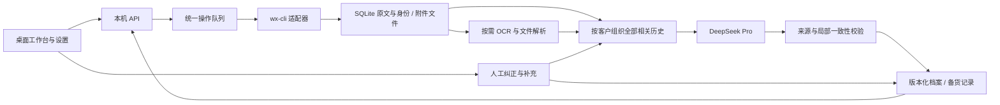

# 实施方案与验收顺序

更新：2026-11-12（北京时间）。依据 [产品方案](PRODUCT_DESIGN.md) 和 [交互方案](INTERACTION_DESIGN.md)。本文件定义接下来的实现，不代表真实服务已存在。

## 1. 当前交付与待实现部分

| 已有                                                   | 仍需开发／验证                     |
| ------------------------------------------------------ | ---------------------------------- |
| 桌面原型、React两页与共享控件；SQLite/schema4及身份API | 原文浏览、手动导入及真实客户档案   |
| wx-cli只读归档、修订、游标、群上下文及身份版本         | 附件获取与解析、模型档案与质量验证 |
| 持久化同步操作、后台worker、进度、停止及历史查询       | 日调度、完整租约恢复及继续／重试   |

M0来源有限采样、M1双次11条归档、2411位联系人读取及任务4后台执行已有Mac证据。当前为M1任务5联系人来源／名称问题修复，任务6未开始；详见[当前实施状态](STATUS.md)和[本轮审查](verification/2026-11-12-contact-names-review.md)。原型数据保存在浏览器，已交付的真实后端数据由本机SQLite管理。不能把示例状态和计时器直接接上真实消息后宣称完成。

## 2. 本轮工程选型建议

- 后端：Python 3.12 + FastAPI + Pydantic；SQLite 存储与事务；FTS5 支持联系人／原文检索。
- 前端：React + TypeScript + Vite。按原型拆共享控件和页面；业务状态集中管理，避免继续靠替换整块 DOM 维持交互。
- 执行层：同一后端中的持久化队列与单个后台 worker，初期串行处理客户。队列与整理策略解耦，后续可扩展不同客户间并发，不预先部署 Redis 或多 Agent 框架。
- 模型：DeepSeek Pro，经模型网关和独立 provider adapter 调用。首版是固定整理流程；上下文、模型协议、整理策略及发布层分开，后续可替换模型或试验受限 Agent，不重做数据底座。实际 API model ID、上下文和图像能力先核验。具体调用、缓存及升级口径见 [模型执行方案](MODEL_EXECUTION.md)。
- 来源：wx-cli adapter 隔离源端版本和返回结构，模型不能直接操纵源服务。
- OCR／文档解析：独立 adapter，输出带原附件定位的文本和表格，避免假设聊天模型支持一切媒体。
- 部署：本机单应用，同源提供 API、静态页面和受控附件访问；绑定 127.0.0.1。建议应用端口 8000，源端地址可配置，最终以本机端口检查为准。

这些是实施默认选型，不引入重建前的业务代码或数据结构。已有静态原型继续作为验收参照。

## 3. 最小架构

核心边界只有：来源归档、联系人与归属、资料组织、模型整理、档案读写、操作控制。模型通过统一网关调用，只有校验与发布层可写正式模型档案。将来 Agent 复用同一上下文与输出契约，不直接改库。

## 4. 数据底座

| 数据域           | 必须保存的内容                                                                   |
| ---------------- | -------------------------------------------------------------------------------- |
| 工作账号与联系人 | 稳定 ID、源端备注／昵称、人工身份及修改时间；按账号隔离                          |
| 会话与原文       | 会话类型／名称、成员关系及可信度、发送人、时间、稳定消息标识、原文修订、引用关系 |
| 附件与解析       | 文件引用、哈希、原件／缩略图、获取／解析状态、提取内容及页码／单元格／图片位置   |
| 事实与档案版本   | 目标联系人、事实所属批次、值、时间、来源引用、不确定性、输入版本、模型／提示版本 |
| 人工内容与备货   | 固定字段纠正、按组补充资料、原始模型值、关联单号、批次阶段、修改记录             |
| 操作与检查点     | 范围、目标、任务状态、步骤、输入清单、完成数量、最后活动、可用操作、失败原因     |

输入快照、分段结果和模型调用单独落盘：记录输入／输出结构版本、策略、提示词、模型配置、结束原因、重试、token 及耗时。覆盖率根据程序中的输入与实际处理记录计算，不能直接信任模型自报“全部读完”。

原文修订追加保存，档案引用确定版本。附件文件存在本机工作目录，数据库存引用；前端按附件 ID 访问，不接受任意磁盘路径。

当前状态以真实输入清单版本比较，不能沿用原型 `fresh` 布尔值当生产判定。清单包括相关消息版本、附件解析版本、参与人身份和人工约束版本；模型、模板和策略版本另行固定。新策略启用不自动全量重跑，通过显式重算入口选择范围。

SQLite 迁移和档案 JSON 结构均版本化；升级前生成一致性数据库备份及附件清单，M5 验证在独立目录恢复。重算只增加派生结果版本，不删除原文或人工修改。

## 5. 来源与身份实现

1. 读取源账号及能力，确认本次工作账号，不把另一账号资料混入。
2. 分页获取会话与联系人，读取备注、昵称和群名；群成员及发送者映射能力单独验证。
3. 按来源标识幂等归档消息，保留原文、上下文和修订；进度落盘后再推进游标。
4. 无稳定服务器消息 ID 时使用该源明确可用的稳定本地标识组合，记录其能力边界；不能按正文哈希全局去重。
5. 记录每个会话同步成功／部分完成／失败。一次查询成功不代表全历史齐全。
6. 新资料关联到商家后，计算输入清单变化；源端未成功查询时不能报告“无新消息”。

单客户同步优先私信和已知相关群，发现引用关联后补充必要上下文；仍按来源归档，不能制造一份客户私有的聊天副本。共享群同步按会话串行推进游标，归档的新消息也可能使其他商家进入待更新，但本次只分析目标商家。

联系人归档增加结构性标识校验：明显异常标识隔离为`contacts.identity_state=quarantined`，原文和人工身份保留。联系人列表、身份修改、操作目标和分析规划只接受active联系人；后续原文浏览／模型上下文须继续遵守该边界，历史异常发送人不能被当作有效人物或事实归属。无好友卡的有效群发言人可以读取已知关联会话，但群覆盖不明仍显式报告。

CSV／JSON 导入复用同一归档层，保存来源批次与行号。导入接口不直接写模型总结或覆盖人工身份。

## 6. 模型执行链路

详细设计见 [模型调用、上下文与升级方案](MODEL_EXECUTION.md)。下列规则与该文件共同构成实现契约。

### 6.1 输入组织

- 目标：明确的 account ID、contact ID 与人工身份。
- 材料：从首次接触开始的相关私信、群聊连续上下文、引用、图片／文件解析及具体缺口。
- 每条材料标明发送者稳定身份、我方／商家／服务商／平台、会话、时间和来源 ID。
- 群聊按目标客户组织上下文，不只取客户发言，也不把整群所有需求归给目标人。
- 加入上版档案和人工纠正作为参考，但原文仍是核对依据；聊天内容不作为执行指令。
- 请求不依赖供应商会话记忆。先冻结输入快照，再按“规则与模板 → 人工约束 → 既有记录 → 带来源的历史材料”组装；每次调用关联到快照、分段和步骤。

先核算输入、输出预留和安全余量，实际窗口内可装入的客户直接整理。超过窗口时，按时间和连续话题切分，引用与跨段上下文保留重叠，保存分段覆盖清单。禁止静默截断，也不能只用关键词 Top-K 代替首次相关历史扫描。

分段先整理事实与对应来源，再汇总档案；事实仍超窗则按字段组／批次分别归纳。最终汇总可以回读原文，不依赖反复压缩摘要。某段失败要保留已经完成的结果，报告具体缺口，不能把整位客户归零。处理覆盖与业务准确率分别衡量，全部分段执行不等于没有漏提。

### 6.2 输出契约

输出结构版本化，模型返回 `contact_id`、`goods`、`logistics`、`communication`、`shipments`、`gaps`；后端添加根据处理记录计算的 `coverage`。

- `contact_id` 由任务固定，模型不能创建或合并联系人。
- `goods` 与 `logistics` 的固定键一一对应产品模板，不增加企业／项目层。
- 每项结论包含 `value`（可空）、`state`（known / uncertain / not_mentioned）、`sources`。
- `sources` 引用真实消息版本；附件事实还要引用附件及定位。不让模型伪造外部链接。
- `communication` 含当前摘要、有效沟通标签及最近业务时间；没有证据时可为空。
- `shipments` 支持多批，各有稳定标识、内容、时间、单号、阶段和来源。后续更新匹配既有记录，不能每次生成一套新批次。
- `gaps` 写具体缺失及影响；`coverage` 记录已处理、失败、未处理的来源／分段及未理解附件，不由模型一句“已读完”决定。
- 人工补充不由模型代写为聊天事实；展示值与原始模型输出分开保存。

### 6.3 校验与发布

先检查结构、目标、引用存在性和覆盖范围，再做数字／单位／运输术语／时间的局部核对。不能只因为某个数字、单号或单位格式不同，就隔离整份客户档案。

对金额、货量区分原值和有依据的换算，保留原单位；发车日期、系统登记日期和预计到达日期分别处理。

局部不确定项保留为具体疑点；明确的已发货证据不因无关字段缺失而丢失。请求失败或模型只返回空泛内容时保留原档案，不用空对象覆盖。

发布前检查任务未停止、执行令牌有效、联系人仍是商家、人工修订及引用的历史版本没有冲突。写入新档案版本与分析检查点使用事务。只有新消息追加时允许发布已处理快照，同时保留待更新；不能把新消息标记为已整理。

### 6.4 调用与后续升级

统一网关处理供应商协议、超时、有限重试、结构修复、用量及取消。初始连接超时 15 秒、请求总时限 300 秒；临时网络错误等每次调用最多 3 次尝试，结构修复一次、上下文重排最多两次，并受每个工作单元最多 6 次实际供应商请求的总限额约束。鉴权及不支持参数不自动重试。细节和补读边界见模型执行方案。

上下文快照、统一分析结果、`AnalysisStrategy.run` 是升级边界。先固定流程，再按真实问题优化分段／检索、不同客户间并发；Agent 只作为可回放比较的候选策略，使用本客户只读资料工具，经过相同校验与发布。升级必须通过真实样本比较和回退验证，不能把“换 Agent”当准确性保证。

## 7. 统一同步与操作控制

前端不自己推断运行状态。后端统一返回资料状态、执行状态与 `available_actions`，页面、弹窗、日调度复用同一操作入口。

### 7.1 执行状态

`queued → running → succeeded`；运行可进入 `stop_requested → stopped` 或 `failed`。

- `stopped` 且有未完成步骤才允许继续。
- 失败允许重试具体目标，不能卡死所有其他客户。
- 成功且无新资料不重跑；重试失败任务不被成功去重规则挡住。
- 来源同步、附件解析和模型整理分别有完成结果，不混成一个模糊“已完成”。
- 批量内单客户失败不阻塞其他人；总任务只有全部目标成功才为 `succeeded`。部分完成显示已完成／失败／停止数量，允许重试未完成目标；有局部可用档案也不掩盖剩余缺段。

### 7.2 执行顺序

全局和单客户都走：**读取源端 → 归档并判断变化 → 组织商家资料 → 模型整理 → 校验发布**。

同一客户不会并发执行两份分析。用户在批量期间指定客户时，将该客户提升到下一可执行位置；若正处理该客户则打开现有进度，不重复请求。

停止时立即停止调度后续步骤，当前网络请求尽可能取消；原始归档与已完成客户保留。已经发出的模型请求可能仍产生用量，结果不得在停止后误发布。尚在排队的任务直接停止，不为它发请求；恢复生成新的执行令牌。

重启通过持久化检查点和带租约／执行令牌的运行记录恢复。旧 worker 不再拥有租约时，其迟到响应不能写入。应用初期只允许一个拥有执行权的 worker；开发热重载也不能启动第二个调度器。租约过期的任务显示“运行中断，可继续”，不无提示自动重发模型请求。

### 7.3 日调度

保存 IANA 时区 `Asia/Shanghai`、HH:mm 和启用状态；每天最多产生一次该计划的检查。启动时发现错过当天计划，补检查一次。

调度与人工操作统一去重。当前已启用版本下没有待处理输入时跳过模型调用；切换模型或模板不会自动引发全量重算，需显式选择范围。关闭自动整理只停止新计划，不伪造正在运行任务已经停止。错过多天只合并补一次来源检查；应用未运行时不承诺后台执行。

## 8. API 边界草案

账号、来源、身份和操作接口在 M1 固定，档案字段契约在 M2 固定；前端不直接访问 wx-cli 或模型。

| 接口                                   | 职责                                                                                            |
| -------------------------------------- | ----------------------------------------------------------------------------------------------- |
| GET /api/settings、PATCH /api/settings | 来源、模型配置状态、日调度及外观偏好                                                            |
| POST /api/source/check                 | 检查真实账号／连接／能力，不调用聊天模型                                                        |
| GET /api/contacts                      | 搜索、身份、资料状态、分页（最大20）                                                            |
| PATCH /api/contacts/roles              | 按稳定 ID 批量设置身份，返回实际成功与失败                                                      |
| POST /api/operations                   | action=sync_and_organize / reanalyze / stop / resume / retry；新建带 scope，控制带 operation_id |
| GET /api/operations/{id}               | 状态、步骤、进度、错误与可用操作；前端可轮询                                                    |
| GET /api/contacts/{id}/profile         | 当前档案、批次、来源与具体缺口                                                                  |
| PATCH /api/contacts/{id}/manual        | 带期望版本修改固定字段／补充资料，冲突返回明确错误                                              |
| GET /api/contacts/{id}/messages        | 按时间查原文及附件引用                                                                          |
| GET /api/attachments/{id}              | 受控查看原件或解析位置                                                                          |
| PATCH /api/shipments/{id}/numbers      | 保存多个去重单号，不改变阶段                                                                    |
| POST /api/imports                      | CSV／JSON 预览、映射和导入同一归档层                                                            |

操作请求带幂等键；身份范围、账号和版本由服务端检查。配置密钥只由本机后端保存，前端不放入 localStorage，也不在诊断信息中返回密钥。

来源及模型连接可分别配置代理；检测界面能区分源端不可达、模型不可达、鉴权失败和输出契约错误。正常本地页面 GET 不应被跨站检查拦截；写操作使用同源校验。

`reanalyze` 不重新抓取微信，用于指定范围的模型／模板升级或人工复算；关联输入版本及策略版本，复用统一队列。读取档案同时返回分析完整性、来源缺口和版本；人工写入使用期望版本，冲突不静默覆盖。字段级输出结构在 M2 固定，账号／来源／身份与操作 API 在 M1 固定。

## 9. 开发阶段与完成条件

| 阶段               | 交付                                                                       | 完成条件                                                                             |
| ------------------ | -------------------------------------------------------------------------- | ------------------------------------------------------------------------------------ |
| M0：真实能力核验   | wx-cli 版本／响应样本、媒体样本、DeepSeek Pro 实际 ID 和能力、环境依赖     | 明确能读什么、哪里缺失；不以模型名称假定能力；依赖由真实解析生成锁文件               |
| M1：底座与联系人   | SQLite 迁移、来源归档、联系人归一、身份 API、真实同步与浏览、前端公共组件  | 同步幂等、私信群聊不重复人、同名不误合并、名称可定位；未连接不显示成功               |
| M2：单客户闭环     | 输入快照、调用网关、Pro 整理、字段／来源契约、独立批次、原文查看、人工修改 | 一位真实商家跑通并回放同群归属和新旧批次；结构合法不能代替语义验收；人工内容重启保留 |
| M3：长历史与附件   | 分段覆盖、检查点、图片 OCR、PDF／表格解析、缺口和重试                      | 长历史覆盖可证明；附件成功与缺失如实展示，失败不抹掉文本事实                         |
| M4：批量与每日更新 | 统一队列、单客户优先、启停／恢复、日调度、用量记录                         | 无重复任务、无幽灵运行／继续；无新增不调用模型；睡眠及重启后可恢复                   |
| M5：真实样本与交付 | 10位样本及保留测试集、版本重算与回退、备份恢复、桌面回归、部署指引         | 关键回归零错、引用支撑结论、纠正不丢；报告错提和漏提；不将合成测试当真实质量验收     |

每阶段先在云端跑通代码与自动化测试，再按接口依赖继续；Mac 实机验收单独记录，不能冒充已通过，但不阻塞可独立开发模块。原文与身份先于模型；一位客户闭环先于全量批量。开发过程中不重新扩展待办、白名单或复杂 Agent 功能。

## 10. 必测回归

- 源端报错不能显示“没有新消息”；模型接口连通与微信源连通分开判断。
- “已经发出，因装得晚今天登记出库”及订单轨迹“已发车／已出境”识别已走货。
- 卡航方案已接受，同时询海运：保留两个时间点与不同诉求，不误写成汽运。
- 老订单轨迹查询不新建需求；同一商家有新一批则独立建记录。
- 同群多位商家的货量、报价、单号不串人；服务商答复不被预过滤。
- 已走货不让整位客户退出后续新需求识别。
- 停止期间改成非商家、并发编辑人工资料、程序中断重启：不发布过期结果。
- 模型一项引用错误、一个附件失败：其余可核对资料仍可保留，不全客户隔离。
- 统一五类填写框、时间选择、来源收起展开、列表局部切换、深浅色、较矮窗口与减少动态效果。
- 字段变化只是旧批修改；多个活跃需求与“暂无新需求记录”不能冲突；处理覆盖不冒充语义正确。
- 超窗、输出截断、结构错误、429、超时和停止后迟到响应；不静默裁剪、不无限重试、不重复发布。
- 新模型回放、显式批量重算、失败回退、恢复备份；人工资料和批次稳定 ID 不丢失。

## 11. 实机验证清单与实施入口

下表明确尚未取得的证据及如何关闭验证项；目前均为待验证，不能从原型、仓库名称或文档设计推断已完成。

| 验证项             | 怎样验证                                                         | 必须产出的证据与通过条件                                                                | 阶段／未通过的处理                                |
| ------------------ | ---------------------------------------------------------------- | --------------------------------------------------------------------------------------- | ------------------------------------------------- |
| wx-cli 接口与账号  | 在用户 Mac 读取真实版本、能力及一个私信和群聊分页样本            | 脱敏响应、实际命令／接口、账号 ID、分页及错误行为；确认只读范围                         | M0；先补适配，不伪装连接成功                      |
| 联系人与消息身份   | 用同人跨会话、同名两人、改名及引用消息回放                       | 稳定 ID、发送者／我方映射、群名来源及去重依据；不串人、不重复原文                       | M0–M1；不可定位部分保留缺口，不推测名称           |
| 历史覆盖与增量游标 | 首次多页同步、重复同步、追加及修订消息、途中中断后恢复           | 每会话范围与游标、重复数、失败段；成功落盘后推进游标，重复同步幂等                      | M1；覆盖不足明确展示，不能称全量完成              |
| DeepSeek 实际能力  | 官方文档及实际账号可用模型核对后，发送一个最小真实请求           | endpoint、实际 model ID、日期、窗口／输出限制、结构化输出与参数支持；记录真实响应和用量 | M0；未取得可用模型不替换为假 Pro，不宣称已接入    |
| 图片与文档         | 用真实图片、缺失原件、PDF、CSV／Excel 样本分别取文件并解析       | 来源到原件／缩略图及解析位置可追溯；区分未获取与未解析；视觉能力单独实测                | M0、M3；按格式降级和报缺口，保留文本事实          |
| 档案和批次质量     | 从一位真实客户闭环开始，逐步建立首轮样本及独立复测集             | 事实、原文、批次人工期望；报告正确、错误、漏提与未知；关键回归零错                      | M2–M5；未通过时修上下文／模板，不直接扩大全量运行 |
| 规模、耗时和用量   | 记录联系人／群数、消息与附件量、典型及最长历史，跑一轮代表性样本 | 同步、解析、分析分段耗时，P50／P95、请求及 token、日更新是否可完成                      | M2–M4；先量测瓶颈，再选并发／存储升级             |
| 生命周期和恢复     | Mac 应用退出、睡眠、断网、重启、停止及备份恢复                   | 计划只补一次、无幽灵运行、迟到结果不发布、恢复后人工内容仍在                            | M4–M5；先修恢复路径再无人值守                     |

M0 交付一份包含日期、版本、样本和明确结论的本机能力核验记录；没有实测的格子继续标待验证，不能填占位成功。M1 按明确的内部契约建归档及身份底座，通过回放测试开发；源端未知映射保留待验证。M2 再固定模型输出结构并回放。当前可开始的是这些工程验证和底座任务，不是直接给全部聊天启动分析。

开发执行采用已安装的 Superpowers 项目技能，见 [开发工作流](DEVELOPMENT_WORKFLOW.md)。本文保留架构与里程碑，逐任务开发见 [M0–M5 六阶段计划](superpowers/plans/README.md)。当前M1小范围真实归档及幂等已在Mac通过；任务3联系人读取及任务4后台同步已在Mac通过；任务5正式桌面页面云端完成、待实机验证，下一任务为原文浏览及导入，模型和媒体仍待实测；后续在云端串行开发、自动测试后直接推 main，用户本地仅 pull 验证。六份计划固定内部契约，源端和模型真实协议必须有证据；缺实机时继续可独立开发部分，把真实接入标待验证。实际能力不符时在云端更新适配和依赖计划，不以猜测补齐接口。提交和推送按当前用户指示及会话授权执行。
