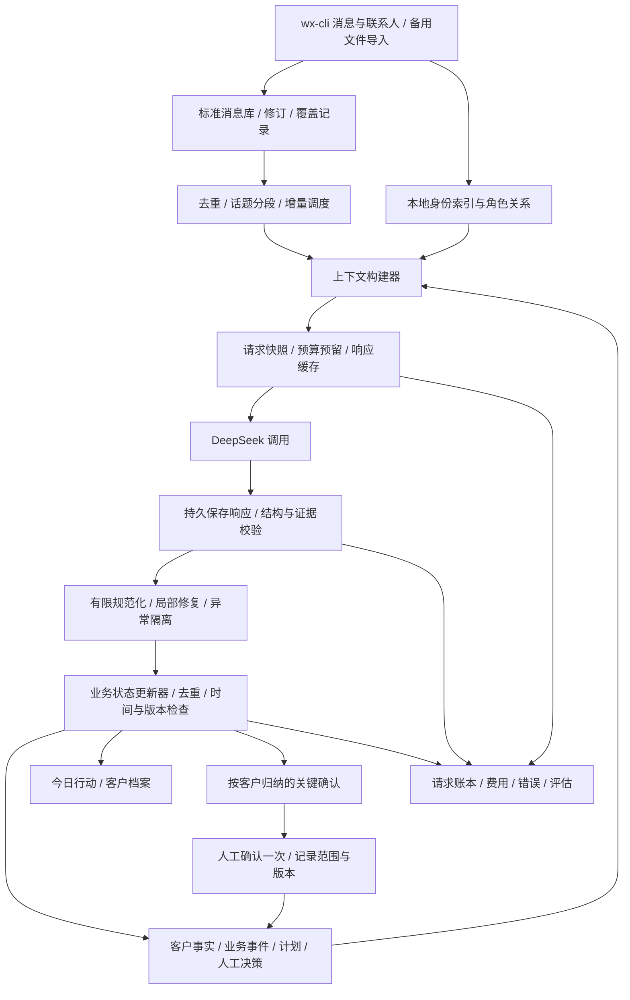

# 半托管欧区备货用户助手：模型请求与客户分析 Harness 方案

状态：**待审阅的目标设计，尚未实施**。日期：2026-11-05（北京时间）。当前已发布代码为 v0.5.2；本方案描述下一轮整体改造，不代表现有功能已经具备。未完成的身份／确认项代码草稿已单独保存，本次只提交文档。

## 1. 结论与业务目标

建议增加一个轻量、有状态的业务 harness，即包在模型外围的执行管理层，统一管理输入、身份、上下文、调用、校验、恢复、业务写入、人工反馈和评估。DeepSeek 负责理解、抽取与提出建议；harness 决定允许读什么、是否需要调用、哪些结果能生效、失败如何恢复。

产品链路保持：

> 微信记录持续进入 → 自动识别客户与需求 → 维护有证据的客户档案 → 更新跟进计划与待办 → 今日该联系谁 → 新回复和少量人工确认反过来更新状态。

用户不应为了让模型工作而逐群关联项目、反复解释同一个客户，或逐条批准抽取结果。默认常规处理自动完成，技术错误进入运行诊断，业务上的关键歧义才进入待确认。

首版继续使用 **本地 Mac + wx-cli + SQLite + Python worker + DeepSeek API**。先建立可测试、可恢复的业务执行流程，不要求购买服务器、更换模型或引入多个自主 Agent。

## 2. 当前代码为什么支撑不足

下面是对现有实现的检查结果，不是对实际聊天内容的推测。

| 当前行为 | 实际后果 | 改造方向 |
| --- | --- | --- |
| 采集适配器忽略 `sender_display_name`，未同步联系人接口 | 群内联系人常显示 wxid；不利于找到真实联系人 | 本地维护身份与显示名索引，模型不生成姓名 |
| 显示名回退到私信标题／ID后缀 | 名字不完整，昵称更新缺少来源说明 | 备注、昵称、群内来源分别保留，显示身份质量 |
| 同一联系人的角色主要存成一个全局值 | 同一人跨群、跨主体的角色差异容易产生反复冲突 | 身份稳定，角色按主体／会话／时间记录 |
| 确认项以问题文字和消息证据去重 | 同一客户同一问题在新分片里不断新增 | 按客户、问题类型、作用范围形成确认案件 |
| 先取全账号最近50条事实，再筛相关联系人 | 繁忙客户挤掉其他客户的事实，目标客户可能没有记忆 | 先定位客户，再按字段和预算读取相关记忆 |
| 人工确认仅在再次读取相同消息时加入上下文 | 用户已经解释过，换个群或新消息又问一次 | 将确认保存为有范围、有版本的客户决策 |
| 主要依靠固定消息窗口和少量前文 | 跨群承诺、报价反馈和旧任务完成情况容易断开 | 话题分段 + 客户记忆 + 有限相关原文检索 |
| 输出字段异常可能让整个分片失败 | 合法档案也无法落库，重复请求已经消耗token | 分层校验、依赖隔离、有限局部修复和响应回放 |
| 模型响应未形成完整本地回放资产 | 修复解析代码后通常只能重新请求模型 | 保存请求快照和响应，优先本地重校验 |

现有身份／证据校验、队列租约、预算和代理处理继续复用。需要重构的是它们之间的组织方式，以及客户状态的持续管理。

## 3. 总体结构



默认一条主模型请求同时返回事实、业务事件和行动建议，不把每一步都变成一次大模型调用。客户页面摘要可先由已存事实确定性渲染；只有需要解释复杂变化时，才安排单独的摘要更新，且不阻塞今日行动。

## 4. 各模块的明确职责

| 模块 | 输入 | 输出／职责 |
| --- | --- | --- |
| Source Adapter | wx-cli可见数据、标准导入文件 | 标准消息、来源元数据、修订与覆盖情况 |
| Identity Registry | wxid、联系人备注／昵称、消息显示名 | 稳定联系人、可核对显示名、角色关系；本地保存 |
| Scheduler | 新消息、历史缺口、人工决策变化、预算 | 有优先级、可恢复的分析单元 |
| Context Builder | 分析单元及相关客户 | 有边界的输入包与上下文清单 |
| Model Gateway | 输入包、模型／契约版本 | 统一代理、证书、超时、预算、调用记录和响应 |
| Validator | 原始响应、允许引用集合 | 可用事实／事件／建议、隔离项、明确错误 |
| Business Reducer | 已验证事件、当前状态、人工锁定 | 客户档案、计划、任务新增／更新／关闭 |
| Review Manager | 影响业务的歧义 | 客户维度确认案件、合并证据、可应用的人工作用结果 |
| Memory Store | 事实、事件、人工决策、派生摘要 | 可追溯、有版本、可重建的客户记忆 |
| Evaluation / Observability | 请求及写入记录、样本标注 | 运行诊断、成本、质量评估、版本对比 |

所有业务写入通过状态更新器完成；模型没有直接执行SQL、发送微信或调用任意工具的权限。

## 5. 身份与客户名：先解决“到底是谁”

### 5.1 身份对象分层

- **联系人**：同一工作账号下的稳定微信身份。昵称、备注变化不会改变联系人ID。
- **客户主体**：商家个人或公司／店铺，可关联多个联系人；没有公司名也能先建立可用档案。
- **关系**：联系人代表哪个主体、在哪个会话、什么时间担任什么角色。同一人可以同时有商家和服务商关系。
- **机会／需求**：某个客户当前要推进的一项业务，不能直接用群ID代替。
- **会话**：提供沟通证据。一个群可以有多个客户，一个客户可以跨多个群和私信。

初始没有可靠组织信息时，按稳定联系人建立工作档案，不凭同名合并公司，不把整个群归给其中某一个商家。

### 5.2 显示名来源

本地展示优先级：**用户明确设置的称呼 → 微信备注 → 微信昵称 → 当前消息可核对的显示名 → 有效私信会话标题 → 待识别联系人及来源群**。微信号／wxid作为辅助定位字段展开，不成为默认唯一展示内容。

昵称是显示标签，不是商家身份的事实依据。公司名从聊天提取后作为带证据的公司候选，与联系人称呼分开，不能用一段猜测的公司名覆盖联系人。

已核对候选 wx-cli 代码提供 `/api/v1/contacts`，包含 `user_name / remark / nick_name / alias`，消息包含 `sender_display_name`。这些字段仍需在用户当前版本实机验收。群名片仅在源端实际提供时使用，不虚构一个尚不存在的群成员接口。

联系人元数据初始化同步一次，随后低频刷新；新消息携带的显示名可补充缓存。姓名刷新只更新本地展示，不重跑全部聊天分析。无法获取昵称时显示“待识别联系人 · 来源群”，并允许直接查看其发言和修正称呼。

### 5.3 页面必须让人能找回微信对象

客户卡／确认卡显示：联系人称呼、公司候选（如有）、最近出现的群或私信、最近一条相关业务原话。展开可查看微信稳定ID和多会话时间线。用户修正一次称呼后统一更新相关页面，不改变历史证据和客户主键。

## 6. 上下文如何管理

### 6.1 每次调用的四类输入

| 内容 | 作用 | 边界 |
| --- | --- | --- |
| 当前待处理原文 | 本次新增事实和业务变化的直接依据 | 按话题／时间／回复链组织，保留否定、条件、数量和时间 |
| 当前客户记忆 | 已知需求、顾虑、关系、当前计划、已关闭事项 | 先筛客户再读取；按字段优先级和预算选择，不取全账号最近N条 |
| 必要的相关原文 | 解释“上次报价”“那一批”“之前答应”等指代 | 只读同一客户相关且获准的会话，限制条数、时间及总量 |
| 人工决策与约束 | 已确认角色、归属、改期、拒绝联系、字段修正 | 作用范围和版本明确，对后续新消息持续生效 |

消息窗是计算边界，客户记忆是连续性来源。每个分片都使用相同的稳定联系人别名；跨群、私信不能换一套身份再重新猜客户。

### 6.2 记忆分层

1. **原始证据层**：消息ID、修订、时间、源序号、会话、发送者和附件状态。作为事实依据保留，不由模型改写。
2. **事实与事件层**：对方报告的需求、提出请求、我方承诺、答复、改期、取消等，带证据和有效时间。
3. **当前状态层**：有效需求、现存机会、阻塞、开放／等待／关闭任务，由事件与规则更新。
4. **人工决策层**：明确的归属、角色、字段修正、拒绝联系、改期和关闭决定，优先级高于模型推断。
5. **摘要层**：为了读得快生成的压缩视图，必须能指回事实；摘要不是新的证据，也不能覆盖人工决定。

### 6.3 上下文选择顺序

1. 确定本次说话人、私信对端、明确引用对象及已有关系。
2. 从这些稳定身份定位客户；不明确时保留会话级线索，不强行归给一个客户。
3. 读取这些客户的当前关键事实、人工确认、未完成任务和相关已关闭事项。
4. 遇到确有指代缺口，再检索相关会话原文；按客户、机会、引用、时间和业务词排序。
5. 为输入中的人物与会话建立别名，组装当前原文和上下文。
6. 记录本次选了哪些来源、为什么选、哪些因预算或权限未纳入。

检索必须同时过滤工作账号、会话可读状态和分析授权；排除的会话不能通过摘要或跨群检索又被间接送出。

### 6.4 初始上下文预算

建议目标输入预算约8,000 token、输出上限沿用已验证的模型配置；它们是可调起点，需根据真实请求用量校准。输入预算优先分配当前原文，其次为人工约束、当前状态和补充原文。

不按一个固定消息数承诺理解完整话题。超长单条消息按可定位的文本片段处理，保留源消息ID、修订、字符范围及必要重叠；价卡表格的单位／条件尽量与数值保持在同一片段。源原文始终保留，不通过静默截断冒充全文已理解。

事实过多时按客户轮流分配额度，完整纳入选中的事实或原文，不截掉句尾的否定／限定条件。无法纳入的信息记录为上下文缺口。

### 6.5 时间与顺序

“明天／下周三”按原消息时间与北京时间解析，不按分析当天。优先使用源端稳定排序字段；只有秒级时间时标记时序不确定，不能把随机本地UUID顺序当成真实对话顺序。

历史补齐先重建已有答复、取消和改期，再判断当前动作。较早证据不能重新激活已经被较新证据取消的事项；人工关闭和改期持续受保护。

## 7. 一次模型请求的完整生命周期

### 步骤1：触发与去重

触发来自新增／修订消息、相关人工决策、待补历史或指定版本的回放。重复采集、昵称变化、打开页面、调整日预算，都不应重新分析整份历史。

优先新回复和近15天未处理需求；更早历史渐进补齐。短时间内同一客户连续来消息可合并调度，避免每条消息都请求一次。

### 步骤2：身份与授权检查

核对源账号和授权范围；加载稳定身份和关系。身份缺失可以继续归档，不能冒充已识别客户。原文及元数据的可读状态和业务归属分开管理。

### 步骤3：构建上下文快照

产生不可变输入快照：源消息及修订、相关客户状态版本、人工决策版本、允许的身份／证据别名、提示词版本、输出契约版本和输入选择清单。

### 步骤4：查本地可复用响应

相同有效输入有已保存响应时，先重新校验／重放，不直接调用API。解析器或枚举兼容修复后，也优先使用此前响应验证新代码，减少再次付费。

### 步骤5：预算与传输检查

按实际请求估算输入、输出与可能的有限修复预留。网络配置沿用已验证的模型专用代理；自检与模型调用使用同一代理和CA规则。本地wx-cli不使用模型代理。

### 步骤6：调用DeepSeek

默认只发一次主请求，要求返回结构化事实、业务事件、行动变更建议和关键歧义。模型只能使用输入已有的身份／证据别名；未知字段留空，不创造身份、报价和承诺。

### 步骤7：先保存响应，再解析

收到结果后先保存本地响应与服务商usage、finish_reason等元数据，再做业务校验。HTTP成功但结构错误也可能已经产生用量，必须如实记账。

### 步骤8：分层校验与局部恢复

依照下一节校验。可确定的角色别名在本地规范化；需要模型修复时最多一次，且仅针对失败项和必要证据。与失败项无依赖的合法信息继续处理。

### 步骤9：更新业务状态

验证源修订、角色关系和人工约束仍有效，事务性写入事实／事件，计算客户档案、计划和任务变化。模型建议不能直接覆盖现有状态。

### 步骤10：反馈与后续调度

常规结果进入客户／今日行动；关键业务歧义归入客户确认案件；技术错误进入运行诊断。新事实造成当前状态变化时更新摘要，保持客户记忆可复用。

## 8. 输出契约与校验

### 8.1 输出对象

| 对象 | 主要内容 | 生效条件 |
| --- | --- | --- |
| 身份／角色观察 | 已有actor别名、所在关系与角色 | 只能引用输入身份；不输出猜测姓名作为主身份 |
| facts | 字段、值、reported／inferred、有效时间、证据 | 字段允许、值类型正确、归属明确、引用有效 |
| events | 请求、承诺、答复、改期、取消、对方报告节点等 | 参与者和机会可定位，时序与语义成立 |
| action_changes | 新建、更新、等待、完成、取消 | 匹配现有任务／机会，检查版本、证据和人工状态 |
| ambiguities | 问题类型、客户或联系人、作用范围、候选、证据 | 仅收集真正影响业务决策的歧义 |

责任方保持规范枚举：`self / merchant / service_provider / other / unknown`，不使用昵称或微信ID作为角色。联系人ID、公司归属和责任方是不同字段。

### 8.2 五层校验

1. **响应完整性**：HTTP状态、JSON可解析、未截断、契约版本可支持。
2. **字段结构**：字段类型、枚举、长度、必填项；只做白名单内的确定性规范化。
3. **引用完整性**：人物、客户、任务、证据别名都来自本次允许集合，且账号一致。
4. **证据有效性**：原消息／修订／片段可回查，来源仍获准，事实归属明确。
5. **业务约束**：日期、报价适用范围、跨批次隔离、禁止联系、人工锁定和完成口径。

“有引用”只证明引用存在，不等于语义正确；语义支持需要规则检查与真实样本抽评共同验证。

### 8.3 单个字段出错不再直接拖垮整个客户

- 响应JSON完全损坏或截断：整份响应暂不可写入，进行一次有预算的受控恢复。
- 一个行动的`party`不合法：隔离该行动，独立且合法的客户事实可以生效；只修复这条行动。
- 一个联系人引用不合法：该联系人及依赖其归属的结果全部隔离，其他无依赖客户可继续。
- 价格／数量／业务完成依据不可靠：不进行“容错猜值”，保留待核验状态。
- 技术修复仍失败：记录具体失败阶段，供维护处理，不要求用户逐条审批模型格式。

## 9. 请求与响应示例（全部虚构）

输入包结构示意：

```json
{
  "contract_version": "crm.v3",
  "timezone": "Asia/Shanghai",
  "analysis_as_of": "2026-11-05T09:00:00+08:00",
  "participants": [
    {"actor_ref":"C001","role_in_conversation":"merchant"},
    {"actor_ref":"C002","role_in_conversation":"service_provider"}
  ],
  "customer_memory": [{
    "customer_ref":"CU001",
    "contact_refs":["C001"],
    "facts":[{"fact_ref":"F001","field":"market","value":"德国","kind":"reported"}],
    "open_actions":[{"action_ref":"A001","summary":"确认本批派送费","state":"waiting_external"}],
    "human_decisions":[{"decision_ref":"D001","field":"company_membership","value":"已确认属于CU001"}]
  }],
  "messages": [
    {"ref":"E001","conversation_ref":"G001","actor_ref":"C001","time":"2026-11-05T08:50:00+08:00","text":"上次那批德国普货，派送费确认了吗？"},
    {"ref":"E002","conversation_ref":"G001","actor_ref":"C002","time":"2026-11-05T08:55:00+08:00","text":"还需要确认偏远地址附加费，暂时不能按全包费用回复。"}
  ]
}
```

期望处理：补充“仍需确认偏远附加费”的事件与阻塞，维护现有任务A001的等待状态及合理复查，不再新建另一个“确认派送费”任务，不把报价条件标为全包，不把服务商C002建立成商家客户。

新增事实只能使用原文E类引用。F／A／D是历史事实、任务和人工决策的上下文引用，不能被包装成新的聊天证据。真实微信名字与别名映射留在本地，页面展示时还原。

## 10. 客户状态如何持续更新

业务状态更新器读取验证过的事件，并与当前状态比较：

| 新证据 | 自动更新 |
| --- | --- |
| 新需求出现 | 建／补充客户需求，必要时建立机会和下一步 |
| 已有事项被回答 | 更新原任务，不按换句话说再新建一条 |
| 我方实际发出询问 | 记录联系；明确匹配后进入等待，不直接完成业务 |
| 商家改期或取消 | 调整／关闭对应机会动作，保留原因和证据 |
| 新回复与人工结论冲突 | 保持人工决定，归入同一个关键确认案件 |
| 旧历史晚到 | 补充过去事件，不能覆盖较新的当前结论 |
| 来源修订／删除 | 失效相关派生证据，按依赖重算，不重跑无关客户 |

任务身份综合客户、机会、动作类型、执行对象与证据链。语义近似可帮助找候选，但不能单靠文本相似度合并报价、批次或公司主体。

同一人跨群的角色按关系记录；同一人代表两个主体时保留两个主体关系。初版对无法可靠区分的归属生成一个可核对的案件，不自动把全部发言混为同一公司档案。

## 11. 待确认按客户归纳

### 11.1 确认案件的唯一性

案件键建议为：`工作账号 + 客户/联系人 + 问题类型 + 作用范围`。源消息是证据集合，不是案件的唯一性来源。

同一客户在20条消息里反复出现角色冲突，只形成一个相应角色案件，证据持续追加。角色、公司归属、报价条件属于不同类型；不为减少数量把不同实质问题强行合成一个选择。

无法安全确定客户的线索，进入“待归属 · 来源群”的独立组，不能为了归纳好看随机选一个商家。

### 11.2 默认页面

```text
王先生（微信备注） · 某商家主体（已确认或候选）
来自：A三方群 / 私信          2类待确认 · 17条证据

1. 身份角色
   系统建议：在这些待确认会话中属于商家
   [商家] [服务商] [按会话分别处理] [稍后]

2. 当前报价条件
   原条件：……  新证据：……
   [保留当前] [采纳有依据的新值] [填写修正]

[统一保存本次判断]      [展开原文与历史]
```

默认只展示影响当前行动的少量类型和差异；展开才看证据明细。没有公司名、未知偏好或低价值信息缺失，不单独催填一张确认卡。

### 11.3 一次确认如何生效

确认产生结构化决策：主体、字段／关系、值、作用会话或机会、有效时间、证据、版本和作者。姓名更正更新本地身份展示；角色决定更新对应关系；业务字段修正写入字段锁定。备注说明作为补充，不依赖模型猜测它应该修改哪个字段。

提交包含用户实际看到的案件ID和版本；期间新增证据不得在用户不知情时被一并批准。重复案件可批量处理，跨客户不允许误批。

决策作用于之后的客户上下文，不只匹配旧消息ID。后续相同冲突只更新案件，不重新铺开多张卡。用户可撤销决定并触发相关状态重算，保留审计历史。

## 12. 持久化、缓存与恢复

建议沿用SQLite事务和WAL，增加以下逻辑实体；具体表名可在实现时收敛：

| 实体 | 保存内容 |
| --- | --- |
| identities / relationships | 来源身份、显示名来源、客户主体关系、角色范围与版本 |
| analysis_units | 主消息、上下文依赖、范围、优先级、检查点、状态 |
| model_requests | 输入快照、选取清单、版本、预算预留、调用时间与传输结果 |
| model_responses | 服务商响应、usage、finish_reason、解析／校验状态 |
| customer_facts / business_events | 有来源的事实与时序事件 |
| customer_memory_snapshots | 可重建摘要、来源版本和过期原因 |
| review_cases / decisions | 客户维度案件、证据、确认决定、范围和撤销记录 |
| projections / audit | 档案／任务等派生状态的写入版本、幂等键和变化原因 |

响应缓存键包含真正影响理解的输入修订、关系／决策、契约、提示词和模型版本。昵称展示改变、网络代理改变、预算调整不单独触发全部业务重分析。

收到响应后业务写入崩溃，重启先复用本地响应完成投影；不会因为事务重试就必然再请求模型。网络超时且没有响应时，服务商可能已经计费，这种情况无法保证调用恰好一次，必须保留未确认用量。

本地业务写入通过幂等键保证重放不重复生成任务。API返回期间其他新消息到达时，独立的有效事实可追加，再按当前状态归并；与人工决定或任务版本冲突的行动建议单独重算，避免整份输入因无关变化反复作废。

当前旧版没有保存全部失败模型响应，已经发生的调用不能由新harness追溯恢复或退款。新机制从上线后的请求开始产生可回放资产。

## 13. 调度、预算与错误分类

继续沿用近期优先、有限并发和后台历史；不通过提高预算掩盖契约或网络错误。已有预算必须由用户明确调整。

| 失败类别 | 恢复方式 | 人工入口 |
| --- | --- | --- |
| DNS／代理／连接／证书失败 | 暂停相关模型连接；安全网络自检；明确未发出请求的预留释放 | 运行诊断，不进入客户待确认 |
| 401／403／402 | 区分凭据、权限与账户余额，修正后恢复 | 设置／模型控制台 |
| 429／暂态5xx | 遵循Retry-After、有限指数退避 | 通常无需人工 |
| JSON截断／结构问题 | 保存响应、有限局部修复或缩小单元 | 技术诊断；不让用户批准格式 |
| 无效身份／证据 | 拒绝关联结果，不放宽引用校验 | 技术诊断；真实归属歧义才建业务案件 |
| 报价／主体／角色等业务冲突 | 有效数据继续落库，相关决策暂缓 | 客户维度关键确认 |
| 预算不足 | 保留断点，等待额度或下一业务日 | 用量／预算页面 |

熔断要区分账号／连接、模型版本、分析单元和客户。两个独立业务歧义不应暂停全账号；同一部署版本反复产生结构错误则应暂停该生成版本并明确报告，避免批量烧预算。

一次主请求最多一次局部修复；每单元和每客户设调用／token上限。首轮优先近期15天产生可用结果，历史分析保留余量给新回复和按需话术；预算不足时不保证任意消息量都能当天完成。

### 13.1 安全与数据边界

聊天、文件和OCR文本都属于待分析数据，不能覆盖系统规则、输出契约或工具权限。首版只允许受控的本地身份／原文检索；不授予模型执行shell、直接写库、发送微信或访问任意URL的能力。

微信密钥、API key及带认证信息的代理配置不进入模型上下文。别名替换不等于业务原文已经完全匿名；外发仍以当前账号、会话和处理范围授权为界。媒体未识别时保留缺口，不把图片原件默认发给文本模型。

请求快照与响应缓存保存在本机私有数据目录，不提交Git，不进入普通日志。缓存清理策略与长期消息归档分开设置；清理缓存不能删除原始消息、事实证据或人工决定。备份和恢复要覆盖这些新增状态。

## 14. 可观测性：每次请求都能解释

运行记录需要回答：

- 为什么分析这段消息？识别到哪些稳定联系人与客户？
- 使用了哪些当前事实、人工决定和相关原文？有哪些缺口？
- 使用哪个模型、提示词、契约、上下文和状态版本？
- API是否返回、是否截断、哪些项有效、哪里被拒绝？
- 是否复用缓存或局部修复？分别消耗多少已报告／未确认token？
- 最后写入哪些客户、计划、任务和确认案件？哪些没有生效以及原因？

页面默认展示业务可理解状态；原始输入输出、技术ID与诊断放在高级详情，并保持本机受限存储。不要把完整正文、key或带认证信息的代理URL写到普通日志。

进度要分开：采集覆盖、模型已处理、校验通过、业务已更新、媒体未识别。Token有消耗不代表档案已更新；一片段有格式失败也不等于其他有效客户必须全部丢弃。

## 15. 评估与发布门槛

测试不只覆盖HTTP和JSON，也要覆盖业务状态与上下文是否选对。

| 样本／场景 | 必须看到的结果 |
| --- | --- |
| 同一联系人跨私信和多个群 | 使用同一稳定身份，相关需求可贯通 |
| 同名不同wxid | 不误合并；页面仍能用来源群及原话区分 |
| 微信昵称／备注变更 | 本地展示更新，不重跑全部模型任务 |
| 一人跨主体／跨群不同角色 | 保留范围，不能强制变成一个全局角色 |
| 同客户20条重复冲突证据 | 同类型、同范围只保留一个案件 |
| 用户确认角色后，新群消息到达 | 决策在正确范围生效，不因换了消息ID失忆 |
| 全账号其他客户很活跃 | 目标客户记忆不会被全局LIMIT挤掉 |
| 旧取消先到、更早需求后补 | 当前任务不被重新激活 |
| 单个party错误 | 独立合法档案可生效，错误行动隔离／局部修复 |
| 证据指向别的账号或不存在消息 | 拒绝写入，不能用容错放过 |
| API成功后进程中断 | 本地响应可回放，不必重复调用API |
| 会话暂停或授权撤销 | 缓存与检索仍遵循授权；新外发停止 |
| 原文修订、人工改期／关闭 | 只重算相关依赖，尊重人工状态 |

建议先建立至少30–50个有权处理的真实业务片段作为本机评估样本，覆盖正例、无行动、否定、广告、三方对接和历史状态；留出独立验证集。模拟服务测试仍保留，但不能替代真实DeepSeek效果验收。

首个验收目标：不手工建档也能在近期消息中得到可定位客户、有证据事实和正确下一步；对同一已确认问题不会持续新增卡片。人工抽评记录事实／任务准确率、漏检、跨客户污染和所需确认量，不先宣称已达到某个精度数字。

## 16. 实施顺序与现有数据迁移

### 阶段A：身份与确认体验

接入真实联系人／消息显示名，修复现有wxid档案展示；建立范围明确的角色关系；把旧待确认项安全归并成客户案件。原始问题和证据保留，不能归属的进入会话线索组。已有消息和人工任务不删除。

验收：用户能从名字、来源群和原话找到人；重复证据不再产生同类多卡；人工决定是可复用的结构化状态。

### 阶段B：上下文与模型执行

将当前 `analysis.py` 拆出上下文构建、模型网关、校验、响应缓存和业务状态更新模块；先修“目标客户记忆被挤掉”“人工确认不跨新消息生效”，再增加受限原文检索和依赖快照。

验收：可解释一次完整请求；跨群上下文、人工保护和事件时序正确；局部失败不拖垮独立结果；代码修复可回放响应。

### 阶段C：全量质量与运行稳定性

近期真实样本评估、离线回放与版本对比；优化分段、缓存、成本、召回和错误隔离；全量历史按预算推进。OCR／价卡解析继续作为独立交付，未识别媒体始终标明覆盖缺口。

迁移前做一致性备份；采用增量表和版本字段，不清空现有库。旧模型结果按其实际能力标记，不冒充已具备新契约事件。代码和界面以功能开关逐步切换，避免新旧worker同时写入。

## 17. 框架选型建议

| 选择 | 判断 |
| --- | --- |
| 只继续给API函数加分支 | 难以覆盖跨群记忆、响应回放和客户确认生命周期，不建议作为主路线 |
| 当前Python + SQLite实现有状态harness | **建议首版采用**；复用已有预算、队列、校验、备份和DeepSeek连接，明确模块边界 |
| 立即接入完整LangGraph等编排框架 | 可用于后续复杂分支和持久执行；当前单模型、单人、本地业务先验证状态模型，避免同时迁移全部运行基础 |
| 多Agent自主讨论客户事实 | 当前不作为默认路径；会增加调用和一致性管理成本，不能代替真实身份和证据 |

关键交付是身份、上下文、决策、恢复与评估能够持续工作。框架可替换，这些业务契约与可追溯状态应保持独立。

## 18. 本轮审阅重点

建议按以下默认值评审：

1. 联系人身份和姓名由本地微信元数据管理，模型只使用稳定别名。
2. 确认项按客户和问题类型归纳；一次确认明确范围，并影响后续新消息。
3. 正常路径一次主请求；复杂项最多一次局部修复，不默认串联多个模型或Agent。
4. 事实、事件、当前状态、人工决定和摘要分层保存；客户记忆可追溯和重建。
5. 模型响应本地保存并支持回放；独立合法信息可先生效，格式问题不交给用户逐条审批。
6. 先实施身份／确认和上下文核心，再基于真实样本扩大历史分析，不要求用户重建商家与项目。

本方案尚未实施。后续可按具体业务场景调整这些默认值，再分阶段改造。
