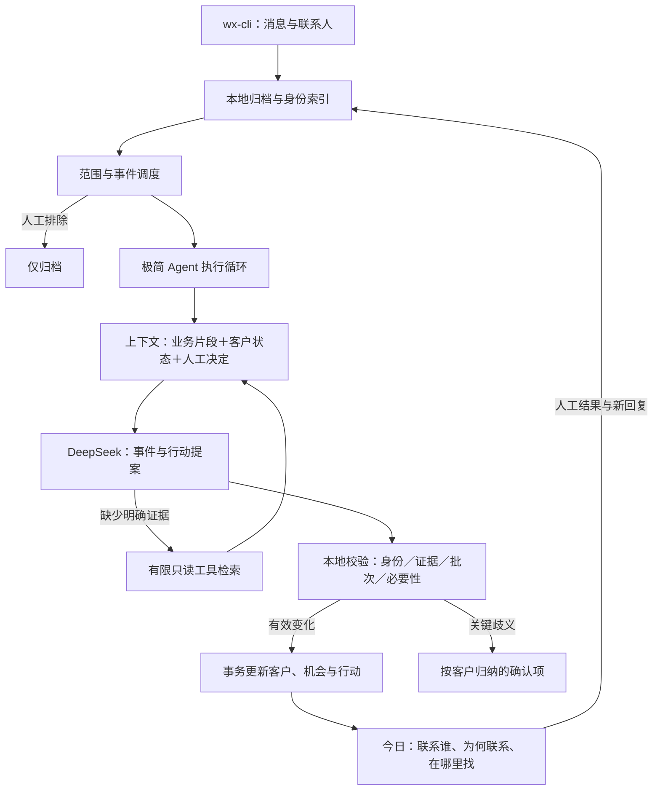

# 半托管欧区备货用户助手：整体评审与极简 Agent 改造方案

> 2026-11-08：接洽培育、客户文档单一状态源、白名单及重建以最新 [客户与批次全量重建设计](AI_CRM_DESIGN.md) 为准；本文保留极简执行、上下文和证据管理的参考。未发布的增量确认修补暂缓，先评审全量重建方案。

日期：2026-11-05（北京时间）。评审基线：`2cd2e61`，应用 v0.5.4、数据库 v8。

**状态：分阶段实施中，v0.6.0 已交付首轮基础改造；下文包含后续目标，不能视作全部上线。** 本文替代上一版模型 Harness 草案。按最新要求参考 PersonalAI 的极简方向：保留 Python + SQLite + DeepSeek，不引入新的服务器、向量数据库、多 Agent 协作或完整编排框架。当前部署方式仍以 [SOP](DEPLOYMENT_SOP.md) 为准。

## 当前交付状态（v0.6.0 / schema v9）

已实施：源消息显示名保存与联系人分页同步、客户定位卡与身份统计；独立会话范围入口、跨群人物排除、批量会话排除和恢复原授权的撤销；按参与者筛选客户记忆并补最多6条后续回复；已知机会引用、业务事件、非商家分类关卡、明确已发货同批抑制；原始响应保存与有效响应复用；时间状态标签紧凑布局及手机导航修复。

尚未实施：完整语义片段调度与全文检索工具循环、最多两次调用的统一执行状态机、确认案件结构化聚合、批次名称变化的自动实体消歧、旧结果影子重算及真实样本评估。现有分片调度和最多3次重试继续兼容；当前不是完整自主Agent。原始响应保存在本机数据库，失败响应不冒充成功缓存；尚未提供离线重校验CLI与自动保留期清理。

本轮迁移保留消息、已有成功结果、人工记录和免跟进名单；不会自动把全部存量数据再次发送给模型。源联系人同步失败不阻断消息归档，监控中以 identity 状态记录。已有名字可通过设置“刷新微信联系人”补全，不消耗模型用量。真实 Mac 接口形态与 DeepSeek 输出质量仍须实机验证。

## 1. 评审结论：目前缺的是业务判断闭环

预期链路：

> 持续归档 → 识别可跟进的商家与备货机会 → 读取该客户的相关上下文 → 提取有来源的业务变化 → 更新当前状态 → 只呈现今天有必要联系、且能在微信找到的对象。

当前版本把“模型返回结构化 JSON”与“产生有效跟进”过于接近地连接起来。需要明确四个交付目标：

1. 买手、内部同事、纯服务商对接、明确排除会话不产生商家开发任务。
2. 已发货是某一批业务的状态；同一批不再追问备货，另有新批需求时才产生新机会。用户明确排除的群不能由模型自动恢复。
3. 每个今日行动必须给出联系人、可用微信名称、来源私信／群、近期证据和跟进理由。缺少可定位身份的候选不挤进今日任务。
4. 用户只处理有价值行动和关键歧义；角色修正、免跟进、同批已发货等判断一次生效，后续复用。

本轮不会把既有测试通过数当作模型质量证据。127项回归测试证明部分程序行为正确，未证明真实客户角色、发货状态或任务必要性判断准确。

## 2. 当前实现审计与已验证问题

本次检查了仓库代码、wx-cli 用户版本对应提交 `7bed9e7` 的公开源码，并用虚构消息做了本地复现。**云环境没有用户 Mac 的真实 agent.sqlite3，不能声称已逐条检查现有客户和跟进结果。** 下列代码问题可以确定；它们分别造成多少条错误，须由后续本机审计统计。

| 优先级 | 确认的实现行为 | 对业务的影响 | 对应改造 |
| --- | --- | --- | --- |
| P0 | `collector.py:114` 没保留 `sender_display_name`；没有联系人同步 | 源端有昵称，应用仍可能仅显示 ID 尾部 | 同步联系人元数据，保留消息显示名快照 |
| P0 | `crm.py:31` 优先私信标题、人工角色名，否则 `群聊联系人 · ID后6位` | 当前姓名未必是微信可搜索名称 | 身份与展示分离，增加微信定位信息 |
| P0 | `planning.py:115` 以16条／3500字符分片，最多附前2条消息 | 询价、已答复、发货和新批次容易割裂 | 业务片段 + 最新状态补全 + 有界检索 |
| P0 | `analysis.py:51` 全账号最近50条事实取出后才筛参与者 | 目标客户的记忆可被其他客户挤掉 | 先定位客户／机会，再取相关事实 |
| P0 | 单次提示同时判断角色、客户、机会、动作，后续主要校验 JSON 与引用是否存在 | 有证据ID不等于语义支持“应该跟进” | 事件、状态与行动分层；规则关卡控制生效 |
| P0 | 排除范围仅一个会话布尔值，默认处理全部；名单在设置长列表中操作 | 每次靠人工从全量列表挑出无关会话，仍容易误生任务 | 会话类型分类、人物与会话排除、一键原因与批量预览 |
| P1 | `crm.py:138` 依赖模型生成的 opportunity/action_key 与文字相似度去重 | 同一批业务可能换名字重新出现任务 | 本地稳定机会ID，按机会及动作类型去重 |
| P1 | 默认按阶段安排2／3／7个工作日，实际没有独立“需不需要跟进”判断 | 普通沟通也可能变成到期事项 | 先判必要性，再定日期与频率 |
| P1 | 人工判断以问题文本及特定证据关联；新分片不一定带上 | 用户重复解释身份／状态 | 结构化、带范围的持久决定 |
| P1 | 客户详情取最近300条私信／本人群发言 | 对方的回答可能不在详情内，无法还原上下文 | 依据前后文与同一业务片段查看 |
| P1 | `call_model()` 解析成功才返回，完整响应未做持久回放资产 | 改解析器后容易再次花费模型请求 | 响应先存储，按版本本地重校验 |
| P1 | 今日卡片多按钮、设置页堆叠多职责、名单隐藏在连接设置中 | 用户难以判断先做什么、变更是否生效 | 今日／客户／会话范围三类业务入口 |

虚构复现结果：wx-cli 消息含 `示例商家张先生 (wxid_demo_merchant)`；规范化结果没有显示名；本地联系人最终为 `群聊联系人 · rchant`。这是我们丢弃可用字段的证据，不需要依赖模型推断姓名。

现有可复用资产：归档与修订、消息证据ID、代理连接、预算账本、队列租约、重试熔断、来源排除、任务人工锁定、备份与本机监控。

## 3. wx-cli 数据是否足够，怎样找回真实微信对象

### 3.1 已核对的源端能力与缺口

以 `pandorafuture/wx-cli@7bed9e7` 为核对基准：

| 数据 | 源码可见能力 | 应用现状／限制 |
| --- | --- | --- |
| 会话 | sessions 的 username 与显示名 | 已用于会话标题；需保留独立名称、ID和更新时间 |
| 消息身份 | `EnrichedMessage` 含 sender、sender_display_name、direction | 当前仅提取 sender，自行计算方向，丢显示名 |
| 联系人 | `/api/v1/contacts`，`Contact` 含 user_name、remark、nick_name、alias | 当前未同步；支持分页形态需实机合约探测 |
| 正文 | 消息类型、文本／非文本内容对象 | 当前仅文本进入语义分析；图片未OCR，其他非文本仅占位 |
| 群内身份 | 可从实际消息参与者和联系人映射还原部分 | 不保证接口提供全群成员、群名片或每个陌生人的昵称，需能力探测 |
| 历史完整性 | 本地可读数据与会话可见性 | 不能保证删除、隐藏、未同步历史完整；缺失不视为业务否定证据 |

结论：首先修应用接入，不能把“名称找不到”直接归因于微信或要求重装。元数据同步可以补名字而不重新导入消息、不重跑模型。

### 3.2 身份与显示规则

稳定身份使用 `(account_id, source_user_id)`，群使用 `(account_id, source_conversation_id)`。昵称、备注、群名、公司名均不是唯一标识。同名不合并，改名不新建人。

保存：联系人备注、昵称、微信号 alias、历史名称、消息显示名快照、来源会话、首次／最近出现、更新时间、来源与缺失原因。群内展示名如有可靠来源按群保存。保留源原值，不直接把 `姓名 (wxid)` 整串作为可复制微信搜索名；能严格匹配尾部ID才拆解，否则保留为原始显示快照。

展示优先级：人工指定显示名 → 当前微信备注 → 当前昵称 → 来源群内可用名 → 旧名称快照 → “身份待补全”。人工名仅用于本产品展示；不能伪称它可在微信搜索。模型只使用本地稳定别名，不负责给联系人命名。

**跟进定位卡**应包含：

- 联系谁：备注／昵称；属于哪家商家（有证据才展示）。
- 在哪里：私信标题或群名；群名片如源端可用。
- 怎么找：分别复制真实备注、昵称、微信号（若可用）、群名；可展开技术ID。
- 哪段对话：原文摘录、发送人、时间，展开前后文；明确此为本地证据查看。
- 定位质量：已核对／仅可在来源群定位／待补全／源端不可用。

不承诺直接跳到微信某条消息，也不把 wxid 当成一定能微信搜索的账号。尚未验证的微信深链不列为主操作。群内未加好友但能定位时，给“在此群联系”的路径。

### 3.3 对现有错误客户的修复方案

开发时提供本机审计与重建预览，默认只输出数量及原因，不输出聊天正文或凭据：

1. 客户 → 联系人源ID → contacts／sessions／历史消息，统计昵称缺失、回退名、同名多ID、无来源会话、错误角色、重复机会及任务。
2. 将“源端有但应用丢失”和“源端也没有”分别计数，不用模型补一个假名字。
3. 对可明确映射的联系人自动补名；人工显示名保护，稳定ID不变。
4. 已知买手／同事／纯服务商产生的错误客户标记为非目标联系关系，停止新任务，旧派生结果标为已撤销／待复核；不删除原始消息和人工决定。
5. 历史AI任务以旧算法版本标记，在重算前不作为可信客户记忆。完成影子验证后切换新结果；迁移报告列出修正／合并候选／无法定位／未处理各多少。

无法读取真实 Mac 数据是本轮评审的限制；以上审计是下一阶段交付，当前没有可执行的新审计命令。

## 4. 排除规则：从“找一个开关”变成业务范围管理

用户含义固定：**白名单就是免跟进名单，名单内排除，名单外也只有出现有效商家需求才创建任务。** 菜单名使用“会话范围”，标签使用“已排除（白名单）”，不再出现含义相反的“加入客户跟进白名单”。

### 4.1 会话类型和默认决策

| 类型／状态 | 默认行为 | 例外及证据要求 |
| --- | --- | --- |
| 买手／平台产品与运营内部协作 | 不创建商家备货任务 | 不因出现“商家”“发货”两字就改成商家会话 |
| 纯头程服务商对接 | 不创建客户开发／备货任务 | 若与正常商家机会确有联系，未来可单独授权为辅助证据；首版先排除 |
| 商家私聊／商家三方群 | 允许进入需求分析 | 须识别真实商家、当前批次和实际行动必要性 |
| 已发货／本批完成的群 | 本批静默，不再生成备货催促 | 自动状态遇到明确新批需求可新建机会；人工排除则不自动恢复 |
| 群发广告、价卡转发、通知 | 归档，无直接跟进 | 商家针对材料提出真实需求时才转成业务事件 |
| 类型不明／身份不明 | 小范围识别或暂缓业务写入 | 不建“未知商家”占位客户，不让用户逐条审批噪声 |

群名关键词只作为分类线索。模型不能因为标题里有“服务商”就排除包含商家的三方群，也不能因为写了“已发货”就关闭所有批次。

### 4.2 三种作用范围

- **人物排除**：以稳定联系人ID保存。该人的私信不产生客户跟进，跨群也不能被建成目标商家；不能因为一个群里有同事就排除整群。
- **会话排除**：整个私信或群均不触发模型业务分析，不作为检索证据，已排除会话的新消息仍归档。
- **机会静默／完结**：只针对某批备货，保留客户，另一批需求独立处理。

人物排除不等于禁止其发言出现在一个正常商家群的业务上下文中：默认仍可作为该群的同事／服务商发言辅助辨认责任方，但不能成为目标客户或外联对象；若选择“整段不参与分析”，则按会话排除。界面需清楚说明差别，不能默默把人物排除扩成整群停用。

优先级：账号／会话外发授权 → 人工整会话排除 → 人物角色和免跟进决定 → 本批完结／暂停 → 自动分类 → 需求事件 → 行动规则。任何工具检索与提交写入都再次执行相同判断。

### 4.3 首次整理与持续分类

先用本地已确认角色和排除决定直接过滤，零模型调用。剩余会话用近期代表性片段判断类型；分类与事件抽取尽量合并为同一次请求，不为每条消息串联多次模型。

高可信、证据明确的内部协作／纯服务商可自动暂缓产生任务，放到“建议排除”集合，并显示依据；不自动建立永久人工排除规则。无法判断的暂缓项可以由后续新证据重新分析。轻量分类算模型调用，也计入预算；若需要补充证据使用同一执行的第二次调用上限。

初始处理全量会话时，先索引身份与最近业务状态，再逐步处理近期有需求的会话，最后处理历史。避免先把全部记录都变成任务，再让用户逐个排除。

### 4.4 管理入口与具体交互

主导航“会话范围”，默认页签：全部／正常／建议排除／已排除／待识别。支持按姓名、旧名、群名、类型、最近活动筛选。每行直接显示“私信或群、备注／昵称、业务类型、当前规则、原因、关联客户或批次”，不靠ID辨认。

- 行尾一个“排除”动作；选择同事、买手、纯服务商、已发货群、其他，原因可空，但保留默认作用范围。
- 从今日任务、客户详情同样可直接排除人物／来源会话，无需跳设置查找。
- 点击排除即时显示结果与“撤销”；后台同事务暂停任务，正在调用的结果在提交前复核。
- 批量操作显示明确数量、“本页”或“全部筛选结果”。全筛选用服务端固定的选择快照，不能偷偷只改当前50条或把后来出现的新会话纳入。
- 批量预览：将排除多少私信／群、暂停多少待处理分析、移出多少今日行动；同一动作完成，不要求逐条确认。
- “恢复”只移除指定人工排除规则；如果仍因同事角色、其他规则或本批完结而无任务，解释剩余原因。
- 切换账号清空跨页选择；搜索、分页、返回详情保持筛选；快速切换时丢弃过期请求响应。

迁移必须保留 v0.5.4 的 `followup_source=0` 排除项及原因。**后续升级不再把用户名单清空或全部恢复分析。**

## 5. 极简架构：一个执行循环，四类职责

PersonalAI 尚未提供唯一仓库链接，同名公开项目不能据此认定是哪一个。这里把“极简、个人上下文、有限工具和持久记忆”作为本项目设计原则，未宣称移植某个未核对实现。



沿用一个应用进程与现有采集／分析后台，SQLite 是唯一业务数据源。DeepSeek HTTP 客户端继续使用已跑通的代理与预算处理。首版固定单分析并发，避免同时修改一个客户状态。

实现边界控制在四类模块，不按图里每个框建服务：

| 职责 | 建议模块 | 内容 |
| --- | --- | --- |
| 身份与范围 | `identity.py`、扩展 `source_scope.py` | 源身份、名字、联系人关系、排除规则、定位信息 |
| 执行与上下文 | `agent_runtime.py`、`context.py` | 领取任务、加载状态、有限检索、调用与恢复 |
| 业务校验与更新 | 重整 `crm.py`／`crm_schema.py` | 事件、机会、动作提案、持久人工决定 |
| 模型传输与记录 | 复用 `model_network.py`，缩减 `analysis.py` | API参数、用量、响应保存、重校验 |

先用 SQLite 普通索引和 FTS5 找相关原文；不上向量数据库。摘要是可丢弃、可重建的缓存，不能覆盖原始证据或人工决定。业务数据不放散落的 Markdown 文件让模型自由改写。

### 5.1 一次执行的状态机

`queued → preparing → requesting → response_saved → validating → committed / no_action / needs_review`

异常进入 `retry_wait / budget_wait / source_excluded / failed`，各自保留原因和可恢复位置。没有任务的 `no_action` 是正常结果，界面显示“已判断无需跟进”，不等同于分析失败。

1. 读取账号、人物、会话范围与各自版本，拒绝被排除的业务输入。
2. 选择业务片段，查该客户当前机会和更新消息，构建版本化上下文快照。
3. 找同一输入／上下文／模型配置／提示词版本已保存的响应；能够重校验的先本地处理。
4. 预留预算，发起模型请求；保存原始结构化响应、响应ID、usage、finish_reason及实际参数后解析。
5. 需要明确补证据时，执行只读检索并进行一次续问；结构错误可使用这一次机会修复，不能无限重试。
6. 校验身份、证据内容与时间、角色、批次、业务状态以及动作必要性；人工规则优先。
7. 提交前再次检查来源范围、源消息修订、客户状态版本及租约；过期结果重校验／重排，不覆盖新状态。
8. 一个事务写事件、客户／机会状态、动作、确认案件与检查点；写入幂等键，崩溃恢复不重复产生动作。

响应已经发出但尚未本地保存时进程崩溃，仍可能需要重试且可能重复计费；不声称端到端 exactly-once。请求超时的用量保持不确定，继续沿用现有保守账本。

### 5.2 Agent 允许使用的工具

| 工具 | 目的与限制 |
| --- | --- |
| `get_recent_episode(conversation_id, anchor, limit)` | 读取某段证据附近原文，不能全库无限加载 |
| `get_customer_state(customer_id, opportunity_id)` | 读取已有事实、当前批次、未决动作、人工决定 |
| `search_evidence(customer_id, topic, before, after, limit)` | 在授权且未排除的关联会话中找报价回应、发货或新批需求 |
| `get_identity_status(actor_ref)` | 返回可用角色与定位质量，模型无需真实wxid或手机号 |

请求只允许代码提供的身份和会话范围，每批最多3次本地工具读取，每次至多20条原文，遵守统一输入预算。模型提出参数，程序校验并执行；没有任意SQL、shell、文件写入、发微信、加好友或修改范围工具。不存在“模型决定把自己放出白名单”的路径。

默认一次模型调用输出“分类＋业务事件＋行动提案”；复杂片段允许第二次调用补证据或修复，总计最多2次。工具失败／第二次仍不确定就停止，输出暂缓或关键歧义。模型传输重试同样计入本次最大尝试及日预算；取消无限自我反思。

首版可先由程序确定性预取上下文，无须等待工具调用模式适配。启用原生 tool calling 前，使用虚构样本验证当前账户模型的实际支持、参数和返回结构；不凭 `deepseek-chat` 名称推定底层版本或所有 thinking 功能。

## 6. 上下文和长期记忆

### 6.1 以业务片段组织，且知道“后来发生了什么”

先按会话、时间间隔、引用回复、目标商家／批次、主题线索分段，时间间隔阈值只是可调启发式。超过预算拆分时带上已有摘要与被引用消息；简短“收到”不能单独删除后丢失它确认的是哪件事。

首轮历史初始化，对活跃会话先读近期结尾与明确终结事件，建立截至当前的状态；再处理近15天需求片段，最后回填更早历史。每条事件保留发生时间、观察时间和适用批次，不能按扫描先后覆盖。

同一机会在截止时间之后出现“已发货／取消／已解决”，更早的询价不再生成当前催促。覆盖有缺口时，“没找到回复”不代表“未回复”，应降为状态待验证，不自动制造逾期。

### 6.2 上下文包

按顺序放入：

1. 任务目标、账号范围、当前时间（Asia/Shanghai）、禁止外联和预算限制。
2. 人物稳定别名与角色范围、人工排除／确认、身份定位质量。
3. 当前客户状态、当前批次、未决行动与结束事件。
4. 本次业务片段及引用原文；必要的近期反证，例如后续已发货回复。
5. 至多几个关联会话检索结果；每条带消息ID／修订／时间／来源，允许模型回答信息不足。

先限定客户／机会再限制条数；禁止全账号取前50条再筛选。首版每次输入目标不超过8,000估算token，输出不超过2,000；第二次调用也须重新计入完整上下文成本。预算不足先减低价值历史检索，不截断必须的证据、不发半个JSON。实际阈值通过真实样本调优。

### 6.3 四层记忆与失效

| 层次 | 事实来源 | 更新方式 |
| --- | --- | --- |
| 人工决定 | 用户确认身份、排除原因、批次状态、改期 | 显式作用范围、版本、撤回记录；优先级最高 |
| 客户／机会状态 | 已验证事件与证据 | 可重建投影，不以最新摘要直接覆盖 |
| 业务片段摘要 | 一组原文的压缩表达 | 带时间窗口、证据集合和版本；不能单独支撑新任务 |
| 原文档案 | 微信消息、修订、媒体状态 | 长期证据，检索时执行范围和修订检查 |

排除来源后，依赖该来源的摘要／事实／检索缓存立即不再用于后续调用；移出今日行动但保留审计。更正身份、消息修订和人工判断只使受影响的上下文失效，不重跑整个账号。

## 7. 事件、客户与跟进任务的业务契约

### 7.1 分离人物、商家和批次

人物是微信身份；商家主体是有证据的公司／店铺关系；机会是一次具体备货意向或批次。一个联系人可以属于不同角色范围；多人可关联同一商家；不能按昵称或同群自动合并公司。

首版沿用现有客户ID作为兼容投影，新增人物关系与稳定机会ID。只在明确证据或人工确认后合并主体，不要求用户手动创建项目才能分析。

事件建议类型：`demand_raised`、`quote_requested`、`quote_provided`、`objection_raised`、`commitment_made`、`reply_received`、`shipment_reported`、`cancelled`、`new_batch`。每条包含：主体／联系人别名、机会引用、适用批次、发生时间、证据、是否为当事人陈述、模型置信说明。模型自报置信度只是线索，不能当作经校准概率。

“商家说已发货”记录为当事人报告，足以停止同批备货催促，但不能当作平台已验收、运单已核验等履约事实。

### 7.2 行动生效关卡

模型只提出动作，以下条件全部满足才进入今日／计划：

- 来源和目标人物未被人工排除，客户角色是已确认或有充分证据的商家。
- 有明确需求、尚未兑现的承诺／未解决问题，或者符合另行开启的激活策略；单纯群名、价卡、招呼不满足。
- 能对应具体客户和机会；尚未结束，没有更新的反证。
- 联系对象有可定位路径；找不到人时先进入身份问题集合，不创建无法执行的任务。
- 责任方是我方需要采取行动，或等待外部回复到达合理检查点；服务商自己的内部动作不直接成为用户的待办。
- 与同一机会已有动作合并，使用本地 `opportunity_id + action_type + target_contact`；文字相似度只能辅助，不能代替业务键。
- 频率与日期合理；有明确约定按约定，无明确约定再应用已声明的建议策略，不把默认2／3／7天当作跟进必要性的依据。

日期未知而且缺少行动必要性时不排期；不制造“每天都有事”的假活跃。历史客户激活单独作为未来可开启策略，须有新价卡／新政策适配等理由和频控，不能仅凭最近没说话批量生成催促。

### 7.3 “已发货”案例

虚构群：9月讨论一批德国备货，10月明确说本批已发，11月只有对账。

预期：保留联系人和已报告发货状态；不生成“跟进德国备货”“询问是否准备发货”。对账属于履约协作，本产品当前备货开发范围内不自动立任务。如果11月出现“下一批准备5方，需要新报价”，建立新机会，不能重开旧批；若用户已整群排除，则仍只归档，需用户主动恢复。

### 7.4 确认项与清空语义

按 `客户或会话 + 问题类型 + 机会/字段范围` 聚合，最多展示一个当前决策卡；展开证据来自哪些片段。确认身份、主体归属或批次后保存结构化决定，下一条消息立即复用。

同事和服务商分类批量处理放在“会话范围”，不继续把每个片段变成待确认。一键清空表示忽略这些问题，不等于确认模型判断；相同事实版本不再次弹出，出现新关键证据才允许重新打开。模型JSON错误、网络失败放运行记录，不进入业务待确认。

## 8. 最小数据增量、恢复与费用

业务仍存 SQLite，建议新增／扩展以下逻辑对象，字段在实现时以迁移评审为准：

| 对象 | 最小关键内容 |
| --- | --- |
| 身份元数据 | source_user_id、备注／昵称／alias、历史名、来源、refreshed_at、定位质量 |
| 范围决定 | account、subject_type/person-or-conversation、subject_id、reason、manual-or-inferred、policy_version、撤销记录 |
| 机会／事件 | 稳定机会ID、客户、批次、状态版本；事件类型、证据和发生时间 |
| 人工决定 | 主体、字段／批次范围、值、来源与版本 |
| 执行记录 | input_hash、context_hash、prompt/schema/model版本、状态、attempt、响应引用、用量 |
| 确认案件 | 主体、问题类型、作用范围、事实版本、状态、用户决定 |

归档正文继续复用 messages，不复制一份全库给模型。完整响应只保存在本机受限目录或SQLite，普通日志不记录正文；默认保留30天可配置，清理后仍保留业务证据与执行摘要。输入内容变化、范围变化或配置变化不能盲目复用旧响应。模型内部推理过程不作为客户事实，不展示为来源证据。

费用控制仍区分实际报告、未确认预留和剩余预算。分类、正文分析、工具续问、修复和话术都计费；每个执行页展示调用次数和阶段，不再只显示“655片完成多少”。预算不足留检查点等待恢复；不要为了通过测试静默提高预算。

## 9. 页面与交互重设计

[查看虚构数据交互原型](UX_REVIEW_PROTOTYPE.html)：可演示今日卡片、微信定位、按原因排除／恢复／撤销、筛选多选与结果记录。下载后用浏览器打开；不连接实际数据。原型只覆盖关键动线，完整边界以本节为准。

### 9.1 信息结构与视觉

主导航保留“今日”“客户”“会话范围”；待确认作为今日页上的数量入口，可打开集中处理面板。设置和运行状态放次级入口。原消息档案与技术队列保留在详细信息，日常不作为主工作区。

沿用暖白底、深色文字、单一绿色强调，正文至少14px、主按钮至少40px高，8px间距体系。ID、模型分片和错误码降为次级信息。状态同时给文字和色标，不靠颜色辨认。减少整页滚动卡片；客户详情用固定宽度侧栏，保留原列表位置与筛选。

Apple 风格参考用于反馈节奏：120–180ms的淡入、位移和折叠；状态变化不让卡片突然跳位；支持 reduced-motion。滚动叙事动画不适合高频处理工作台。

### 9.2 今日行动卡只回答四件事

```text
张先生 · 微信备注：欧洲商家张总                 今天 14:00前
德国第二批备货 · 等待报价确认
为什么联系：昨天约定今天确认附加费，尚无后续回复
到哪里联系：欧洲备货三方群 · 群中显示“张先生”
依据：11/04 16:20 “明天下午前确认给您” [展开前后文]
[查看跟进建议]    [记录结果]    […]
```

卡片按客户归纳；同一客户多个机会在卡内展开。点开主操作后同一侧栏展示建议、定位卡、证据、结果记录。复制话术不计为已联系；“已联系／等待回复／已解决／本批已发／暂不跟进”分别处理。不要让点击一次复制自动关闭机会。

更多菜单包含改期、纠正身份、排除该人／该来源会话。操作成功给可撤销反馈；因新消息已更新而冲突时刷新差异，不覆盖别的操作。

### 9.3 客户档案

顶部先展示真实微信身份、相关群和定位质量，再展示业务摘要、当前机会、最近状态变化。公司名与微信名分别展示。来源证据按业务片段展开，而非把最近300条聊天原样堆上来。支持备注／昵称／历史名／公司／群名联合搜索。

“没有真实需求”“非目标对象”“身份待补全”进入各自集合，默认客户列表只展示有有效关系的商家，不继续把每个参与者变成客户。

### 9.4 会话范围与待确认

会话范围使用可快速扫读的表格／紧凑列表，业务类型做页签和标签；少量分类用分段按钮，只有多选筛选才使用弹层。选中后出现固定批量操作条，清楚标明影响范围。

待确认卡展示“谁、为什么需要确认、建议答案、影响哪些客户／任务”，提供常用结构化选项与补充文本。确认后同客户相关问题一次归纳，不分页处理一堆相同内容。

### 9.5 每种交互必须定义的状态

- 加载：局部骨架和按钮忙碌态，保留旧结果；请求只发一次。
- 无结果：区分尚未采集、全部排除、已分析无需跟进、需要补身份，不统一显示空白。
- 出错：靠近发生位置说明原因与重试，技术详情折叠；toast不承载唯一错误信息。
- 多选：跨页选择有数量、作用范围、清空和预览，账号切换失效。
- 弹层：首焦点、Tab顺序、Esc关闭、点外关闭、返回触发按钮；滚动时定位正确，手机不越界。
- 搜索：去抖、取消旧请求、最新查询胜出，键盘回车可用，返回列表保留输入。
- 排除／清空：即时可见、可撤销窗口或审计恢复；已外发请求不能声称撤销外发。
- 刷新：保留阅读位置、未提交输入和选中项；后台更新用提示，不强行替换正在编辑表单。

设置只负责账号／模型／预算，监控显示最近检查时间、正在处理阶段、最近成功与具体失败原因。wx-cli通不代表DeepSeek通；AI已请求不代表已产生有效客户。

## 10. 验证方案与交付顺序

### 10.1 先建立可评估样本

在用户 Mac 本机抽取并标注60个业务片段作为起步集：商家真实需求12、买手／内部同事12、纯服务商8、已发货／取消12、跨群／新批次8、身份／媒体缺失8。按客户或会话分开40个调优、20个保留测试，避免同一客户内容泄漏。小样本结果只作初步门槛，扩大后再评估稳定性。

标注内容：是否目标商家、是否当前有效需求、属于哪批、要不要我方行动、应该找谁、依据是什么、信息是否足够。优先标最典型错误，不要求用户审核全部两万条消息。模型不能自己给自己判满分。

| 门槛 | 判定 |
| --- | --- |
| 硬排除与权限 | 所有边界用例通过：被排除会话零模型检索／零新任务；人物排除不误伤整群 |
| 可定位性 | 每个进入今日的任务100%具备可验证定位路径或被阻止进入今日；覆盖率单独公布，不能靠全部阻止获得高分 |
| 任务精确率 | 起步目标≥90%，同时报告分子／分母及误判类型；漏掉明确需求的召回目标≥85%，不能仅追求零任务 |
| 已发货／旧历史 | 测试集中旧批误催为0；新批需求能独立识别，人工整群排除不自动恢复 |
| 重复与人工决定 | 重放不重复创建；改名、改期、排除、确认角色在新消息里继续生效 |
| 成本／恢复 | 普通一次调用，补证据或修复最多第二次；保存响应后重校验不再次计费，超时不伪造零消费 |
| 交互 | 列表直接排除并可撤销；任务侧栏能完成定位、证据、结果；移动端无溢出，键盘可完成核心动作 |

第一版与新方案用同一批样本、同一时间截点比较。报告角色误判、无效任务率、身份覆盖率、任务精确率／召回率、每有效客户成本和每执行延迟；所有指标是目标，非当前已达到。

### 10.2 分阶段落地，明确退出条件

1. **P0 身份与范围**：补联系人／显示名、定位卡、本机存量审计、人物和会话排除、已发货本批静默、名单管理交互。退出条件：真实来源名字可找回，非目标来源不再污染新任务，原有排除规则保留。
2. **P1 极简 Agent 核心**：事件／机会、相关上下文、持久人工决定、响应保存、规则关卡、两次以内有界检索。退出条件：样本集能正确判断无行动、已有回复、旧批结束、新批需求，失败可恢复。
3. **P2 工作台闭环**：今日客户归纳、统一跟进侧栏、集中确认、局部刷新、可撤销与状态反馈。先做交互原型评审再接真实写入，避免继续逐处堆按钮。
4. **P3 存量重算与扩展**：按客户／会话分批影子运行，展示新旧差异；验证通过后切换活跃投影，保留旧审计及人工决定。近15天先行，历史按预算推进；OCR／价卡理解与历史激活另立交付。

不清空消息库；不要求重建商家／项目；不把旧AI摘要作为新系统的真实事实。发布前备份，迁移可回滚；回滚切换代码与一致性备份，不能直接让旧版打开新schema。新旧执行不能同时写同一业务投影。

## 11. 参考依据与未核验部分

- [wx-cli 用户版本的消息结构](https://github.com/pandorafuture/wx-cli/blob/7bed9e7/crates/wx-cli/src/schema.rs)：核实 sender_display_name 与消息 enrich。
- [联系人模型](https://github.com/pandorafuture/wx-cli/blob/7bed9e7/crates/wx-db/src/model.rs)、[contacts 服务处理](https://github.com/pandorafuture/wx-cli/blob/7bed9e7/crates/wx-cli/src/cmd/serve/handlers.rs)：核实 remark、nick_name、alias、分页参数。
- [Deep Agents 官方仓库](https://github.com/langchain-ai/deepagents)：已阅读其上下文、持久状态、工具和人工反馈设计；参考这些职责划分，不引入其默认文件／shell／子Agent能力。
- [DeepSeek 官方模型仓库](https://github.com/deepseek-ai/DeepSeek-V3.2)：本次读取的 README 内容为 V3.2-Exp 的长上下文与工具使用说明，不代表当前用户 API 具体版本或参数契约。
- [DeepSeek API 文档入口](https://api-docs.deepseek.com/)：当前云环境网络策略未包含该站，未据此核验实时模型参数。落地前在允许的环境做模型版本与工具调用合约测试；既有成功直连配置继续保留。
- PersonalAI：用户指定“极简架构”方向，尚未指定唯一仓库；本方案不把同名搜索结果冒认为指定参考。若后续给出链接，只调整实现借鉴，不改变已明确的业务边界。

本轮交付为整体评审与可执行的分阶段设计；当前业务代码、真实客户库与运行队列未修改。
