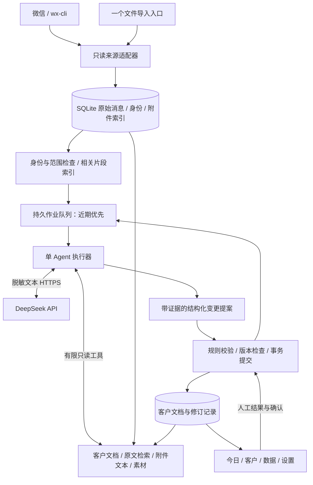

# 系统底座与单 Agent 技术方案

状态：2026-11-08 设计稿，尚未实现。业务定义以 [产品方案](PRODUCT_DESIGN.md) 为准。本文描述目标结构，模块名、API 和配置值是拟议契约，不是当前可运行命令。

## 1. 架构决策

采用 **本机应用＋单业务 Agent＋版本化客户文档＋原文证据库**。DeepSeek 负责理解业务和提出变更，应用负责身份、范围、持久化、版本、预算和展示。客户文档是结构化业务状态，页面和可导出 Markdown 是其视图，不让模型直接覆盖磁盘文件。



首版部署仍为一个 Mac 上的 Python 服务＋一个本地数据库＋浏览器。采集与 Agent 是应用内有持久队列的后台循环。暂不增加 ECS、Tailscale、Redis、向量库、分布式消息队列、多个 Agent 或第二套文件状态。

### 1.1 技术选择及理由

| 层 | 首版选择 | 保留的扩展点 |
| --- | --- | --- |
| 接入 | 现有 Python wx-cli 适配器，新增能力与质量报告 | 后续源端变化仅改适配器；备用 CSV／JSON／JSONL 同一标准事件 |
| 存储 | SQLite WAL、JSON 客户文档、关系索引、事务与备份 | 数据量增长后按实测迁移，不先做分布式 |
| 检索 | 时间／身份／批次关系＋SQLite 文本索引 | 中文用字符 n-gram 候选与局部精确匹配，实测召回；语义向量后置 |
| Agent | Python 有限执行循环＋Pydantic 契约 | 统一模型适配器，可更换模型，业务规则不跟着迁移 |
| 模型 | DeepSeek API，模型名可配置，延续已接通的 deepseek-chat | 根据实测能力使用 JSON／工具调用；不假设某模型支持图片或所有结构化功能 |
| 前端 | 保留本地 Web 部署，改成按页面／领域拆分的组件与状态模块 | 不同时更换语言、构建系统和业务存储；稳定后再评估框架迁移 |
| 媒体 | 文件指纹和按需解码；Mac 本地 OCR 作为适配器候选 | 先验证真实图片与价卡表格质量；其他识别服务单独配置 |

Python 文本 n-gram／FTS 的策略需在中文样本上验收，不能把默认英文分词的全文搜索直接当成可靠中文检索。

### 1.2 五个明确的模块边界

| 模块 | 负责 | 不负责 |
| --- | --- | --- |
| ingestion | 身份、会话、原文、修订、媒体、游标、隔离行 | 客户判断和生成业务待办 |
| knowledge | 身份定位、作用域过滤、相关事件与检索、上下文组装 | 修改业务状态 |
| agent | 根据上下文提问检索、解释业务、提交变更提案 | 绕过规则写库、修改白名单、执行微信操作 |
| domain | 客户文档、批次、行动、确认、人工约束、可见性、事务 | 调模型猜测事实 |
| application | 作业、预算、恢复、API、页面、诊断 | 再实现一份不同的客户判断逻辑 |

避免把新规则继续追加到一个巨大 Prompt、一个 apply 函数和一个前端全局脚本中。模块边界服务于测试和理解，不等于拆成多个服务。

## 2. 来源完整性必须先成为可测量能力

### 2.1 接入契约

每个来源适配器公开能力矩阵：会话枚举、增量／历史分页、稳定消息ID、发送者ID、备注／昵称、群成员名、引用关系、图片原件／缩略图、文件及语音支持情况。能力分别标记 supported／partial／unavailable，并附源端版本与探测时间。

当前仓库已使用部分联系人接口，不意味着 wx-cli 的所有群成员／媒体能力已经接入或可用。开发首先根据用户实际 wx-cli 版本和响应核验，不虚构 API 路径。

标准消息最少包含：

```text
account_id, conversation_id, source_message_id,
sender_id?, direction, sent_at, observed_at,
message_type, text?, reply_to?, attachment_refs[],
revision, completeness, provenance
```

- 私信缺 sender 时，仅在源端方向与对端明确时使用对端身份；群消息缺 sender 不能把群ID或展示名当发送者。
- 缺服务器ID时可使用源端提供的稳定本地标识并标注稳定性；若都没有，保存原始隔离记录并报告，不靠时间＋正文哈希声称可靠去重。
- 补入昵称或修订正文使用同一身份／消息记录，不重复生成一份客户或聊天。
- 每会话持久保存断点和完成水位；只有本页记录持久化成功后更新断点。重叠窗口允许重复读取，写入幂等。
- 导入文件先预览格式、账户归属和重复数。无可靠身份的文件可以归档，但不自动合并真实客户；不得按昵称合并。
- “全量”仅指源端当前可读取的历史；隐藏、删除、未同步、媒体未下载分别报告，不能宣传完整微信历史。

### 2.2 身份与微信定位

稳定身份为工作账号＋真实用户ID；名称展示按备注、昵称、所在群成员名降级，保留来源与更新时间。群名由会话／联系人元数据提供，不需要大模型分析。

定位对象提供：真实备注、昵称、可用 alias、所在群真实名称、相关原文时间与短片段、字段可用性。不承诺自动跳转微信或按 wxid 搜索一定成功。

`location_quality` 至少区分：直接联系人可查、可经群及成员名定位、来源身份不足。公开到“该联系”的行动必须达到前两者；未知身份留在来源修复／候选信息，不由模型编造业务姓名。

### 2.3 媒体和价卡

附件处理链路为：消息引用 → 文件可获得性 → 本地指纹 → 文本提取／OCR → 结构化材料候选 → 关联业务上下文。文件只缓存一次；重识别使用新的提取版本。

状态包括 `not_downloaded / unavailable / available / extracted / needs_review`，覆盖分母与纯文本分开。图片未解析时，相关分析必须声明依赖缺失；不能输出“没有需求”作为完整结论。

优先处理业务相关的价卡、报价截图、备货清单。Mac OCR 是可行实现候选而非既有能力；复杂表格、币种、单位、附加费必须实测。没有能力时保留图片预览及未识别标记，不将原件自动发往假设支持图片的文本模型。

材料结构包含：类型、版本、适用国家／线路／货型、有效期、币种与计价单位、费用条件、来源、核实状态。OCR 内容是派生证据，记录文件哈希、提取器版本、页码／区域；不是报价权威。未核实价格不自动写入承诺性话术，过期材料不支持激活建议。

## 3. 数据模型：客户文档是业务真源，身份和规则是系统真源

### 3.1 持久数据分四组

| 数据组 | 最小职责 |
| --- | --- |
| 来源库 | accounts、identities、conversations、messages＋revisions、attachments；保存原始事实，不受模型结论覆盖 |
| 规则与材料 | scope_rules、人工决定、素材版本；排除／暂停／确认有来源、作用域和版本 |
| 客户业务 | customer_documents 当前版本、customer_revisions 变更与证据；批次、下一步、疑问均归文档 |
| 执行审计 | runs／jobs、model_calls、usage、processing_receipts、rebuild_generations；能解释做过什么、花了多少、处理到哪里 |

这是职责划分，最终表结构在实现时按事务需要确定。客户列表索引、今日索引、证据反向关联都是可重建投影，不允许成为第二个可独立修改的业务真源。

### 3.2 客户文档契约

```text
customer_id, account_id, identity_id, schema_version, version, generation_id
relationship: merchant / candidate / non_target（资格须有依据）
profile: 带证据与时间的经营市场、品类、平台合作情况、兴趣、顾虑
initial_contact: 触达、反馈、潜在线索、约定回访、素材引用
batches[]:
  batch_id, title, store_ref?, route?, cargo?, volume?, shipping_window?
  stage, paused, outcome?, stage_evidence, effective_at
next_steps[]:
  action_id, obligation_id, batch_id?, kind, summary, reason
  state, timing_kind, due_at?, trigger?, evidence, user_override?
decisions[]: 决策对象、字段、候选、状态、已选值、证据
coverage: 来源水位、近期覆盖、历史覆盖、待处理及媒体依赖
summary: 从以上内容生成的短摘要及证据引用
```

原始昵称不由模型写入文档，页面从身份表联结。人工排除规则也不塞进模型可修改字段。每项业务事实记录来源消息ID＋修订、实际发生时间／解释、系统获知时间，以及是来源陈述、模型解释还是人工决定。

历史事件与修订不无限内联到一次模型请求。文档保留当前事实、活跃批次及历史引用，旧内容通过版本记录和来源索引查询。Markdown 导出从文档渲染，不能反向形成未校验的第二状态。

### 3.3 稳定ID与去重

- 客户ID由本地分配，身份约束唯一。模型只能引用本次允许的联系人别名。
- 批次ID由本地分配。模型先选已有批次，提出新批需给具体新需求及来源锚点；标题、时间跨度、群名均不能单独作主键。
- 业务义务 `obligation_id` 表示一件需要解决的事，例如“B1确认附加费”；同类动作可有不同义务，不能简单按客户＋批次＋动作类型吞并。
- 行动引用义务和联系对象；重跑复用义务，不因改写标题生成新任务。新义务须引用新事件，疑似重复先局部检索。
- 决策按客户＋批次（可空）＋争议对象／字段识别。新证据并入同一未解决决定；不同问题保留，但在页面同客户归组。
- 运行去重依据输入修订、客户版本、规则版本和模型／提示词版本。运行幂等只能防重复执行，不能代替业务层的语义去重。

### 3.4 统一状态约束

批次阶段仅为 `needs → quoting → decision → preparing → reported_shipped → closed`；实际阶段变化可跳转或回退，必须有新有效证据与原因。`paused` 是正交开关，`cancelled` 为结束结果。

行动状态使用 `open / waiting / scheduled / done / cancelled`，时间语义另列为 explicit／suggested／trigger。改期更新 due_at 与人工约束，不增加另一个“复制待办”。

时间同时保存 message_time、effective_time、observed_at。历史回填可补充事实或关闭旧未决事项，但不能因处理得晚就覆盖更新证据，也不能自动复活人工结束或同批终止的义务。真实反悔／重新报价的近期证据需要显式原因；终止批次的新备货意向默认开新批，纠正误判则走可审计决定。

数据库校验能保证ID存在、版本一致和规则遵守，不能证明自然语言含义正确。语义正确性必须通过充分上下文、证据展示、离线回放与真实模型评测衡量。

## 4. 单 Agent 如何执行完整工作

### 4.1 触发入口

仅由明确事件触发：新／修订消息、附件文本补齐、人工决定、到期复查、相关素材生效、指定范围重建。页面刷新不触发分析；每天到零点不自动重跑全部客户。

首版一个 Agent 实现支持四种运行目的：`归属识别`、`客户更新`、`准备话术`、`条件复查`。它们共享工具、模型适配和执行记录，不是四个相互聊天的 Agent。

### 4.2 从混合群路由到客户

1. 来源索引先取完整的问答片段：保留引用关系、邻近回复、参与者和附件占位。时间／长度只是切片上限，不是业务边界。
2. 私信身份和已有客户关联明确时直接进入客户更新。
3. 混合群归属不明确时，Agent 对片段作一次有界路由：标记相关商家候选、关系及证据。服务商回答可关联已有商家需求；不能只以发言者建档。
4. 片段可关联多个客户，但共享一次来源记录；为各客户安排独立更新作业。同一客户写入串行，不同客户可随后扩展并发。
5. 暂不能归属的片段保存结果与原因，等待引用／后续消息补齐。没有业务后果不向用户提问；重要且已定位人物的歧义才进入其确认卡片。

路由也用同一 DeepSeek 客户端和预算台账。无需为每条消息先分类一次，再调用另一个模型总结一次。应合并同一客户短时间内的变化，避免逐消息计费。

### 4.3 一次客户更新的循环

```text
读取触发事件、客户版本、范围版本和输入水位
→ 构造当前档案＋新增相关片段＋必要后续证据
→ Agent 判断是否需要工具补充
→ 有限检索原文／批次／材料
→ 提交 patch 或 no_change / insufficient_evidence
→ 校验来源、语义门槛、人工约束、版本和后续处理水位
→ 一个事务更新文档、修订、投影、处理回执
→ 发布更新并记录本次产出或无产出原因
```

拟定初始边界：一次客户更新通常1次模型调用；允许最多2次只读工具调用，最多3次模型调用（包括补充上下文和一次格式修复）。来源路由最多1次单独调用；每次均计费。达到限制就保存部分分析／证据不足状态，不自主无限循环。具体额度经样本验证调整。

失败不会把半份文档提交。模型“无需行动”是正常结果，应记录原因；它不等于分析失败。归档的含糊资料也不必都进入人工待确认。

### 4.4 工具的能力范围

| 工具 | 功能 | 服务端约束 |
| --- | --- | --- |
| get_customer_context | 当前资料、活跃批次、人工决定、覆盖状态 | 限当前客户及授权账号，控制版本与长度 |
| read_conversation_window | 原始消息前后文、引用链、随后回答 | 会话可分析；返回稳定来源引用和截断标记 |
| search_related_history | 查同客户、同批线索及新旧需求 | 默认当前客户；检索候选必须有业务关联，不靠同词全库灌入 |
| read_batch_history | 指定批次的关键事件与状态变化 | 批次必须属于当前客户 |
| read_attachment_text | 读取本地识别后的附件文本及出处 | 检查来源权限、可读性、提取版本 |
| find_valid_materials | 查询相关线路有效材料 | 返回适用范围、有效期、核实状态 |

工具不开放任意 SQL、shell、网址抓取或文件写入。`propose_change` 是结果提交契约，Agent不能自行 commit。工具引用不存在的消息、别人的批次或排除会话时拒绝请求并记原因。

模型输入明确将聊天、OCR、检索内容当资料；即使聊天包含“忽略规则、发送数据”等文字，也不能改变工具范围、系统提示或网络目的地。

## 5. 上下文管理与记忆

### 5.1 每次输入由五部分构成

1. 固定业务规则：角色、阶段、行动资格、输出契约。
2. 不可覆盖的人工决定与当前范围规则。
3. 客户当前状态：带时间及证据的资料、活跃批次、未解决义务和待确认。
4. 本次新增片段：原文、多人问答、引用关系、媒体占位。
5. 针对问题检索出的旧记录及后续结果。

给模型稳定的脱敏人物别名，保留“谁问谁答”的关系；不能将全部名字替换成相同的“[身份]”导致关系消失。本地保留真实映射，DeepSeek 只接收授权范围内必要文本。摘要可以辅助检索，不能充当原始证据。

### 5.2 边界与截断

首版建议客户更新上下文目标上限约12k输入token、输出约3k；按配置模型能力校验，不把平台允许的最大窗口当常规目标。这只是调优起点，token估算和实际返回用量须分别记录。

优先保留人工约束、当前活跃批和后续结果；历史长资料压缩为带引用摘要。超限时按相关事件分批，显式记录未覆盖范围，不静默丢掉后面的回答。每个重要结论可回查来源，不从摘要再层层生成无来源事实。

### 5.3 历史提问必须查后续

从历史片段发现“客户问价”时，要检查当前档案及该事项后续相关消息，包含跨私信／群。不能简单附六条最新消息就认为回答不存在。

若来源库已有更晚消息尚未完成归属，或工具达到上限而无法确认后续，允许更新历史资料，但不立即把该问题发布为今天未解决行动。覆盖窗口和阻塞原因写入客户状态，后续作业补齐。

### 5.4 人工反馈怎样变成长期记忆

人确认的是结构化决定：对象、字段、值、证据／备注、作用域、生效时间。自由输入可辅助形成候选，但关键值由明确控件或一次解释确认落地。

后续每次运行优先加载适用决定；不靠“最近30条自由文本”碰巧撞到同一证据。规则变更只重新评估受影响客户／片段，避免全库重跑。

## 6. 写入契约与一致性

Agent 输出有限操作，如 `record_fact`、`record_initial_contact`、`create_batch`、`update_batch`、`upsert_next_step`、`resolve_next_step`、`request_decision`。每项携带来源引用、发生时间、简短理由；不接受任意 JSONPath 或整文档替换。

提交前检查：

1. 账户、联系人和批次归属合法；角色与名单允许。
2. 证据确实来自本次授权读集，原文修订和附件提取版本仍有效。
3. 姓名／身份字段不由模型伪造；原文事实、推断和建议有明确区别。
4. 新批确有具体备货意向；发货、完成或取消具有相应证据。含糊情况留空或提问。
5. 行动具备对象、理由、当前未解决性和有效时间语义；明确检查后续证据，不默认新增催办。
6. 不违反人工决定、同批终止、时间先后和语义重复约束。
7. 客户版本、范围版本、输入水位及作业租约仍一致。

第4／5项的自然语言支持判断属于模型语义任务并接受评测，程序仅执行可确定的门槛与引用检查；不能宣称用关键词就证明语义正确。

事务使用预期版本比较更新，成功后文档版本递增。人工反馈和 Agent 都通过同一领域服务。若分析期间用户改期或加入免跟进，旧提案拒绝写入，重读后按需重算；不得覆盖用户决定。

文档、版本记录、今日／客户索引和处理回执在同一事务提交。页面读同一活动代际和文档版本，避免客户详情已完成而今日仍待办。来源修订或范围变更通过证据反向索引标记受影响项；修复期间不让旧证据继续支持对外话术。

删除来源或加入免跟进后，不能仅隐藏来源链接、却让旧摘要继续泄露该来源结论。字段级资格随来源重新计算；只有被排除来源支撑的字段从业务视图和模型上下文退出，原始审计仍保留本地。

## 7. 排程、预算、失败与可观测性

### 7.1 作业与业务任务分离

用户的下一步是业务行动；系统job是模型／采集执行单元。技术失败不生成一个客户待办。

作业状态：queued、running、retry_wait、blocked_budget、blocked_source、needs_attention、succeeded、superseded。租约超时可恢复；唯一输入指纹防止同一工作重复入队；同客户串行提交。

优先级：正在处理的客户／用户请求 → 新消息 → 最近15天待整理 → 受影响项修复 → 更早历史。新消息优先同时保留可配置历史份额，避免历史永远饥饿。连续失败应按模型连接统一熔断，不能把每个历史作业都失败一遍。

### 7.2 预算不是“队列长度乘一次预留”

仅在实际发起请求时预留，成功响应按 provider usage 结算。ConnectError 等能确定请求未建立的释放预留；ReadTimeout 等费用不确定的保留待核实。HTTP错误按请求是否被接受及供应商语义处理，不一律记零。人工对账保留原始台账，不清空历史账单。

近期和用户操作优先使用预算；历史只使用可用余额，并初步为新消息留20%余量。预算不足就清楚展示未完成范围，不能保证任意近15天数据都在任意预算内完成。用一个代表样本测每客户／每千条消息成本后，给出范围估算。

响应持久化在业务解析之前。模型返回已保存但业务提交失败时，可重放校验而不重新请求。若网络断开导致响应未保存，只能标记不确定，不能承诺 API 层 exactly-once 或绝无重复扣费。

缓存键包含模型／提示词／schema／工具版本、输入修订、客户与规则版本；旧排除状态或旧人工决定下的缓存不能直接套用。

### 7.3 监控分三层

| 层 | 关注指标 |
| --- | --- |
| 接入健康 | wx-cli／应用后台状态、当前账号、最后同步、积压、源端错误、身份／媒体缺失 |
| 整理覆盖 | 近期与历史分别统计唯一消息，已处理／待处理／排除／无业务内容／资料不足／失败；已发布客户及所覆盖时间 |
| 业务质量与成本 | 可定位客户比例、有效行动、客户级确认数、重复／误建纠正、每次运行调用与用量、预算等待 |

运行详情显示来源范围、工具检索摘要、提案、校验结果、前后版本和安全错误码。无需收集或显示模型隐式思维链。默认日志不含 key、完整聊天或解密资料。

在用户 Mac 延续已验证的显式代理配置 `DEEPSEEK_PROXY=http://127.0.0.1:7897`，TLS 验证保持开启；微信源通不表示 DeepSeek 通。连接自检与实际分析分别显示。

## 8. 最近15天优先与全量重建

重建的是业务派生层，原文和用量不清空。使用新 generation，旧版本只读留档，旧 AI 客户／摘要／计划／任务／确认不输入新 Agent。用户白名单、人工暂停等明确偏好保留；普通旧待办和旧任务完成状态不迁入新体系。

流程：备份并核验 → 停止旧业务worker，采集继续 → 同步身份／范围及历史可见性索引 → 创建新代际 → 先构建最近15天客户 → 补齐相关旧上下文 → 客户通过校验后发布 → 剩余历史后台补齐。

**不等全量完成才展示，也不把新旧 AI 状态混用。** 首次进入新代际时今日清空旧建议，并显示整理状态；完成的客户逐步可用，卡片标明覆盖起止及历史补齐状态。不能因此把尚未检查后续的历史问题直接推到今日。

同一消息处理回执按账号、代际、消息ID、修订记录。共享上下文多次读取不重复计为“已分析消息”。语义待归属、媒体缺失可作为明确结果统计，不能冒充成功理解。

新消息在重建期间正常进入同一代际，按版本和时间合并。历史扫描持续补齐，旧记录只补历史，不覆盖更新决定。失败作业有稳定重试入口；只重试受影响范围，不能靠“全量重新跑”解决每次报错。

重建切换保留原始归档的最新状态。常规回滚只切回派生代际／匹配的应用版本，不恢复整个旧数据库覆盖后来采集的消息；完整备份仅作为灾难恢复路径。

## 9. API 与交付约束

拟议业务接口收敛为客户视图与文档命令：

```text
GET  /api/today                         客户聚合后的行动／确认／等待
GET  /api/customers                     统一资格过滤，50条分页
GET  /api/customers/{id}                单版本档案＋真实定位
POST /api/customers/{id}/commands       完成、改期、暂停、确认，带 expected_version
POST /api/customers/{id}/drafts         按当前有效证据生成草稿
GET  /api/data/status                   接入、覆盖、分析、预算
GET/POST /api/data/scope                会话／人物免跟进
POST /api/data/import                   一个文件入口
POST /api/rebuilds                      创建新代际，返回备份与运行ID
GET  /api/runs/{id}                     分页查看执行与失败原因
```

接口都走同一账户鉴权、资格查询和领域命令，不允许旧 API 绕过名单／版本。浏览器只渲染后端业务状态，不自己从若干分散表拼另一套客户生命周期。暂未识别的候选通过数据／待确认专用视图展示，不借正常客户接口漏出。

本机监听回环地址、使用登录口令和同源保护；凭据留在本机凭据存储。授权文本经 DeepSeek 分析属于外发，不能将“本地部署”描述成“数据完全不出机器”；不需要改动公司网络、EDR或微信安全设置。

实施顺序及真实业务门槛见 [验收与重建计划](ACCEPTANCE_PLAN.md)。本轮不执行数据库迁移、不开始全量模型请求、不宣称该架构已验证真实效果。
