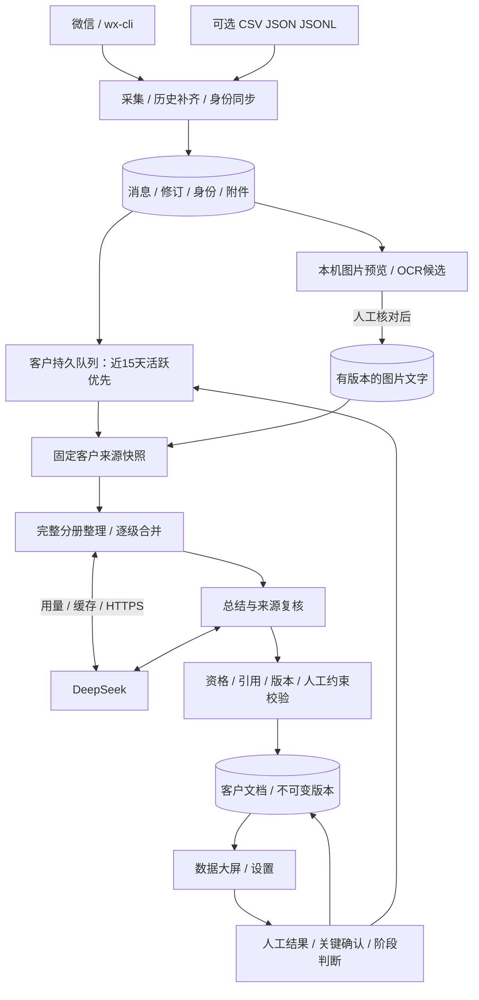

# 系统与单 Agent 架构

更新：2026-11-10，v0.13.0 / schema v15。本文描述当前代码，后续扩展单列。业务规则见[产品方案](PRODUCT_DESIGN.md)。

## 运行结构

一个Mac上的Python服务、SQLite WAL数据库和浏览器。wx-cli提供本机只读微信来源，DeepSeek通过HTTPS分析授权后的脱敏文本；发送微信仍由用户操作。无需ECS、Redis、向量库或多Agent框架。

## 模块边界

| 模块 | 职责 |
| --- | --- |
| collector、archive、ingestion、identity、media | 本机来源、分页游标、稳定ID、修订、隔离行、名称及图片缓存；不判断商家需求 |
| workspace/context、order_links | 共用资格范围、客户相关完整会话、脱敏、精确订单关联、快照与人工上下文 |
| workspace/packets、transport | 分册抽取和合并、模型调用、缓存、用量、错误和续跑 |
| workspace/agent、quality | 总结／复核、结构化契约、引用校验、疑点保留；不直接任意修改数据库 |
| workspace/clues | 保留推断的人工核实／不采纳／撤销，来源修订约束和处理记录，不从被隔离的模型行动直接创建待办 |
| workspace/store、schema | 唯一客户业务写入口、稳定ID、阶段、行动、确认、人工锁和版本提交 |
| workspace/queue | 按账号开关、按客户任务、优先级、退避、全局及单客户文件锁 |
| workspace/drafts | 基于当前可处理行动及其来源生成短草稿；复用模型台账，独立审计，不记已发送 |
| workspace/ocr、vision.swift | 本地候选识别、人工核对版本，候选与模型输入分开 |
| workspace/views、presentation、web | 展示、原文／分册分页、设置与监控、鉴权API |
| workspace/dashboard | 只读聚合来源联系人、有效文档、跟进资格与任务投影；先按联系人归一，再分上下两组，不创建第二套业务状态 |
| workspace/whitelist | 人物／会话搜索与添加／恢复；共用actor_exclusions与source_scope，不依赖旧CRM人物索引 |
| static/workspace/*.js | dashboard负责同列分组、搜索、轮询和统一任务命令；settings内嵌whitelist，主脚本只负责双入口导航和客户详情 |

保留旧模块作为采集与兼容依赖，原界面仅显式 `/legacy` 访问。默认首页为数据大屏，导航只有大屏与设置。旧客户／今日／进度链接映射到大屏，旧scope／whitelist链接映射到设置内白名单。

## 客户上下文与模型流程

1. 以工作账号＋真实联系人ID确定客户来源。读取已授权私信及出现过此联系人的群聊全部已归档消息，包括他人回复、媒体占位和早期沟通；不做价值预过滤。
2. 在短事务中固定来源、授权、人工版本。名称只用于本地定位，外发使用CUSTOMER／SELF／其他参与人别名；订单等业务信息保留。
3. 每册通常最多32条或约10000 JSON字符，提取有引用的身份、需求、报价、发货、承诺、回复、背景和不确定性；保留其他参与人归属。每册最多80项，原文不被摘要替换。
4. 合并每组最多16项或约6000 JSON字符；输出截断立即二分重试，契约失败最多修复3次并仅回传安全字段路径及类型，仍失败才二分。单项不能再拆时保留错误码。子分册持久缓存，已完成原始分册不因升级或重试重新抽取。资料过长逐级合并，原始分册仍持久保留；上限8层，不收敛时明确暂停／失败，不假称完成。最终请求不超过90000 JSON字符。
5. 资料完成后提出客户、批次、行动和确认，再独立复核；总结阶段最多3轮。有来源的数字差异标为待核对，不抹掉独立成立的发货事实；归属或运输术语问题按项隔离保留。
6. 应用检查资格、引用、修订、人工约束、稳定对象ID和状态再事务发布。同一义务不因换文字重建；确认按客户／批次／类型归并。语义去重仍需真实样本校准。

客户整理不设置固定请求次数上限，持续执行同一来源快照直到完成、人工暂停或实际错误；缓存不产生新增模型调用。新版不设每日Token限额。最终档案只在分册和复核完成后发布，不把半份结果当完整客户资料。

## 一致性与人工反馈

- `workspace_documents` 是当前业务文档，`workspace_versions` 保存每次完整版本；页面是视图，不另建可独立编辑的第二套客户真源。
- 批次／行动依据稳定来源及既有ref定位。已走货旧批关闭失效备货任务，独立新批继续有效。完成／取消状态、暂停、角色与文本纠正受人工锁保护。
- 人工跟进以事件完整保存，最近50次客户操作也进入上下文；全部版本和人工跟进历史留在本地。新增反馈使文档重新排队，不要求聊天先变化。
- 批次阶段人工约束单独保存，即使来源修订导致旧模型证据过期，也保留人工判断作为约束；不会把过期模型事实继续用作证据。
- 分析期间只追加消息允许当前快照发布，文档标记新进展待整理，追加记录下一轮处理。来源修订、授权／名单、图片核对版本或人工决定变化阻断旧结果提交。
- 待核实线索按原内容、类别、来源修订生成稳定标识；人工核实生成带来源且锁定的资料，不采纳保留处理记录，同一线索不再重复出现。撤销恢复原推断并撤回相应核实资料；原文改变后按新修订重新核对。模型上下文只接收当前有效的精简人工判断，不使用失效引用。
- 名单与资格共用查询规则。原文／分册、大屏与详情均按当前账号和资格读取；名单不是模型可写字段。

## 调度、用量与错误

`workspace_automation` 保存账号开关；`workspace_queue` 保存每人状态、来源摘要、`user_paused`与`control_version`。每分钟核对来源，优先近15天活跃客户，已开始的长历史优先续完。无变化且已完成不重复请求；人工反馈变化也重新入队。

全局和单客户文件锁避免跨进程重复执行。进程退出的未完成任务可恢复。客户整理不按固定请求次数或每日Token限制中断。网络／限流5、10、15分钟退避，连续三次后需处理；认证／余额等问题暂停账号调用，人工修复后恢复。显式重试更新失败响应缓存标识，已验证分册继续复用。

模型仅记录预估用量，成功以usage结算；每日门槛只保留旧引擎兼容，不用于新版整理或草稿。明确未建立连接或拒绝的请求释放预留，不确定是否计费的保留。草稿共用台账，每次最多2轮；同客户版本、行动、当日草稿可缓存，生成不改变待办。数字和运输表述仍按来源检查；不保证模型语义绝对准确。

## 图片文字与schema v15

`message_extractions` 记录消息ID、原修订、图片SHA256、版本、OCR候选、人工确认文本、引擎和时间。原始消息／图片不改写。Mac通过本地Apple Vision脚本，其他支持环境可用Tesseract；没有工具可手动核对文字。

候选不会进入模型；确认后才按当前消息修订和图片哈希加入上下文。读集引用包含 extraction_version，重新核对会使旧派生证据过期，并触发相关客户更新。媒体仍保留覆盖不足状态，不能声称完整理解表格和价格条件。原图不发给DeepSeek。

升级到schema v15先创建 `pre-v15-*.sqlite3`，新增当前阶段完成数、总数与合并轮数，已有图片文字、单客户暂停标记和控制版本保留；保留聊天、分册、名单、客户文档、版本、队列和用量。第三方依赖锁不随项目版本改写；发布需干净安装并检查wheel包含新JS模块及Swift脚本。

## 验证与后续

自动测试和浏览器只用合成消息、模拟模型。它们验证流程和不变条件，不证明真实DeepSeek的业务准确率。Linux验证本地识别可用路径；macOS Vision及用户实际价卡需在Mac验收。

后续重点是真实客户金标准回放、批次归属和发货／新需求识别、图片表格质量，再考虑素材驱动历史激活。长期经验学习、自动记忆总结和复杂Harness扩展暂不加入。

## 统一任务命令与状态

`queue.command`是开始、暂停、继续、重试的唯一用户操作服务；自动后台与手动请求共用`_perform`执行和结算。`POST /api/workspace/jobs/command`接受source_id和start／pause／resume／retry。原analyze、progress/control和queue/retry仅作薄兼容转发，CLI也调用同一服务。前端每次操作只发一次jobs/command请求，服务端决定排队或仅执行该客户，不再由浏览器先改状态再补发分析请求。

`GET /api/workspace/progress?page=1`一次返回计数、分页卡片及primary_action，每页20位，隐藏已完成／已排除；原队列查询也共用此投影。未开始／排队不能当作正在运行。活动客户锁证明实际执行；短暂的“已领取、尚未加锁”显示正在启动，最长15秒，超时按中断处理。手动任务也持有同一运行锁，后台恢复时不能抢占。单客户命令仅在短事务阶段持有独立命令锁，模型调用期间释放，保证暂停不被长请求阻塞，重复开始不重复调用模型。

暂停在每次模型调用及事务发布前检查，控制版本阻断旧轮次。当前请求结束前显示正在暂停，继续操作暂不可用；停止后保留进度并提供继续。已完成资料缓存复用；只在失败重试时刷新失败响应缓存标识。队列回写按来源及控制版本比较更新，不能覆盖新操作；命令返回也基于落地后的实际状态。鉴权、CSRF和来源授权统一保留；只读进度不调用模型。

`workspace_scans`的total_pages／completed_pages与source_messages／processed_messages只表示原始分册覆盖，不代表任务完成。stage_completed／stage_total表示当前阶段进度，merge_level表示当前合并轮数。流程依次为collect、merge、summarize、review、publish、done，仅文档事务提交后才标done并退出进度列表。合并每完成一组更新检查点；旧call_limit检查点在schema v15升级后恢复为可继续状态，人工暂停仍保留。

大屏每5秒读取一次聚合快照，保持按钮焦点时也继续刷新并在渲染后恢复焦点；状态、阶段与操作仍由同一个后端投影提供。手动分析请求尚未返回时，进度卡片仍会显示实际阶段并允许暂停。

## 大屏聚合与设置白名单

`GET /api/workspace/dashboard`一次返回上下分组、共享计数与自动整理状态。来源联系人来自`source_people`，未运行模型也可见；授权／缺少文本时按钮禁用。任务状态仍来自`queue._jobs`，详情与跟进资格仍来自`views`，不复制状态机。

上方按有效行动归组，下方仅保留无有效行动者；两组返回同一行结构、独立每页20位。搜索与联系人状态筛选同时作用于两组；跟进日期筛选只作用于上方。完成整理的联系人保留，任务控制按钮消失；人工完成／取消行动后，下次快照归入适当组。失效证据不能泄漏旧摘要或行动。

`GET/POST /api/workspace/whitelist`统一管理来源人物和会话。大屏菜单、客户详情与设置共用这一入口，人物按账号＋source_id操作，避免旧CRM索引缺失而无法排除。人物排除与来源资格规则共同决定大屏分组、搜索和统计；会话通过现有`set_sources`变更范围。变更后重新核对队列，运行中的旧结果仍受来源资格校验约束。原始消息、用量和历史版本不删除。鉴权、CSRF与输入校验沿用现有中间件。

前端上下两组共用contactRow与同一CSS网格；搜索控件不随轮询重建，进度展开状态及按钮焦点保留。返回设置旧链接只改变导航，不开启自动模型调用。删除旧独立scope模块，保留旧API作兼容读取，避免多套页面重复维护。
