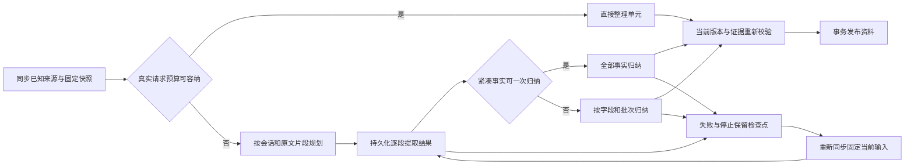

# M3 文本长历史与恢复验收

2026-11-16（北京时间）。本轮只交付已确认商家的文本长历史、容量核算与有效检查点恢复。M3附件获取／解析、业务意图发现的长历史、M4调度和真实业务语义验收仍未完成。

## 已交付链路

`RuntimeSession`正式启用WorkflowV2，旧WorkflowV1保留兼容测试。策略升级会使旧v1资料第一次重新计算；之后完全相同的有效输入仍跳过模型。同步来源准入、业务范围、人工优先和角色确认不放宽，不能因已分段而跳过已知来源缺口。

## 模块与容量

- `context/tokens.py`统一真实HTTP请求形状：模板、人工约束、元信息、原文、Schema注入及响应格式都计入；输出按单次请求（档案上限8192），加10%窗口余量和256修复空间。规划与网关共用函数。
- 目前生产采用`utf8-upper-bound-v1`，不是DeepSeek实际tokenizer。支持程序注入计数器，但没有暗中套用其他型号或假设字符比例。保守估算可能多拆段，不能把填入1M理解为实际容量已经压测。
- `context/chunks.py`是纯函数，在工作线程规划，避免在async worker内做整套规划CPU工作。按冻结后的会话与时间顺序分段；超长单条以Unicode字符区间拆分，仍引用原message_id/revision。相邻两条语境在预算内尽可能保留，明确reply_to的必要引用必须容纳，不能静默丢弃。
- 固定规则、单条必要元信息、必要引用本身仍无法容纳时明确失败。没有自动截断、Top-K替换首次全量扫描或递归摘要丢事实。

## 检查点与恢复

schema16新增`history_runs`、`history_run_units`、`history_checkpoints`，保留原有表与数据。

每个run绑定当前账号、客户、操作和快照；原始修订及完整字符长度固定为独立处理清单。unit记录阶段、主处理范围、请求预算和状态；checkpoint记录同一有效输入的校验结果、失败原因及累计网络请求次数。

缓存键包含账号／客户、参与人语境、材料及修订／片段、人工／角色／范围／资料版本、模型配置、提示词、输出结构及策略。操作ID、快照ID和无关运行时间不影响内容复用；当前执行unit仍严格绑定操作／快照授权。改动材料会使依赖它的主段或引用／相邻段失效；分段边界因此变化时可能多重做相邻单元，不承诺只重算恰好一个段。人工、角色或配置变化按语义版本失效。

同一逻辑单元累计最多6次真实网络请求，跨新操作仍累计；单次网关最多3次，不能换call_id重置预算。达到累计上限后再次同步不会无限追加费用，手动重置预算／完整任务继续控制留M4。成功单元不重复请求；合法空提取表示看过无关，保留检查点。含有效候选的空归纳或丢失有效字段会失败，不能缓存成成功。

当前“恢复”入口就是重新同步：重新检查来源、固定当前输入，然后复用仍有效检查点，并非跳过来源刷新继续旧快照。旧档案保留，全部必需文本提取与归纳单元成功后才发布新档案。

## 事实、覆盖与性能保护

提取结果受AnalysisResult结构、当前段可见来源和现有证据规则约束。语义相同的字段值可合并，保留全部引用；不同事实不靠重复压缩摘要丢弃。全部紧凑事实仍超窗时按货品／物流字段、沟通、备货批次拆归纳单元。单个字段或批次仍超窗时返回`history_merge_unit_too_large`，保留提取结果；没有假称无限处理能力。

程序核对每条原文修订的所有主处理字符区间，必须连续完整、无重复、无未知引用，且所有必需归纳成功。模型无权声明覆盖率。覆盖说明执行范围，不说明模型理解正确率。

每个工作流只创建一次已授权冻结ContextReader供各单元复用；复用阅读器必须匹配同一快照。进度使用每次unit变化的增量计数，提取初始化、归纳注册及最终覆盖核验才读取单元清单，避免每段重读整份历史。最终发布仍新建阅读器并重新检查原文修订、角色、人工、范围、资料版本和停止状态，不能用运行内缓存绕过发布保护。

首次固定客户相关全量归档仍有O(N)读取和内存成本；本轮不是源端增量订阅，也没有声称任意规模端到端P95或无人值守已达标。

## 页面与诊断

客户同步状态和记录展开卡片共享HistoryProgress，显示分段提取、复用段数、事实归纳和已处理原文数。中断或失败明确成功分段保留；同步会话数量不当作模型处理数量。最终任务写入合并持久进度，不用旧counts覆盖正在更新的计数。小历史保持原来紧凑界面。

卡片结果颜色沿用成功绿、失败红、部分字段待核对橙；诊断折叠处记录容量、最大单元输入估算、输出预留及保守估算方式。

## 一次整体CR与修复

独立只读CR审查`4f34ba4..ef267f2`，提出3项P2，已在一次修复回合完成：

1. 空归纳被缓存成功，使后续零请求重复失败；增加空／漏字段失败回归，归纳失败不再毒化成功缓存，重试只做归纳。
2. 分批归纳合法匹配旧shipment_id时误判越界；分开校验候选成员与旧编号授权。旧编号仍由同账号同客户证据／发布器校验。
3. 每单元重建全历史阅读器和进度扫描导致缓存复用二次方成本；共用已授权阅读器并改为增量进度。结构测试断言整个run只构建一次阅读器、至多3次全单元清单读取，不用脆弱时间阈值代替验证。

自查另加覆盖清单的短截范围／未知来源反例；独立于unit声明的冻结长度防止错误完整标记。错配阅读器不能授权其他快照。无第二轮派审查，修复后完整回归。

审查未评价真实供应商分词／语义和Mac接入；本轮保持显式待测。未延期其他Minor。

## 验证证据

- 最终Python：**623 passed**（`/tmp/m3-backend-final.log`），包含真实网关小24k窗口的大历史、source→worker→快照→分段／归纳→发布、错误恢复与零新增首次处理。
- 前端单元：**45 passed**；Node24.14.1生产构建成功。
- 浏览器：最终CR修复后完整 **74 passed**（`/tmp/m3-browser-final.log`）；首轮亦为74通过，修复后执行的是最终代码的新一轮完整回归。
- wheel：105个Python／SQL／提示词资源逐字节对应当前源码；独立从wheel加载应用，schema16及生产HTML／JS／CSS服务通过。前端dist仍独立构建，不虚称已打进Python wheel。
- schema15→16在带原文／资料／操作／快照的数据库上升级两次，原数据逐行保持、检查点表初始空。
- 纯规划合成测量：10,000条正文共10,000,000 UTF8字节、1,000,000窗口，14段全部预算可容纳、10,000条主范围完整，约2.337秒。不是模型速度、语义质量或端到端P95。

合成回归还覆盖：中段与归纳失败、停止后无继续请求、重启新连接复用、引用越界、空提取／空归纳区分、角色／人工／配置／修订失效、累计6次上限、字段分组、单字段超窗明确失败、在途进度与最终计数一致。未连接真实微信或DeepSeek执行客户整理。

## 更新与下一步

按[Mac指南](../MAC_SETUP.md#m3文本长历史更新与验收)pull main、构建前端并重启8766，健康接口应为schema16。保持`.2`来源与归档，不需重装Rust或清库。

先复验此前超窗失败的一位已确认商家，观察提取／归纳／复用，再逐条核对档案、主体、单位、旧新备货批次及引用。使用真实供应商容量，输出无需盲目调到官方最大。下一步为M3附件获取与解析；实际分词器、极端单字段事件结构、动态缩段与补读、业务意图发现分段及M4完整控制另列后续。
